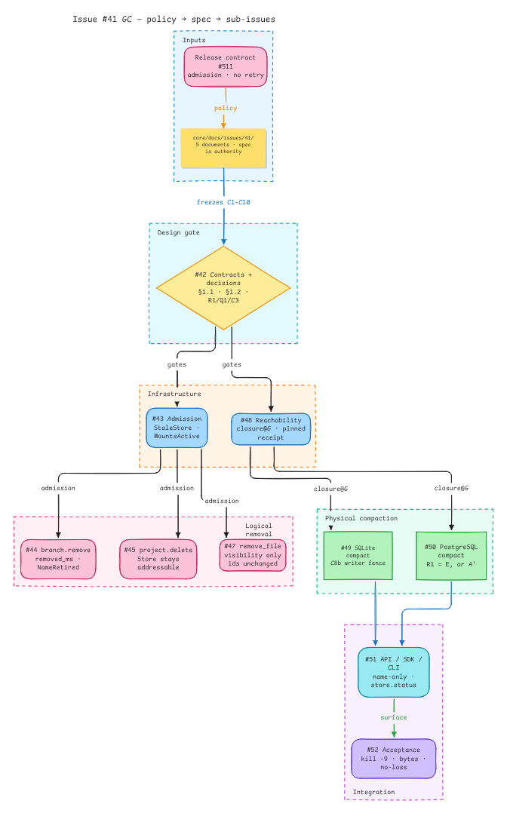
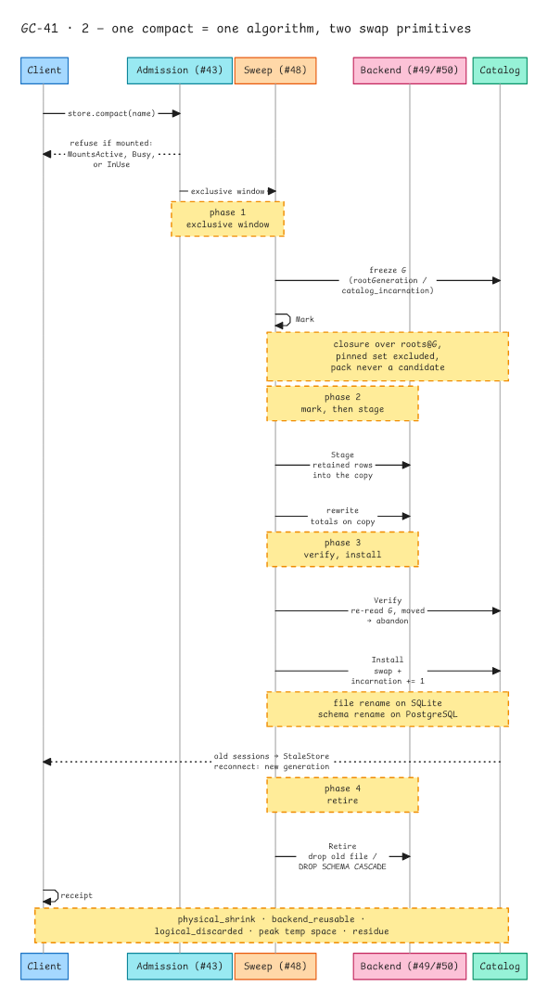
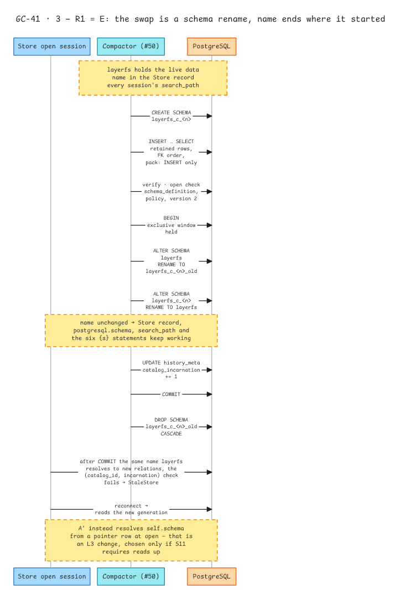
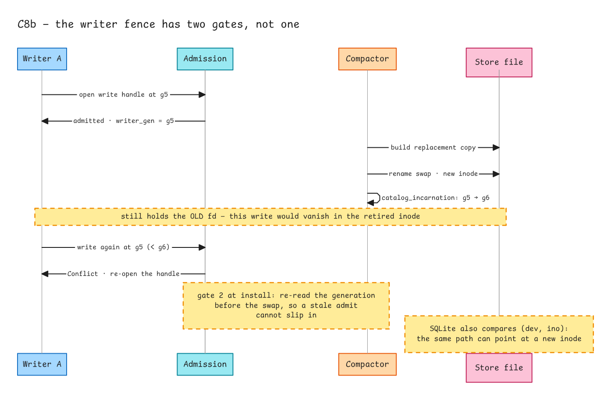
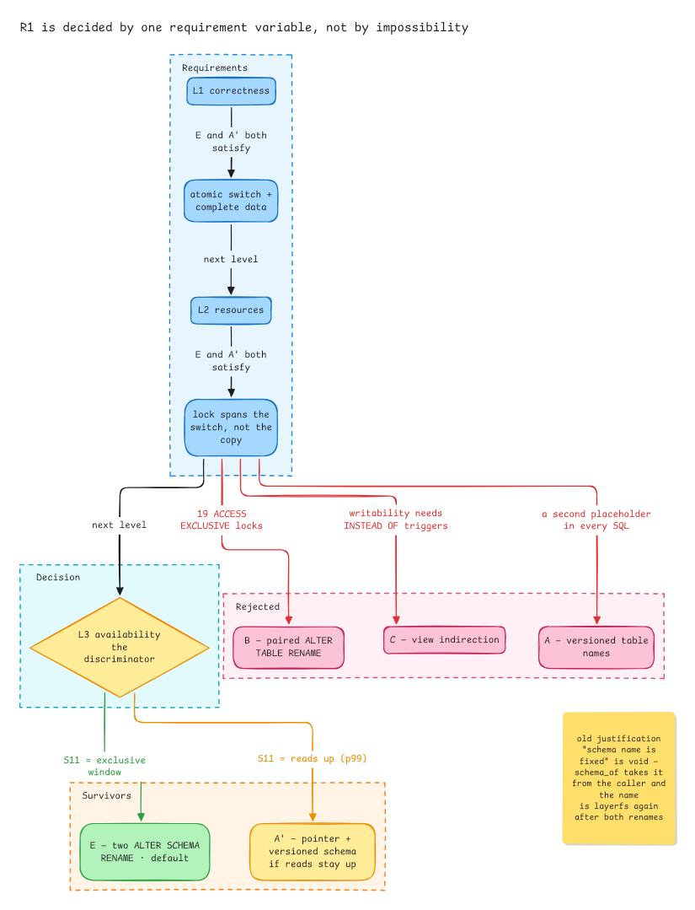
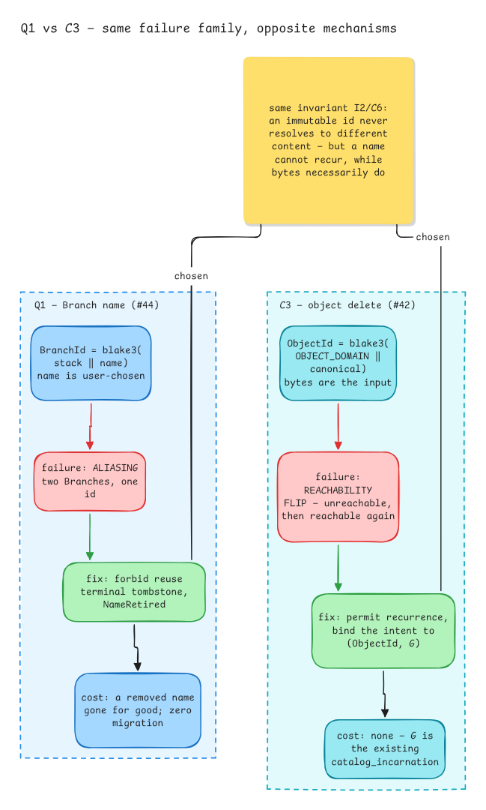

# Issue #41: LayerFS Garbage Collection - Soft Removal & Store Compaction

**Status**: Design phase, implementation pending  
**Release Target**: LayerFS 2.0.0  
**Release Contract**: Ephemeral-AI-Lab/layerfs#511  
**Project Tracking**: Ephemeral-AI-Lab/layerfs-project#41

## Overview

Deliver explicit LayerFS garbage collection for SQLite and PostgreSQL through soft removal and explicit compaction:

- **`branch.remove(name)`** - Soft-remove a Branch
- **`project.delete(name)`** - Soft-delete a project  
- **`project.remove_file(...)`** - Logically remove a file/folder across history
- **`store.compact(name)`** - Physically reclaim discarded storage

## Key Constraints

The constraints are defined once, as contracts **C1–C10** in
`LayerFS-GC-spec.md` §5. This README does not restate them.

**Correction:** an earlier version of this README carried a table that gave C1,
C2 and C3 different meanings from the specification (it labelled C1
"Reachability = Store", C2 "Pinned object protection", C3 "Historical mount
inclusion"). In `LayerFS-GC-spec.md` **C1 is the root set and generation, C2 is
the collectability decision, and C3 binds a per-object delete to
`(ObjectId, G)`** — the meaning the #42 sign-off request uses. The stale table is
removed; cite §5 rather than any local summary.

## Files in This Directory

- **README.md** - This file
- **LayerFS-GC-spec.md** - The authoritative single-file specification (§1-§12):
  decisions, contracts C1-C10, Mark, Sweep, operations, acceptance. Every other
  document in this directory derives from it and cites its section numbers.
- **02-operation-contracts.md** - Operation specifications
- **03-decision-record.md** - R1 / Q1 / C3: scenarios, alternatives, decision basis;
  §5 lists the open items the decisions exposed (PostgreSQL rebuild-and-swap vs
  in-place row deletion, and C3's scope; §5.3 records that the C3 sign-off already
  constrains the answer to a confirm-or-reopen), including §5.1a: the restored argument
  for why in-place deletion was ruled out in the first place
- **C8b-N3-C9-Resolution-Plan.md** - Deep dive on three critical issues
- **IMPLEMENTATION-CHECKLIST.md** - Per-issue acceptance criteria, dependencies and
  the critical path (task detail lives in each issue's body)
- **diagrams/*** - Six rendered architecture and sequence diagrams, embedded below

## Implementation Phases

### Phase 1: Design Finalization (#42)
- Confirm the settled conclusions (`LayerFS-GC-spec.md` §1.1, S1-S11)
- Answer the open questions (`LayerFS-GC-spec.md` §1.2, Q1-Q6)
- Sign off R1 / Q1 / C3 (see *Sign-off requests* above)

### Phase 2: Infrastructure (#43, #48)
- Admission enforcement
- Shared data reachability

### Phase 3: Soft Removal (#44, #45, #47)
- Branch removal
- Project deletion  
- File removal

### Phase 4: Physical Compaction (#49, #50)
- SQLite compaction
- PostgreSQL compaction

### Phase 5: Integration (#51, #52)
- API/SDK/CLI exposure
- Comprehensive testing

## Admission & Mount Policy

Which mounts each operation excludes is the admission matrix, **C10** in
`LayerFS-GC-spec.md` §5 — see it there; this README does not restate it.

## Diagrams

Rendered from the design set. Each caption names the issue the diagram belongs to;
the images are stored in `diagrams/` beside this file.

**1 · Documents → design gate → sub-issues** (#42)
The five documents and the gate they feed: `#42` freezes C1-C10, then admission
and reachability run in parallel.

**2 · One compact = one algorithm, two swap primitives** (#48)
Mark, verify, install, retire over a single exclusive window; the fences sit on
the timeline, not beside it.

**3 · R1 = E: the swap is a schema rename** (#50)
Build the replacement schema, copy retained rows, verify with the readers' own
open check, rename both schemas in one transaction, bump the generation, drop the
old schema. The name ends where it started, so nothing that remembered it changes.

**4 · C8b: the writer fence has two gates, not one** (#49)
A writer holding the old fd would write into the retired inode; the admission
check and the install re-read are both required.

**5 · R1 is decided by one requirement variable** (#50)
L1 and L2 do not discriminate; L3 does, and L3 is governed by S11 alone.

**6 · Q1 and C3: same failure family, opposite mechanisms** (#44, cross-linked to #42)
A name cannot recur, bytes necessarily do — which is why one decision forbids
reuse and the other binds the intent to a generation.

## Decision ownership

Where each decision or reconciliation entry is realised. The specification
sections are §-numbered as in the GC spec; `R`/`N`/`Q` ids are that spec's
reconciliation and net-new tables.

| Item | What it decides | Contract / record | Implemented in | Verified in |
|---|---|---|---|---|
| **R1** | PostgreSQL Store replacement: E (two `ALTER SCHEMA RENAME`) by default, A' (pointer + versioned schema) if S11 requires reads up | #42 (§1.3 R1, §7.3, S11), 03-decision-record §1 | **#50** | #52 |
| **R2** (= C8, replaces the `compact_intent` row) | Reader fence: `catalog_incarnation += 1` at install; every session/transaction entry checks `(catalog_id, incarnation)` → `StaleStore`; SQLite also `(dev, ino)`; `lfq1` across a generation → `StaleStore` | #42 (C8, generation arithmetic; no second generation field) | **#43** (the session-entry half; shared by both backends), `(dev, ino)` in #49 | #52 |
| **Q1** (= C6) | Branch name reuse: none; terminal tombstone, `NameRetired` | #42 (Q1, C6), 03-decision-record §2 | **#44** | #52 |
| **C3** | Per-object delete binds `(ObjectId, G)` | #42 (C3), 03-decision-record §3 | **#49**, **#50** (consumers of the signature) | #52 |
| **N3** | Soft delete visibility: `removed_ms` / `deleted_ms`, partial unique indexes | #42 (schema change) | **#44** (`removed_ms`), **#45** (`deleted_ms`, migration) | #52 |
| **C8b** | SQLite writer fence: incarnation check at admission plus install re-read | #42 (C8b) | **#49** | #52 |
| **C9** | HistoryCatalog stays extensible: GC methods behind a default `Unsupported`, no new `HistoryError` variants | #42 (C9) | **#51** (trait), #49/#50 (overrides) | #52 |
| **C10** | Admission matrix: which mounts each operation excludes | #42 (C10) | **#43** | #52 |
| **Q3** | Rewrite step: transfer phases with one inserted `rewrite` | #42 (§7.1) | **#49** | #52 |
| **Q5** | PostgreSQL reader behaviour | Superseded by C8/R2 — no separate decision | **#43** | #52 |
| **D3** | PostgreSQL fence mechanism (advisory lock / `FOR UPDATE` / schema lock) | Pending sign-off — see #50 | **#50** | #52 |

### Sign-off requests

**The full product-decision inventory — all twelve items, with the issue that owns
each — is the single entry point on
[#42](https://github.com/Ephemeral-AI-Lab/layerfs-project/issues/42#issuecomment-6819532224).**
Start there; the three reconciliation decisions below are asked for approval in
the issue that realises each one, with a short reasoning summary and a checkbox
block:

| Decision | Recommended default | Asked in | Comment |
|---|---|---|
| R1 | **E** (exclusive window) | #50 (PostgreSQL GC) | <https://github.com/Ephemeral-AI-Lab/layerfs-project/issues/50#issuecomment-6818137198> |
| Q1 | **A** (no reuse) | #44 (Branch removal) | <https://github.com/Ephemeral-AI-Lab/layerfs-project/issues/44#issuecomment-6818137920> |
| C3 | **`delete(id, G)`** | #42 (contracts) | <https://github.com/Ephemeral-AI-Lab/layerfs-project/issues/42#issuecomment-6818138560> |

R1 is independent. **Q1 and C3 are read together** — same failure family, opposite
mechanisms (`03-decision-record.md` §3.6) — and each request links to the other,
so a reviewer signs them knowing both.

When an answer arrives, record it here and in `03-decision-record.md`; an
unanswered decision keeps its implementation issue blocked.

R2 is not a separate sub-issue: the spec folds it into C8 and assigns C8 to
admission (#43). Its install-time bump is executed by whichever backend installs
(#49 on SQLite, #50 on PostgreSQL), and its reader-facing refusal is what #52
tests across a generation boundary.

## Related Resources

- **Specification PR**: Ephemeral-AI-Lab/layerfs#658 (`core/docs/issues/41/`)
- **Release Contract**: Ephemeral-AI-Lab/layerfs#511
- **Sub-Issues**: #42-#52

## References

- See the complete specification in Ephemeral-AI-Lab/layerfs#658
- Three critical issues (C8b, N3, C9) explained in C8b-N3-C9-Resolution-Plan.md

---

**Last Updated**: 2026-11-12
