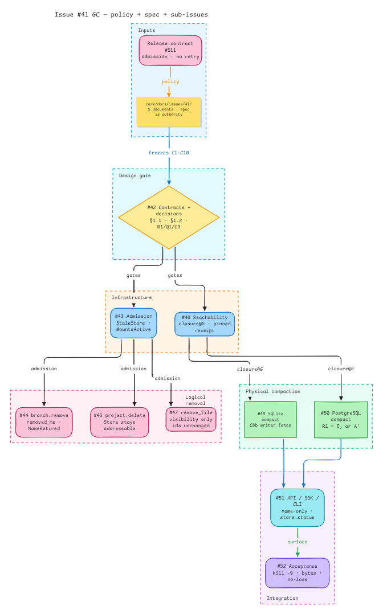
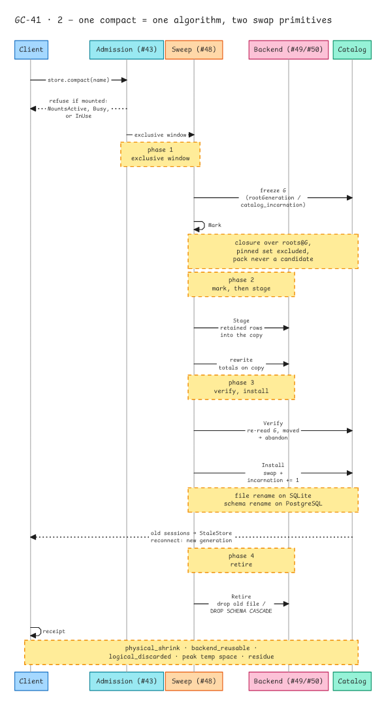
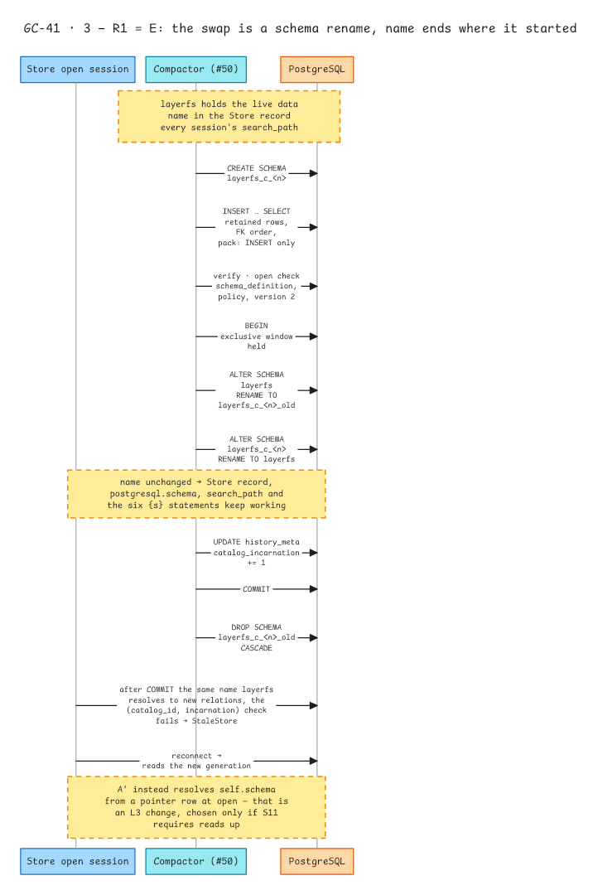
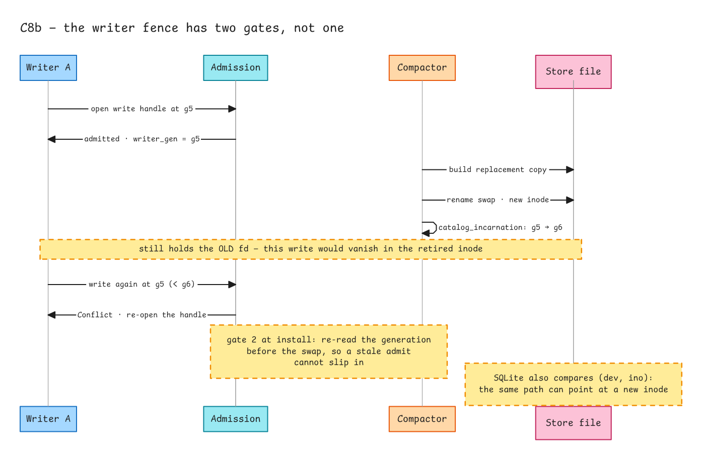
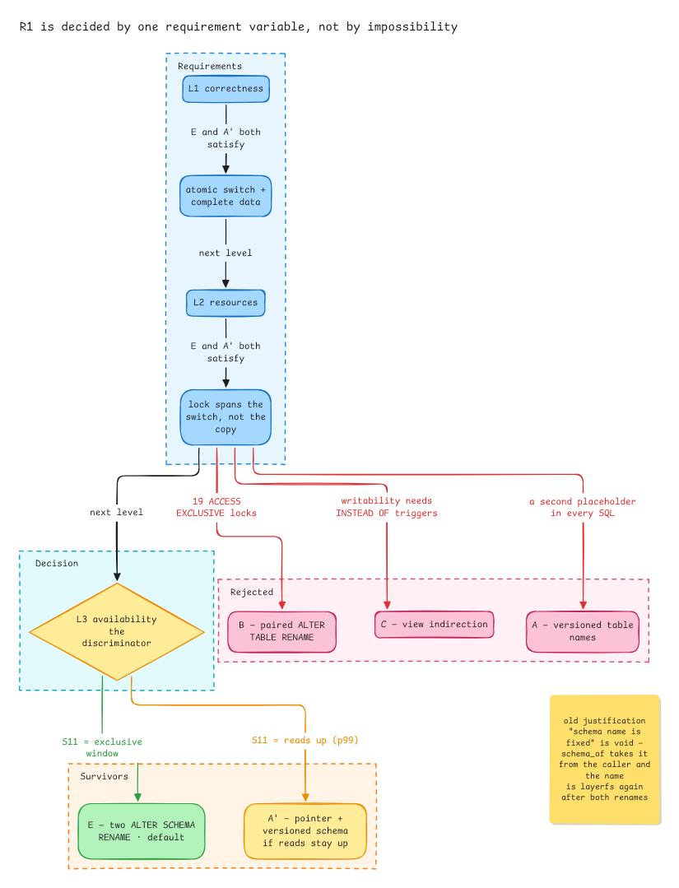
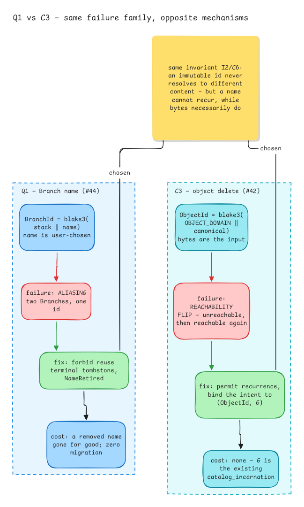

# Garbage collection

> **Status:** designed for LayerFS 2.0.0; the implementation is tracked in [#42](https://github.com/Ephemeral-AI-Lab/layerfs-project/issues/42)–[#52](https://github.com/Ephemeral-AI-Lab/layerfs-project/issues/52). Until it lands, the only reclaim path in the source is [page reclamation](../../../../engine/crates/layerfs-persistence/src/backend/sqlite/lifecycle/reclamation.rs).

Explicit garbage collection over SQLite and PostgreSQL: what may be reclaimed and
what may not, how a sweep is fenced against concurrent writers and readers, how
each backend replaces a Store, and what the report may claim.

| | |
| --- | --- |
| Layer | [Engine](../README.md) |
| Topic | [Store](README.md) |
| Pages | [Specification](spec.md), [Contracts](contracts.md), [Decision record](decision-record.md), [Implementation plan](implementation-plan.md), [Acceptance](acceptance.md) |
| Tracked in | [#42](https://github.com/Ephemeral-AI-Lab/layerfs-project/issues/42)–[#52](https://github.com/Ephemeral-AI-Lab/layerfs-project/issues/52) |

## The three decisions that shape it

| Decision | Chosen | Why it is not something else |
| --- | --- | --- |
| **R1** | PostgreSQL replaces a Store by two `ALTER SCHEMA RENAME`s in one transaction, ending at the original schema name | the name is recorded in the Store record and in every session's `search_path`; a pointer (A') is the only read-available alternative and is chosen only if S11 requires reads up |
| **Q1** | A removed Branch name is never reused; a same-name create returns `NameRetired` | `BranchId = blake3(stack ‖ name)`, so reuse would re-point old history at a new Branch |
| **C3** | A per-object delete is bound to `(ObjectId, G)`, where `G` is the existing `catalog_incarnation` | a content-addressed id necessarily recurs; binding the intent is the only way to exclude ABA without a second generation field |

## Pages

| Page | What it holds |
| --- | --- |
| [spec.md](spec.md) | Settled decisions (S1–S11), open questions (Q1–Q6), reconciliation with the older draft (R1–R4), contracts (C1–C10), Mark, Sweep, the operations surface, acceptance, non-goals |
| [contracts.md](contracts.md) | The four calls — `branch.remove`, `project.delete`, `project.remove_file`, `store.compact` — their preconditions, refusals and what may remain |
| [decision-record.md](decision-record.md) | Why R1/Q1/C3 are what they are: scenarios, alternatives, the requirement level that decides each, and the open items the decisions exposed |
| [implementation-plan.md](implementation-plan.md) | Implementation guidance for the three hardest items: the SQLite writer fence, soft-delete visibility, and the `HistoryCatalog` extension contract |
| [acceptance.md](acceptance.md) | Acceptance criteria and dependencies per sub-issue; task detail stays in the issues |

## Diagrams

**Documents → design gate → sub-issues** (#42)

**One compact = one algorithm, two swap primitives** (#48): mark, verify, install, retire over a single exclusive window.

**R1 = E: the swap is a schema rename** (#50): build the replacement schema, copy retained rows, verify with the readers' own open check, rename both schemas in one transaction, bump the generation, drop the old schema.

**C8b: the writer fence has two gates, not one** (#49).

**R1 is decided by one requirement variable** (#50): L1 and L2 do not discriminate, L3 does, and L3 is governed by S11 alone.

**Q1 and C3: same failure family, opposite mechanisms** (#44, cross-linked to #42): a name cannot recur, bytes necessarily do.

