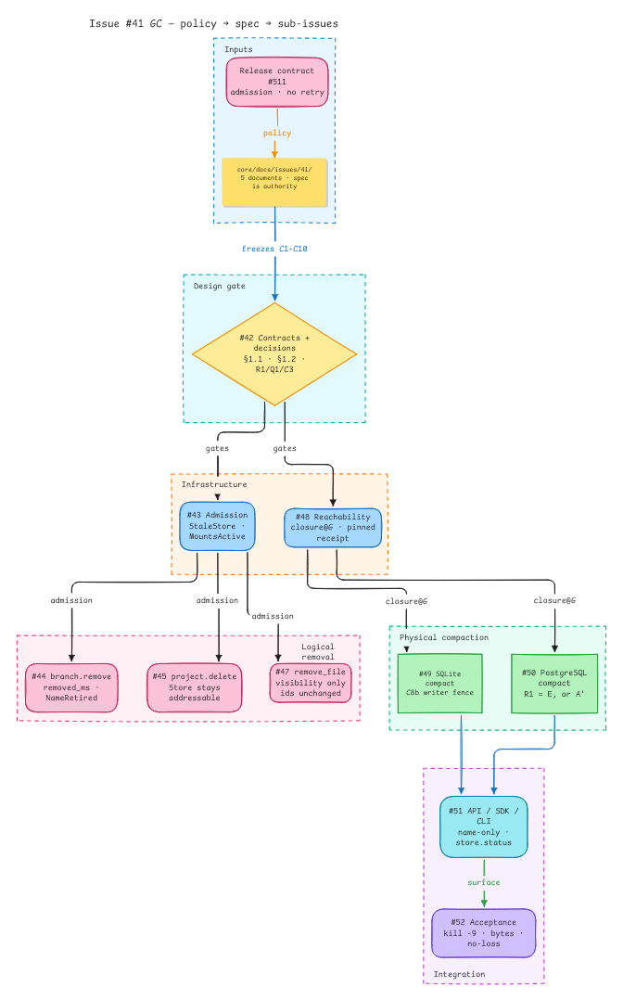
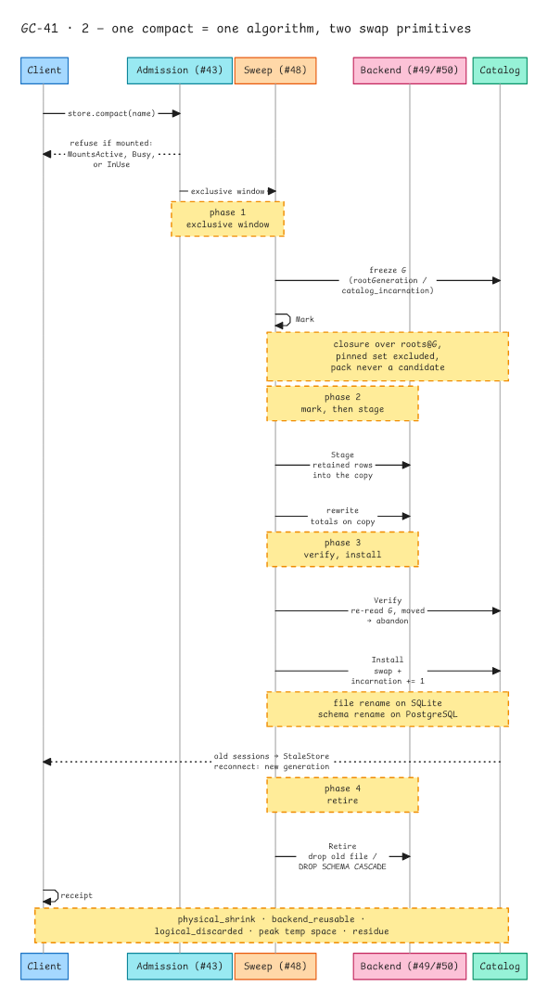
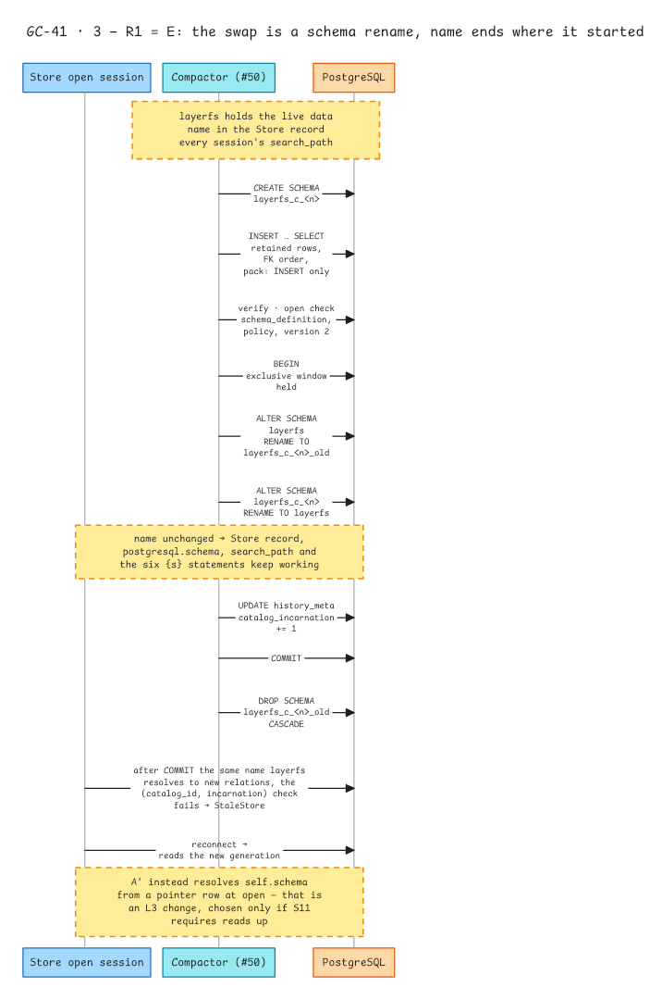
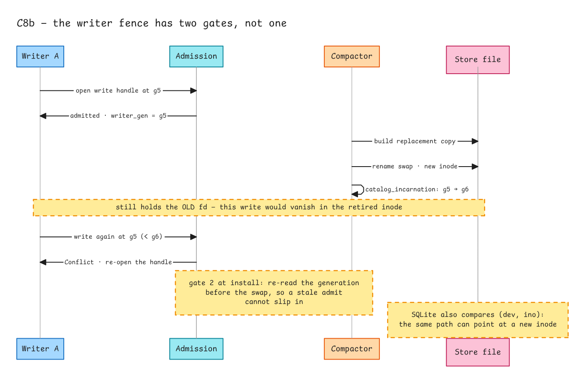
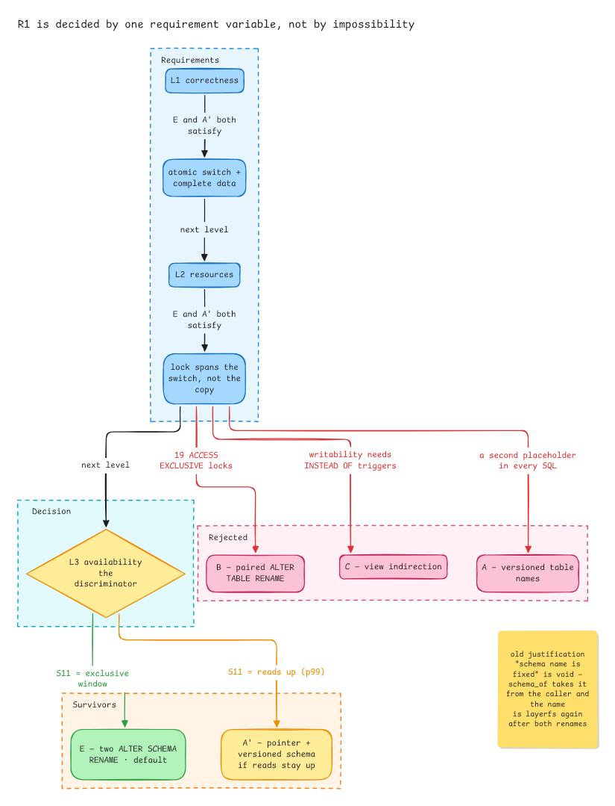
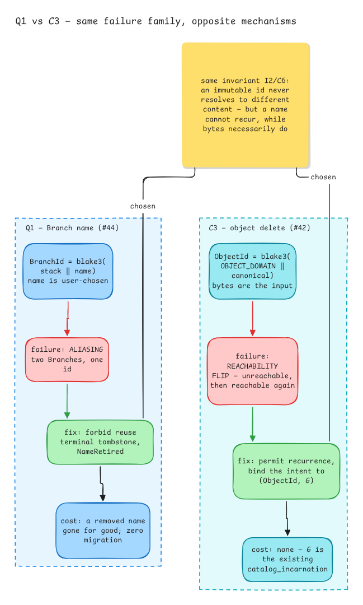

# LayerFS garbage collection — design set (issue #41)

> **Status:** design, not implemented. Informative, not a product contract.

The design for explicit garbage collection over SQLite and PostgreSQL: what may be
reclaimed, how a sweep is fenced, how two backends replace a Store, and what the
report may promise. It was reviewed in
[#41](https://github.com/Ephemeral-AI-Lab/layerfs-project/issues/41) and merged in
[#658](https://github.com/Ephemeral-AI-Lab/layerfs/pull/658); the pages below are
that set, moved here when `core/docs/` was removed by
[#671](https://github.com/Ephemeral-AI-Lab/layerfs/pull/671).

Nothing here describes current source behaviour. The reclaim half that exists
today is [`lifecycle/reclamation.rs`](../../../engine/crates/layerfs-persistence/src/backend/sqlite/lifecycle/reclamation.rs);
everything else is design for work that has not landed.

## Pages

| Page | What it holds |
| --- | --- |
| [`LayerFS-GC-spec.md`](LayerFS-GC-spec.md) | The specification: settled decisions (S1–S11), open questions (Q1–Q6), reconciliation with the older draft (R1–R4), contracts (C1–C10), Mark, Sweep, the operations surface, acceptance, non-goals |
| [`02-operation-contracts.md`](02-operation-contracts.md) | The four calls — `branch.remove`, `project.delete`, `project.remove_file`, `store.compact` — their preconditions, refusals and what may remain |
| [`03-decision-record.md`](03-decision-record.md) | Why R1/Q1/C3 are what they are: scenarios, alternatives, the requirement level that decides each, and the open items the decisions exposed |
| [`C8b-N3-C9-Resolution-Plan.md`](C8b-N3-C9-Resolution-Plan.md) | Implementation guidance for the three hardest items: the SQLite writer fence, soft-delete visibility, and the `HistoryCatalog` extension contract |
| [`IMPLEMENTATION-CHECKLIST.md`](IMPLEMENTATION-CHECKLIST.md) | Acceptance criteria and dependencies per sub-issue; task detail stays in the issues |

## Diagrams

Architecture and sequence diagrams for the same set, on Comic Shanns.

**Documents → design gate → sub-issues** (#42)

**One compact = one algorithm, two swap primitives** (#48): mark, verify, install,
retire over a single exclusive window.

**R1 = E: the swap is a schema rename** (#50): build the replacement schema, copy
retained rows, verify with the readers' own open check, rename both schemas in one
transaction, bump the generation, drop the old schema.

**C8b: the writer fence has two gates, not one** (#49).

**R1 is decided by one requirement variable** (#50): L1 and L2 do not discriminate,
L3 does, and L3 is governed by S11 alone.

**Q1 and C3: same failure family, opposite mechanisms** (#44, cross-linked to #42):
a name cannot recur, bytes necessarily do.

## Where the work is tracked

Sub-issues [#42](https://github.com/Ephemeral-AI-Lab/layerfs-project/issues/42) to
[#52](https://github.com/Ephemeral-AI-Lab/layerfs-project/issues/52). The three
decisions that need an owner signature — R1, Q1, C3 — are asked for in the issue
that realises each one; #42 carries the full list.
