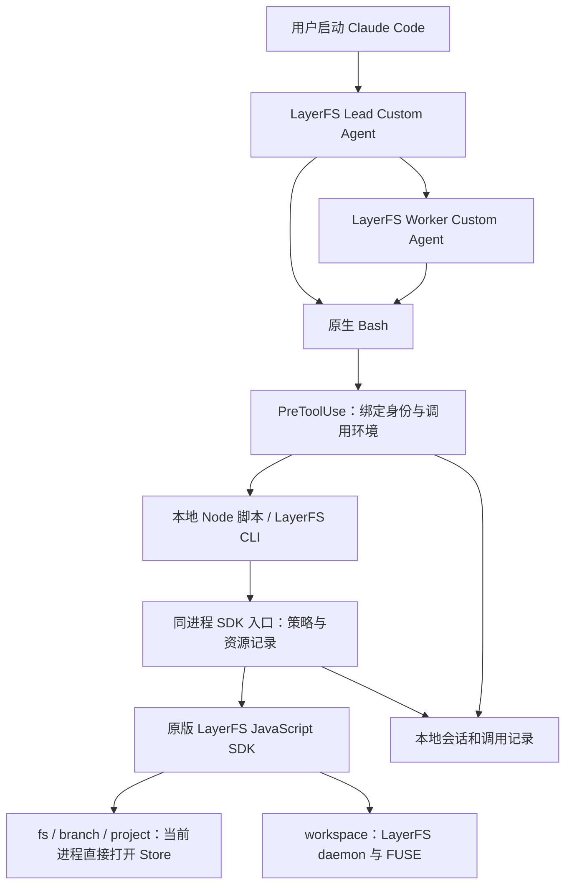

# LayerFS × Claude Code 插件设计

> **Status:** Proposal; target LayerFS 1.0.0 JavaScript SDK compatibility; not a released contract.

日期：2026-10-22。依据：LayerFS 源码 `5fb68ddc1acc3163e3ac3486133bde014c5fbed3`、本机 Claude Code `2.1.307` 的 CLI，以及文末的 Claude 官方文档。本文件规定插件的目标行为。候选实现已落在 [claude/](../../claude/README.md)，实际 Claude 会话和 Docker/FUSE 验收留给使用者，尚不是已发布集成。

## 1. 目标和范围

交付一个遵循 Claude Code 官方插件结构的 `layerfs` 插件，让 Claude Code 采用与现有 DSH 集成基本等同的开发方式：Agent 在独立 Branch 上工作，通过 JavaScript SDK 读取、修改和版本管理，通过 Workspace 安装依赖、构建和测试，由 Lead 集成并发布。

插件使用 Custom Agent 作为系统提示词和工具配置的来源，直接复用上游 Skill，不依赖在用户项目中编写 `CLAUDE.md` 或 `AGENTS.md`。Claude Code 负责模型调用、对话、压缩、原生 Bash 和子 Agent 调度；LayerFS 负责文件、Branch、Commit、Workspace、合并和发布。

交付范围为 Linux 和 WSL2 中的本地 Claude Code CLI。SDK 与 daemon 必须共享同一 Linux 内核，Store 位于支持的本地 Linux 文件系统。WSL2 下不把 `/mnt/c`、`/mnt/d` 等 Windows 文件系统上的路径当作 Store 支持证明。macOS 用户可在符合这些条件的 Linux 环境中运行整套 CLI；本设计不扩展 DSH 专属的 macOS Store worker 例外。

不包含 MCP、新 UI、Git worktree 集成、另一套文件工具协议、Store 代理服务，也不修改 LayerFS 的存储格式或 daemon 协议。运行配置沿用项目唯一允许的 Disposable Store profile。

### 与 DSH 的对应关系

| DSH 的能力 | Claude Code 插件中的实现 |
| --- | --- |
| LayerFS preset 的 persona | `agents/lead.md` 和 `agents/worker.md` 的正文 |
| Bash、后台任务、Subagent | Claude Code 原生工具和任务机制 |
| 移除普通文件工具 | Custom Agent 的 `tools` 白名单 |
| 每次 Bash 注入 SDK 环境 | 插件级 `PreToolUse` Hook 与调用执行脚本 |
| LayerFS SDK Skill | 原样打包 `.agents/skills/layerfs-js-sdk/` |
| Branch 与 Agent 的关联 | 本地会话记录，以真实 `session_id`、`agent_id` 为键 |
| SDK、CLI 与 Workspace 工作流 | 原生 SDK，加少量同进程的集成逻辑 |
| Work、History 页面 | 本次不实现；保留终端结果、Commit 和 trace |

“基本等同”指开发工作流和 LayerFS 语义等同，不表示复制 DSH 的界面、调度实现，或承诺对任意恶意脚本进行安全隔离。

## 2. 总体架构



同进程 SDK 入口只补充当前 Agent 的 Branch 检查、发布角色检查和资源记录。它委托原版 SDK 执行操作，不增加数据路径中的 IPC、HTTP 服务或第二份项目数据库。

插件采用与 DSH 相同的可信开发环境模型。工具集合、Hook 和受管 SDK 入口约束正常开发调用；运行任意 Bash 的用户仍有其操作系统账户的能力。本插件不把这些工作流约束宣传成跨用户、跨租户的安全边界。

## 3. 官方插件结构

候选实现位于 [claude/](../../claude/README.md)，采用官方默认的 `.claude-plugin/plugin.json`、`agents/`、`skills/`、`hooks/hooks.json` 和根目录 `settings.json`。仓库级 marketplace 描述使用 `./claude` 作为插件来源。插件代码与受管项目的 Store、home、控制目录分别配置，安装缓存不保存项目历史。

实现中的本地脚本分别处理部署配置、Hook、每次 Bash 执行、SDK/operator 入口及恢复。CLI 保留 DSH 常用命令并补充资源和集成操作；完整命令见 `lfs help`。`claude/tools/` 只做 Skill 打包和本地检查；`claude/tests/` 使用原版 JS SDK 和 native addon 替身，不代替实际宿主或文件系统验收。

### Manifest

`.claude-plugin/plugin.json`：

```json
{
  "name": "layerfs",
  "version": "0.1.0",
  "description": "Develop LayerFS projects in Claude Code through the JavaScript SDK.",
  "author": {
    "name": "LayerFS contributors"
  },
  "license": "MIT"
}
```

Agent、Skill 和 Hook 使用官方默认目录发现，不重复声明相同 Hook 路径。插件根目录的 `settings.json`：

```json
{
  "agent": "layerfs:lead"
}
```

该默认值只应在启用本插件的 LayerFS 控制目录中使用。项目绑定和权限设置不写入插件的 `settings.json`：官方插件默认设置只支持 `agent`、`subagentStatusLine`，其他键会被忽略。

`compatibility.json` 记录核对过文档的 Claude Code 版本、实际会话是否测试、LayerFS revision、Skill 文件摘要和 SDK 源码摘要。native addon、daemon 的构建摘要以及运行镜像 ID 属于具体控制目录的部署配置。插件版本和 LayerFS SDK 版本分别记录，不相互冒充。

## 4. Custom Agent 和工具范围

### Lead

`agents/lead.md` 的配置形式：

```yaml
---
name: lead
description: Develop, delegate, integrate and publish a LayerFS project.
tools: Bash, Skill, Agent(layerfs:worker), TaskStop, AskUserQuestion
skills:
  - layerfs:layerfs-js-sdk
---

你是这个 LayerFS 项目的主 Agent。

当前目录用于临时脚本、笔记和命令输出。项目文件存在于 LayerFS。
首次项目操作前阅读 LayerFS SDK Skill 及所用方法的参考页。
使用 fs.* 读取和小范围修改；使用 Workspace 安装、构建、测试和运行程序。
在运行上下文指定的 Branch 上工作；main 是发布视图，只能读取和从中分叉。
把可并行任务交给 layerfs:worker，并说明任务、验收方式和来源版本。
集成 Worker 的结果，验证集成后的版本，再发布到 main。
结束前说明最终 Branch、Commit、验证结果和仍持有的资源。
```

正文中的运行时名称由 Hook 补充，不把项目名称、Branch 或机器绝对路径固化进 Agent 文件。若主会话未预加载 Skill，则 SessionStart 上下文要求通过 Bash 读取 `DSH_LAYERFS_SKILL`；首次 SDK 写操作前必须完成加载。

### Worker

`agents/worker.md`：

```yaml
---
name: worker
description: Complete a delegated task on an assigned LayerFS Branch.
tools: Bash, Skill, TaskStop
skills:
  - layerfs:layerfs-js-sdk
---

你在独立的 LayerFS Branch 上完成主 Agent 委派的任务。
使用运行上下文指定的 Branch，遵循 LayerFS SDK Skill。
项目读取和小修改使用 fs.*；安装、构建和测试使用 Workspace。
不发布到 main，不修改其他 Agent 的 Branch，不再次委派任务。
完成后报告 Branch、Commit、改动、验证结果和遗留 Workspace 或进程。
```

支持一个 Lead 和多个并行 Worker。Worker 不拥有 `Agent` 工具，因此分支归属无需处理任意深度的委派树。Lead 的 `Agent(layerfs:worker)` 排除使用本地文件工具的默认 Worker、Explore 等类型。

普通文件工具、LSP、PowerShell 和进入 Git worktree 的工具不在白名单内。后台输出通过 Bash 读取本地任务日志；不依赖已移除的 `TaskOutput`。压缩、对话恢复继续由 Claude Code 管理。

插件 Agent 的 `hooks`、`permissionMode` frontmatter 会被 Claude Code 忽略，因此不在上述文件中配置它们。Hook 放在插件级文件，权限模式由启动会话决定。

## 5. SDK、Skill 和 CLI 复用

| 内容 | 复用来源 | 插件中的处理 |
| --- | --- | --- |
| 开发 Skill | [layerfs-js-sdk](../../.agents/skills/layerfs-js-sdk/SKILL.md) | 连同方法、规则参考页按固定 revision 原样打包 |
| SDK | [sdk/js](../../sdk/js/README.md) | 使用匹配构建的原版 SDK 和 native addon |
| DSH 系统提示词 | [minimalist preset](../../dsh/packages/dsh-layerfs/presets/layerfs-dsh-minimalist.patch.yml) | 保留工作规则，替换为 Claude 原生工具名 |
| 环境接线 | [env.js](../../dsh/packages/host/src/env.js) | 复用变量约定，按 Claude Hook 上下文生成 |
| 常用 CLI | [lfs.js](../../dsh/packages/host/src/lfs.js) | 保持命令面，增加身份接线并修正异常时丢弃 Workspace 的处理 |
| 观察和诊断 | [layerfs-sdk-observe](../../.agents/skills/layerfs-sdk-observe/SKILL.md) | 供维护者使用，不默认预加载给 Worker |

Skill 只有一个上游来源，不维护 Claude 专属改写版。涉及宿主的补充说明放在 Agent 提示词或 Hook 上下文。完整 SDK 参数、分页、返回值和 Refusal 继续以原参考页为准。

保留 DSH 的环境变量，使原 Skill 中的示例可直接使用：

| 变量 | 内容 |
| --- | --- |
| `DSH_LAYERFS_PROJECT` | 当前项目名称 |
| `DSH_LAYERFS_SDK` | 插件受管 SDK 入口的文件 URL |
| `DSH_LAYERFS_OPERATOR` | 同进程 operator 入口的文件 URL |
| `DSH_LAYERFS_CLI` | 兼容 CLI 的绝对路径 |
| `DSH_LAYERFS_SKILL` | 原版 Skill 文件的绝对路径 |
| `DSH_LAYERFS_HOME`、`_DOCKER`、`_IMAGE`、`_VOLUME`、`_DAEMON`、`_STORE_PATH` | 当前项目的有效部署设置 |
| `DSH_LAYERFS_TRACE`、`_TRACE_STEP`、`_TRACE_START` | 当前 Agent 的诊断 trace 与工具调用关联 |
| `CC_LAYERFS_BRANCH` | 当前 Agent 的工作 Branch |
| `CC_LAYERFS_ROLE` | `lead` 或 `worker` |

普通的 `LAYERFS_*` 设置在 SDK 中优先于 `DSH_LAYERFS_*`。调用脚本必须消除或拒绝冲突的继承设置，不能让用户 Shell 中的旧值静默改变项目。原版 SDK 的真实入口由受管入口内部配置，避免把 `DSH_LAYERFS_SDK` 再次导入自身。

受管 SDK 入口导出相同的 `LayerFS` 使用方式和原版错误辅助函数。文件写操作检查目标 Branch 的归属；`publish` 检查 Lead 角色；Workspace 操作检查已登记的所有者。通过检查后在当前进程调用原版 SDK，保留返回值和原生 Refusal。插件策略拒绝单独标明来源，不伪造 LayerFS 原生成功或错误。

这层检查约束通过插件入口发起的调用，不承诺阻止同一操作系统账户故意绕过入口。

## 6. 项目绑定与运行状态

每个项目有一个专用控制目录。该目录包含项目运行配置、会话记录和 scratch，不放一份可被误当作项目源码的 checkout。导入项目通过 `project.init` 显式执行一次；日常启动连接已有项目，不重复导入，也不先复制整个项目。

项目配置指定项目名称、真实 SDK 入口、native addon、LayerFS home、Store 路径、Docker 端点、volume、daemon 和运行镜像。启动时验证路径、访问权限和构建身份。插件不假定普通用户必然能打开 Docker volume 下的 Store；无法满足直接访问条件时明确报错，不切换到代理路径。

会话记录放在控制目录的 `.layerfs-claude/` 下。插件安装目录只存代码；插件缓存或 `CLAUDE_PLUGIN_DATA` 不承担 Store、项目历史和恢复记录的唯一保存责任。

| 记录 | 必要信息 |
| --- | --- |
| Session | `session_id`、项目、配置身份、Lead 当前 Branch |
| Agent | 实际 `agent_id`、角色、来源版本、拥有的 Branch |
| Call | `tool_use_id`、Agent、状态、输出位置、SDK 操作关联 |
| Workspace / Job | 所有者、`sandbox`、`path`、Branch、进程、已知结果、是否明确保留 |

记录使用少量原子写入的本地文件，并对并发更新作互斥。它们只保存控制信息，不复制文件内容、提交树或 Store 权威状态。

Lead Branch 名使用 `cc-<session>-lead`；Worker 使用 `cc-<session>-w-<agent>`，实际编码遵守 LayerFS 名称约束并检查冲突。Worker 从启动时 Lead 的已提交版本分叉。已有同一 Agent 的绑定可恢复；失败后不得因名称相同就猜测先前的 fork 已成功。

项目在会话首次绑定后固定。Resume 恢复原绑定；明确 fork 的新会话建立新 Branch。缺少 Agent 定义、身份、项目配置或版本不匹配时，进入阻止项目操作的状态，不回退为普通本地开发。

## 7. Hook 设计

| 事件 | 职责 |
| --- | --- |
| `SessionStart` | 检查是否处于 `layerfs:lead` 模式；连接项目、绑定 Lead；加载公共环境和恢复信息 |
| `SubagentStart` | 仅匹配 `layerfs:worker`；登记真实身份、分叉 Branch，注入任务运行上下文 |
| `PreToolUse`：`Agent` | 检查委派类型，拒绝 Git worktree 隔离请求和不受管的 Worker |
| `PreToolUse`：`Bash` | 校验绑定状态；生成当前 Agent 的调用环境、调用记录和 trace 标识；改写为调用执行脚本 |
| `PostToolUse` / `PostToolUseFailure` | 收集已知结果和资源记录；执行失败不等于丢弃 Workspace |
| `SubagentStop` / `Stop` | 检查未完成调用和资源；存在可恢复问题时反馈给 Agent；避免无限阻止结束 |
| `SessionEnd` | 保存状态，执行有界的清理通知；不依赖该事件完成全部恢复 |

关键 Bash Hook 的官方配置形式：

```json
{
  "hooks": {
    "PreToolUse": [
      {
        "matcher": "Bash",
        "hooks": [
          {
            "type": "command",
            "command": "node",
            "args": ["${CLAUDE_PLUGIN_ROOT}/scripts/hook.mjs"],
            "timeout": 10,
            "onFailure": "block"
          }
        ]
      }
    ]
  }
}
```

实现时同一文件还需登记上表其他事件。`onFailure: "block"` 用于可阻止的入口检查，不把它当作 SessionStart 或停止事件也能阻断一切的承诺。SubagentStart 本身不能阻止创建；绑定失败后由该 Worker 的首个 PreToolUse 阻止项目操作。

公共 SDK 环境可由 SessionStart 写入 `CLAUDE_ENV_FILE`。Branch、角色、trace step 按每次调用生成，不写入所有 Worker 共享的环境文件。身份取自 Hook 的 `session_id`、`agent_id`，不采信模型自报的角色。子 Agent 缺少身份时不能按 Lead 处理。

`run-call.mjs` 读取受保护的调用记录，通过参数数组和独立环境运行原 Bash 内容；命令正文作为数据传递，不使用字符串拼接、`eval` 或 JSON 字符串冒充 Shell 转义。插件路径由 Hook 提供绝对值，不能假定 `${CLAUDE_PLUGIN_ROOT}` 自动出现在 Bash 环境中。

**不把所有 Bash 自动包成 Workspace。** Bash 运行 SDK 脚本、读取 Skill、处理 scratch；只有调用 `workspace.exec` 的项目命令才进入 Workspace。否则会把 SDK 自身的启动也错误地放进项目执行环境。

## 8. 文件操作、命令和长任务

| 工作 | 路径 | 历史语义 |
| --- | --- | --- |
| 读取、搜索、diff | `fs.read/list/grep/glob/diff_files` | 读取已提交状态，不创建 Commit |
| 小修改、创建、移动、删除 | `fs.*`；关联修改可用 `fs.apply` | 按原版 SDK 的原子操作创建 Commit |
| 安装、构建、测试、格式化、Git | `mount → exec → commit → unmount` | Commit 捕获该 Workspace 的变化，包括依赖和生成物 |
| Dev server、watcher、长构建 | 显式持有 Workspace 和进程 | 可跨调用运行、阶段性 Commit，结束时明确回收 |

不对项目目录使用 Claude 原生文件工具。Workspace 命令使用相对路径，不把每次变化的挂载路径写入源码。运行镜像提供工具链，Commit 保存项目文件及已提交依赖；宿主凭据和配置不会天然出现在新 Workspace 中。

每个普通项目命令结束后尝试 Commit，包括退出码非零的命令。`UpToDate` 不生成空 Commit，但调用结果仍被记录。一段 Bash 中的多个 SDK 写调用可以产生多个 Commit，不承诺“一次工具调用恰好一个 Commit”。

受管入口在挂载前记录意图，在成功后登记句柄；Job 明确登记是否跨回合保留。普通脚本使用 `finally` 释放客户端和可正常结束的 Workspace。后台任务的停止必须传递到已登记的进程，再检查 Workspace 状态，不能把关闭 Claude 的外层 Bash 当作项目进程已全部结束。

SDK trace 只用于诊断与关联。其写入失败不会改变 SDK 结果，不能用“没有 trace”证明没有挂载或没有提交。进程在挂载成功与本地记录完成之间终止时，保留未知状态并通过现有 operator/status 能力核查，不宣称已保证自动恢复。

## 9. 失败与恢复

| 情况 | 行为 |
| --- | --- |
| 命令非零退出，Commit 成功 | 保存变化和退出状态，正常卸载；向 Agent 返回失败结果 |
| `HeadMoved`、`Busy` 等明确 Refusal | 原样返回，由 Agent 检查；插件不自动重试或重放 |
| Workspace Commit 出现 `Conflict` | 保留该 Workspace，在其中查看和解决冲突 |
| Branch merge 出现 `Conflict` | 输入不变；在工作分叉上处理后显式重新合并 |
| 卸载返回 `Dirty` | 保留现场，要求明确 Commit 或放弃 |
| 丢失回复、进程被杀、状态未知 | 标记待核查；不猜测成功、不重发写操作、不自动 discard |
| 已登记的干净、空闲资源 | 核实所有者和保留标志后卸载 |

不沿用 DSH CLI 中异常时自动 `unmount(ws, true)` 的清理策略。插件只在明确放弃自己拥有的改动时 discard，不强制丢弃其他 Agent 的 Workspace。恢复检查只针对已登记或有充分证据关联的资源。

Claude 的 `/rewind` 不负责回滚 SDK 写入的 LayerFS 状态。代码回退通过 LayerFS 的 Commit/Branch 操作完成；会话恢复后重新注入当前绑定，不能让旧对话中的 Branch 名覆盖运行记录。

## 10. 集成与发布

Lead 收到 Worker 报告后，先核实 Branch、Commit 和验证结果，再使用 `branch.merge(a, b, newName)` 集成。该 API 创建新 Branch；输入不变。当前脚本使用返回的 Branch 继续操作，成功选用的集成结果登记为 Lead 的当前 Branch，后续 Bash 刷新环境。

项目首次工作时按上游规则建立 `/.lww`，通常使用 `%include .gitignore`。生成物的 LWW 决策需要保留在结果中；源码冲突仍由 Agent 理解和解决。合并成功不等于业务验证通过。

发布流程为：合并当前 `main` → 在集成结果上验证 → 核实待发布版本和 `main` → `branch.publish(branch, commit)`。同一项目的插件内发布操作串行执行；`main` 推进后重新检查集成和验证。测试若修改源码或依赖，先处理变化再判断验证是否有效。

只有 Lead 可通过受管入口 publish。保留 SDK 返回的 `HeadMoved` 和 `overwrote` 等信息；不能把原生 publish 可能跳过新主线层的行为隐藏成“必然无覆盖”。这一协调范围限于插件管理的会话，不承诺与任意外部写入客户端形成新的原子协议。

## 11. 安装与使用

使用官方插件安装或本地加载机制分发。开发时的启动形式如下；路径是部署占位符，先按插件 README 配置控制目录后执行：

```bash
cd /path/to/layerfs-control/shop
claude --plugin-dir /path/to/layerfs/claude --agent layerfs:lead
```

项目配置预先放在控制目录中，由 SessionStart 读取。插件启用范围限定为这些控制目录。发布后可提供官方 marketplace 条目，安装仍使用 Claude 原生命令；不依赖修改 Claude Code 源码或私有加载器。

交付包带 README 和项目 MIT 许可证。README 说明用途、支持平台、运行依赖、安装、启动和已知限制；manifest 带作者与许可信息。公开目录上架另行满足目录校验和审核要求，不把本地插件格式校验当作已获官方上架批准。

部署检查包括 Claude Code 版本、Node、SDK/native addon、daemon、Docker、FUSE、Store 所在文件系统及访问权限、运行镜像是否已存在。不得假设公开 npm 包、预编译 daemon 或公共运行镜像已经提供。失败给出具体缺失项，保留当前项目状态。

用户进入 `layerfs:lead` 会话后直接描述开发任务。正常工作无需手工选择每个 Workspace，或为每次 SDK 调用重复配置环境。最终回复包含当前 Branch、Commit、测试结果和仍运行的任务；UI 和项目历史浏览继续使用已有工具。

## 12. 验收和交付标准

| 编号 | 验收内容 | 通过条件 |
| --- | --- | --- |
| A1 | 官方格式 | `claude plugin validate --strict claude` 通过；Agent、Skill、Hook 均按预期加载 |
| A2 | 主会话 | 以 `layerfs:lead` 运行；可用工具符合声明，未暴露普通文件修改和 Git worktree 入口 |
| A3 | Skill 复用 | 与固定上游 revision 的运行必需 Skill 文件逐文件一致；方法和规则页可读取 |
| A4 | 直接 Store 路径 | Linux 中 SDK 自进程打开 Store；Workspace 经原有 daemon；不存在新增 Store 代理 |
| A5 | 单 Agent 开发 | 导入或连接项目后，读取、修改、安装、测试、Commit、发布完整完成 |
| A6 | 并行开发 | 两个 Worker 有不同 Branch；各自改动可由 Lead 集成并验证 |
| A7 | 调用环境 | 并发调用不串 Branch、角色或 trace step；旧 `LAYERFS_*` 不静默改变部署 |
| A8 | 策略 | 通过受管 SDK 的越权 Branch 写入、Worker publish 被拒绝，原生合法调用行为不变 |
| A9 | Hook 故障 | Bash Hook 丢失、崩溃、无效输出、超时均阻止调用；绑定失败不退回本地编辑 |
| A10 | 失败与冲突 | 非零退出的变化可追溯；两类冲突按原语义恢复；Dirty/未知现场不被自动丢弃 |
| A11 | 长任务 | 进程和 Workspace 可跨调用保留、查询、Commit、停止和卸载 |
| A12 | 恢复与升级 | Resume 继续原 Branch；fork 建新 Branch；插件更新或缺失 Agent 不静默恢复默认开发模式 |
| A13 | 发布与回退 | 集成当前 main 后验证；publish 返回信息完整；对话回退不被误报为代码回退 |

当前本地结构检查和固定用例覆盖见插件 README；A1 的官方 validator、宿主工具加载和所有真实 Claude/Docker/FUSE 项仍按 [TESTING.md](../../claude/TESTING.md) 验收，不能据此声明整表已通过。格式验证、固定用例验证和真实模型验收分开报告。`claude plugin validate` 对 manifest 的通过结果不代表已经加载并验证了 Agent 工具池、Skill 预加载或 Hook 执行，须查看它实际覆盖的报告项。真实模型验收至少执行一次 Lead 加两个 Worker 的开发任务，并检查真实 Store、Commit 和 Workspace 状态。静态 validator 通过不能代替实际 SDK、Docker/FUSE 和 Claude 调度链路的验证。

实现已包含插件配置与打包、单会话 SDK 接线、Worker 与资源管理；下一步由使用者完成实际宿主验收。交付要求是整套基本等同工作流，不能以只有提示词、只有 manifest 或模拟 Store 的演示代替完成。

## 13. 参考与约束来源

Claude 官方文档，2026-10-22 核对：

- [CLI reference](https://code.claude.com/docs/en/cli-reference)：`--agent`、`--tools`、`--plugin-dir`。
- [Custom subagents](https://code.claude.com/docs/en/sub-agents)：Agent 正文、工具白名单、Skill 预加载、指定 Worker、插件 Agent 的 frontmatter 限制。
- [Plugin manifest reference](https://code.claude.com/docs/en/plugins-reference)：目录、manifest、默认设置和插件路径变量。
- [Hooks reference](https://code.claude.com/docs/en/hooks)：事件、真实 Agent 身份、调用改写、环境文件、`onFailure` 和各事件的阻止能力。
- [Permissions](https://code.claude.com/docs/en/permissions)：工具可用范围与免确认规则的区别。
- [Tools reference](https://code.claude.com/docs/en/tools-reference)：后台任务、日志和当前工具名。
- [Checkpointing](https://code.claude.com/docs/en/checkpointing)：原生文件回退的边界。

LayerFS 约束以 [AGENTS.md](../../AGENTS.md)、[SDK](../../sdk/js/README.md)、[开发 Skill](../../.agents/skills/layerfs-js-sdk/SKILL.md)、[Branch API](../../.agents/skills/layerfs-js-sdk/references/methods/branch.md)、[Workspace API](../../.agents/skills/layerfs-js-sdk/references/methods/workspace.md) 和 [DSH 集成](../../dsh/README.md) 为准。
