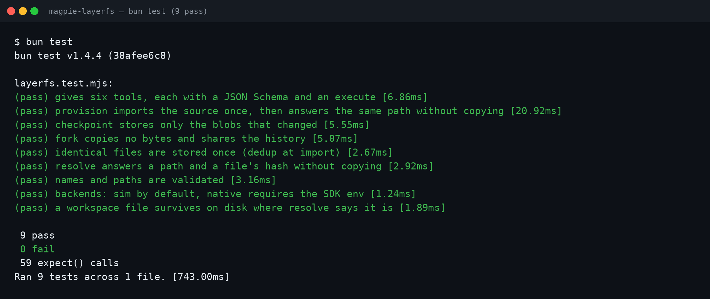

# LayerFS × Magpie

`magpie-layerfs` is a tools plugin for [Magpie](https://usemagpie.ai) — the
model gateway that puts every agent on one endpoint — that gives those
agents LayerFS workspaces, the same way [`dsh-layerfs`](../dsh/) gives
DeepSeek Harness agents theirs.

Magpie serves the plugin's tools on its MCP server (`/mcp/magpie/tools`) to
every connected agent — Claude Code, Codex, OpenCode and the rest — as
`layerfs_provision`, `layerfs_checkpoint`, `layerfs_fork`,
`layerfs_history`, `layerfs_resolve` and `layerfs_status`. An agent calls
`provision` and works in the returned path; parallel agents `fork` branches
of one project instead of copying its tree; `checkpoint` grows the shared,
deduplicated history.

## How it maps onto LayerFS

| Plugin tool | LayerFS (JS SDK) |
|---|---|
| `provision` | `project.init` (first time), `branch.fork` if needed, `workspace.mount` |
| `checkpoint` | `workspace.commit` |
| `fork` | `branch.fork` |
| `history` | `branch.list_commits` |
| `resolve` | the mounted workspace's path from `workspace.mount` |
| `status` | `project.list_branches` + store accounting |

## Backends

- **native**: with `LAYERFS_SDK_PATH` (this repo's `sdk/js/src/index.js`)
  and `LAYERFS_STORE_PATH` (the store file on the mounted LayerFS volume)
  set, the plugin drives the real LayerFS through the SDK.
- **sim**: without them, a local content-addressed store implements the
  same model — SHA-256 blobs, branches as manifest pointers, checkpoints
  as deduplicated manifests — so the plugin and its tests run anywhere.
  `MAGPIE_LAYERFS_BACKEND=auto|native|sim` selects explicitly.

## Measured (sim backend)

184-file, 26.8 MB project, 6 parallel agents × 3 checkpoints
(`bun bench/bench.mjs` in the package repo): forking an agent takes
~1 ms and copies 0 bytes (naive copy: 321 ms, 26.8 MB); 18 checkpoints of
history occupy 27.2 MB of store for 509.4 MB of logical trees (18.7×
dedup; naive snapshots: 482.6 MB); resolving a file path takes ~138 µs.




## The package

The canonical package lives at
[Mola-maker/magpie-layerfs](https://github.com/Mola-maker/magpie-layerfs)
and is listed in the Magpie community registry as
`@magpie-community/tools-layerfs`:

```sh
magpie plugin add @magpie-community/tools-layerfs
```

Files here mirror the package: `index.mjs` (the tools), `layerfs.mjs`
(the two backends), `layerfs.test.mjs` (`bun test`, 9 tests, sim backend
end to end plus the native backend's configuration contract).
