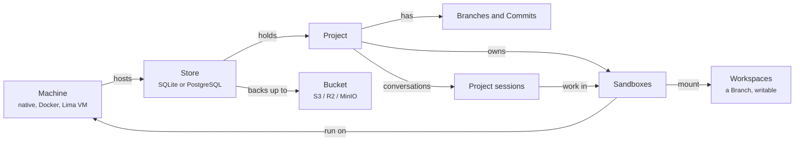
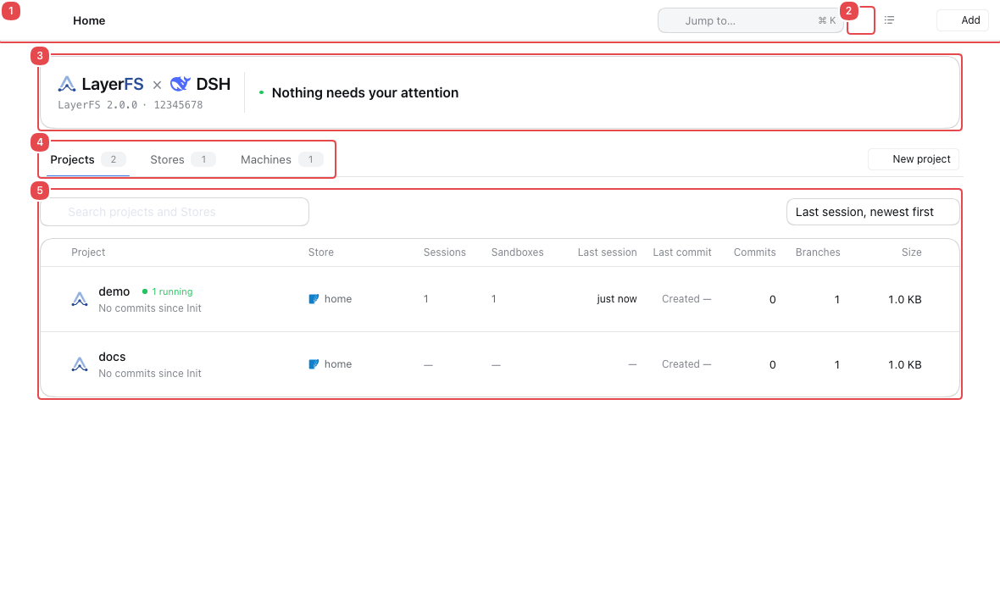
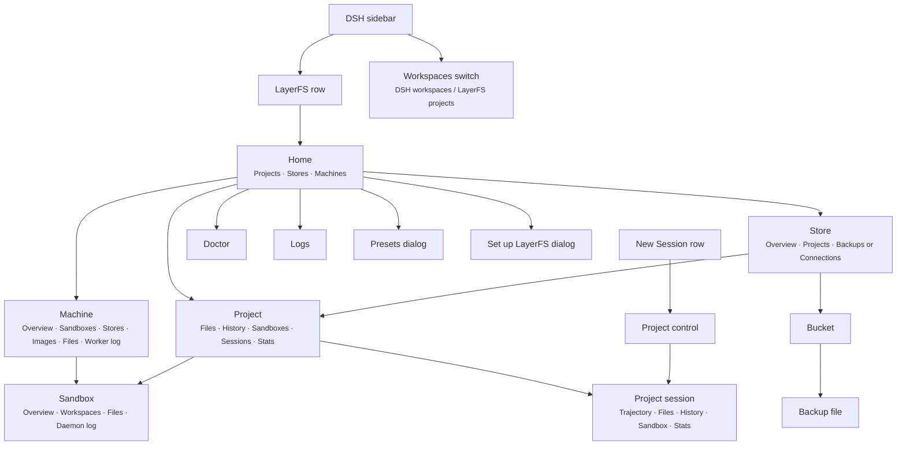

# LayerFS in DSH: UI guide

> Images marked “isolated fixture data” show the current components rendered in a private browser with sample data. Other images come from the earlier demo setup.

dsh-layerfs adds LayerFS to the DeepSeek Harness (DSH) web app. LayerFS keeps project
files in Stores and records every change as a Commit on a Branch. Agents work in
Sandboxes on your machines. DSH stays the chat app it always was, and LayerFS adds one
sidebar row, a set of conversation tabs, and a few controls around the window.

This guide goes through the UI one page at a time. For each page it covers what the page
is for, what each component shows, what every interaction does, and which LayerFS CLI
call runs behind it.

## How to read it

- **Places are paths**, like `LayerFS › Home › Stores › demo-starter › Backups`. DSH has
  no URLs, so a path is how you find a place. Menus look like `⋯ › Back up to…`.
- **Screenshots are numbered.** Each number matches a row in the table under the picture.
- **Every interaction names its LayerFS call** in a "LayerFS call" column, such as
  `store move`. "(read)" marks what a view reads to draw itself, and `—` means no call
  (the answer comes from host memory or from what your browser remembers).
  [cli-map.md](cli-map.md) lists every interaction in one place.
- **Words are the UI's own.** Buttons are in **bold**, spelled as on screen.
- The earlier screenshots come from a demo setup: the Starter preset's Store `demo-starter`
  (project `bookshelf`, 235 commits), a small Store `guide-notes` (project `handbook`, with
  one project conversation), and a bucket `guide-backups`.

## Two modes: DSH sessions and project sessions

A **DSH session** belongs to a DSH workspace folder, just as it would without LayerFS.
A **project session** belongs to a LayerFS project. Its files live in the project's Store,
and the local folder you pick is only scratch space. While a project session is on screen,
the conversation's tab row gains LayerFS's tabs:

| # | Tab | What it shows | Page |
|---|---|---|---|
| 1 | Trajectory | Each tool call, the LayerFS calls it made, and the versions they left. Replaces DSH's own Trajectory tab. | [Conversation](conversation.md#trajectory) |
| 2 | Files | The project's files on the session's Branch, at any Commit | [Conversation](conversation.md#files) |
| 3 | History | The project's Branches and Commits as a graph | [Conversation](conversation.md#history) |
| 4 | Sandbox | The Sandbox the session runs in, live | [Conversation](conversation.md#sandbox) |
| 5 | Stats | The session's LayerFS numbers | [Conversation](conversation.md#stats) |

Switch to a DSH session and these tabs go away, and DSH's own tabs come back.

## What's what

| Word | Meaning |
|---|---|
| Machine | Where LayerFS runs. **native** is this computer. Docker and Lima machines are workers LayerFS starts and stops. |
| Store | The database holding projects. A SQLite Store sits on one machine and can be pushed, pulled or moved between machines. A PostgreSQL Store lives on a database server. |
| Project | A tree of files with its own Branches and Commits. Projects live in a Store. |
| Branch, Commit | Every save is a Commit. `main` is the project's line, and side Branches carry work in progress. |
| Sandbox | An isolated place on a machine where a project's commands run. It belongs to the project. |
| Workspace | A Branch mounted writable inside a Sandbox. Commands run there, and **Commit…** saves the changes. |
| Bucket | Object storage holding SQLite Store backups. |
| Session | A DSH conversation. A project session's files and commands go through LayerFS. |

## The map

LayerFS has a single row in DSH's sidebar. It opens **Center**, a page that shows one place
at a time under its own navigation bar. Center starts on **Home**.

*Isolated fixture data.*

| # | Component | What it is | Page |
|---|---|---|---|
| 1 | Navigation bar | History, location, Jump to and Add | [Navigation](components.md#nav-bar) |
| 2 | Doctor | Opens the checks and shows the findings count | [Doctor](health.md) |
| 3 | Head card | Runtime, most urgent notice, Presets and Refresh | [Home](home.md) |
| 4 | Tabs | Projects, Stores and Machines | [Home](home.md) |
| 5 | Projects table | Projects with their Stores, sessions and Sandboxes | [Projects](home.md#projects) |

Optional tabs only show when they apply. Images, Files and the log tabs depend on the
machine and the pinned CLI, and a Store shows Backups or Connections depending on whether
it is SQLite or PostgreSQL. Each page reopens on the tab you last had open there, in
this browser.

## Pages

| Page | Open it to… | Where |
|---|---|---|
| [Entry points](entry-points.md) | find LayerFS in the DSH window: the sidebar row, the Workspaces switch, the New Session project control, the setup and project dialogs | DSH window |
| [Home](home.md) | see everything at once: projects, Stores, machines, and what needs you | `LayerFS › Home` |
| [Store](store.md) | look after a Store: its size, its projects, its backups or connection, moves between machines | `LayerFS › Home › Stores › <store>` |
| [Bucket](bucket.md) | see a bucket's backup files and restore one | `LayerFS › Home › Stores › <bucket>` |
| [Project](project.md) | browse a project's files and history, its Sandboxes, sessions and numbers | `LayerFS › … › <store> › <project>` |
| [Machine](machine.md) | run a machine: power, readiness, Sandboxes, Stores, images, its files and log | `LayerFS › Home › Machines › <machine>` |
| [Sandbox](sandbox.md) | work inside a Sandbox: Workspaces, terminals, files, its daemon log | `LayerFS › … › <machine> › <sandbox>` |
| [Conversation](conversation.md) | follow a project session: its trajectory, files, history, Sandbox and numbers | a project session |
| [Doctor](health.md) | check that LayerFS and everything it runs is healthy, and fix what is not | `LayerFS › Doctor` |
| [Logs](logs.md) | see each LayerFS call the app made, and why | `LayerFS › Logs` |
| [Presets](presets.md) | build a demo library, or reset this LayerFS home | `LayerFS › Home ›` Presets |
| [Components](components.md) | read once about the parts many pages share | — |

## How do I…

| I want to… | Go to | Behind it |
|---|---|---|
| Set LayerFS up the first time, or change its runtime or folder | [Entry points › Set up LayerFS](entry-points.md#set-up-layerfs) | `home get`, `home init`, `machine update native` |
| Start a conversation in a project | [Entry points › New Session project control](entry-points.md#new-session-project-control), or a project's [Sessions](project.md#sessions) tab | `project get`, then `branch fork` for the session's Branch |
| Create a project, or import a folder as one | [Entry points › Project dialog](entry-points.md#project-dialog) | `store create`, `project init`, `store move` |
| See what a project looks like at any Commit | [Project › Files](project.md#files) and [History](project.md#history) | `file list`, `file read`, `commit list`, `commit diff` |
| Follow what an agent did, call by call | [Conversation › Trajectory](conversation.md#trajectory) | — (the session's own log) |
| Back up a Store, or restore one | [Store › Backups](store.md#backups-sqlite), [Bucket](bucket.md) | `backup create`, `backup restore` |
| Move a Store to another machine | [Store menu](components.md#store-menu) | `store move` (twice, through native) |
| Connect a PostgreSQL database | [Store › Connection](store.md#connection-postgresql) | `store save-auth`, `store connect`, `store doctor` |
| Start, stop or fix a machine | [Machine](machine.md), [Machine menu](components.md#machine-menu) | `machine start`, `machine stop` |
| Make a Sandbox and run commands in it | [Machine › Sandboxes](machine.md#sandboxes), [Sandbox › Workspaces](sandbox.md#workspaces) | `sandbox create`, `workspace mount`, `workspace exec`, `workspace commit` |
| Free disk space on a machine | [Machine › Overview › Disk space](machine.md#disk-space-dialog), [Images](machine.md#images) | `machine stats --with space`, `machine prune` |
| Find out what is wrong, and fix it | [Doctor](health.md), [Needs-you notices](components.md#needs-you-notices) | `<family> doctor`, then the fix LayerFS names |
| See which LayerFS call a click ran | [Logs](logs.md) | — (reads the call log) |
| Try LayerFS on demo data | [Presets](presets.md) | a recipe of many calls |

## Behind every button

Every click calls a route on the dsh-layerfs host, and the route runs the pinned
`layerfs` CLI as `layerfs <family> <call>`.

- [cli-map.md](cli-map.md) lists every interaction, the route it calls, and the LayerFS call(s) behind it.
- [cli-routes.md](cli-routes.md) is the full route table, generated from the host code.
- [Logs](logs.md) shows the calls a click actually ran, tagged with its session. Use it to check.

## Keeping this guide current

[CONTRIBUTING.md](CONTRIBUTING.md) has the page template, the rules for the LayerFS call
column, and the commands that retake the screenshots and regenerate the route table.
