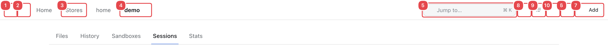
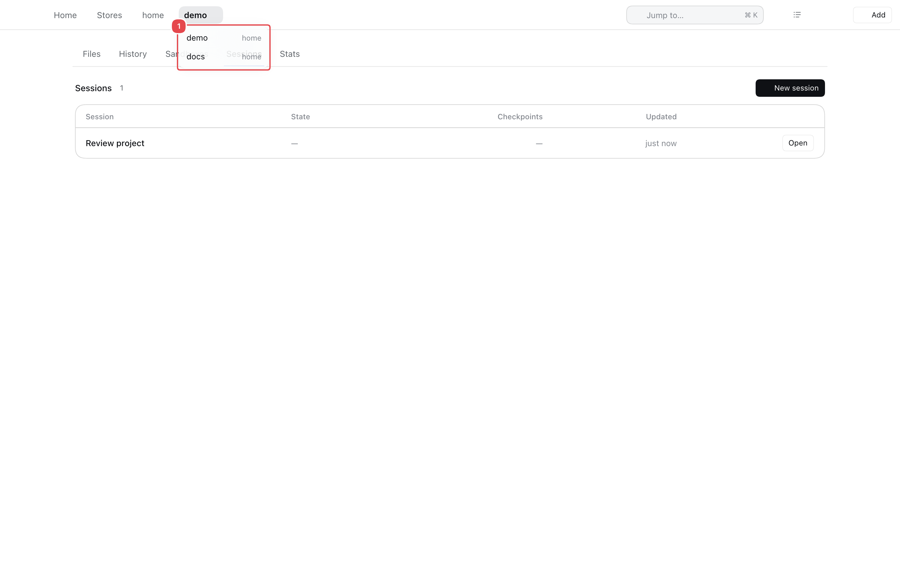
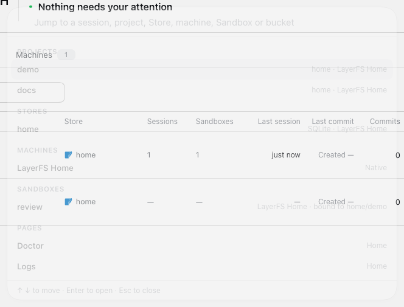
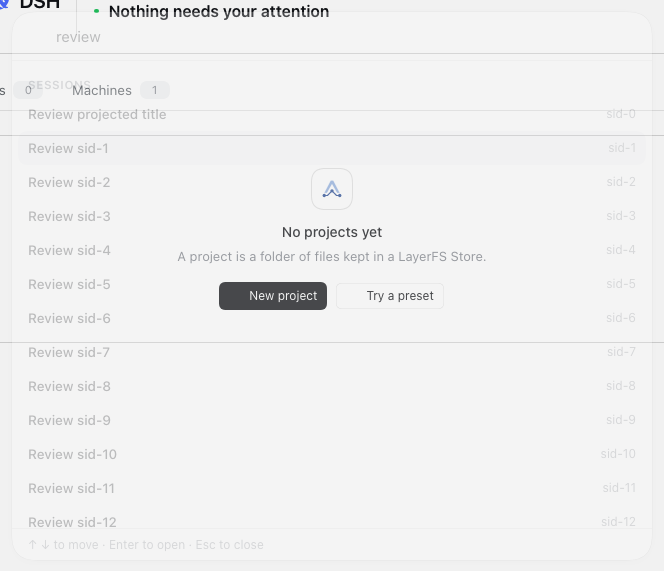
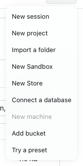
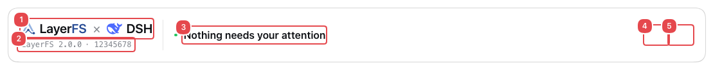

# Components

> Images marked “isolated fixture data” show the current components rendered in a private browser with sample data. Other images come from the earlier demo setup.

These parts appear on more than one page, so each is described once here. Page guides
link to the sections below instead of repeating them.

## Nav bar

The strip across the top of every Center page. It shows where you are, gets you
elsewhere, and adds things.

On the current Home navigation bar, 1 opens Doctor, 2 opens Logs and 3 opens Settings.

*Isolated fixture data.*

The earlier multi-Store example below shows the breadcrumb switcher.

| # | Component | What it shows | Interaction → result | LayerFS call | States |
|---|---|---|---|---|---|
| 1, 2 | Back · Forward | Arrows | Press → the previous or next Center page (up to 50 are kept) | — (local history) | Off at either end |
| 3 | Breadcrumb | `Home › Stores › demo-starter › bookshelf` | Press a crumb → that page | — | The last crumb is the page you're on |
| 4 | Crumb switcher | A chevron after a crumb (**Switch from {name}**), or a caret on the current crumb, when that place has siblings | Press → a menu of its siblings (every Store, every project in this Store, …) with their kind and place → open one | — (uses what Center already read) | Only when there is more than one sibling |
| | Transfers | **{n} transfers**, with a percentage and a progress track, while moves, backups or restores run | Press → that Store's page (one job), or a menu of them (several) | — (the jobs Center already tracks) | Hidden when nothing is running |
| 5 | **Jump to…** | A field with **⌘K** (**Ctrl+K**) | Press it or use the shortcut → **Jump to a session, project, Store, machine, Sandbox or bucket**, grouped as Projects, Stores, Machines, Sandboxes, Buckets, Pages and Sessions. Session hits show the title and ID and open the conversation. **↑ ↓ to move · Enter to open · Esc to close** | — (searches what Center already read) | **Nothing matches “{q}”**. At most 60 hits. The shortcut is off while a dialog is open |
| 6 | Refresh | A circular arrow, on every page except Home | Press → the page reads its data again | The page's own reads | A dot while reading |
| 7 | **+ Add** | **New session**, **New project**, **Import a folder**, **New Sandbox**, **New Store** (set to the machine when opened from a machine page), **Connect a database**, **New machine**, **Add bucket**, **Try a preset** | Opens that dialog | `store create` · `store save-auth`, `store connect`, `store get` · `machine create` · `backup connect` · the preset's script. New project: `store create`, `project init`, `store move` | New machine and New Sandbox stay visible with the reason when unavailable |
| | Doctor | A shield with a count badge. Title: **Doctor: {n} findings** | Press → `LayerFS › Doctor` ([Doctor](health.md)) | The results the host holds. When none are held, the home checks run once as Home opens: `home doctor` | Red badge for an error, orange for a warning |
| | Logs | A list icon | Press → `LayerFS › Logs` ([Logs](logs.md)) | — | |
| | Settings | A gear | Press → Set up LayerFS | `home get` (read) | |

*Isolated fixture data.*

*Isolated fixture data.*

*Isolated fixture data.*

## Head card

The top of Home. It tells you which LayerFS this is and whether anything needs you.

*Isolated fixture data.*

| # | Component | What it shows | Interaction → result | LayerFS call | States |
|---|---|---|---|---|---|
| 1 | LayerFS × DSH | The LayerFS × DSH wordmark | — | — | |
| 2 | Runtime | `LayerFS 2.0.0 · 12345678` (**Show the pinned runtime**) | Press → opens [Set up LayerFS](entry-points.md#set-up-layerfs) | `--version --json` (read) | **LayerFS unavailable**, **Reading LayerFS…** |
| 3 | Headline | A dot and the most urgent need, or **Nothing needs your attention** in green | The need's buttons (see [Needs-you notices](#needs-you-notices)) | The button's call | **+{n} more** when there are several |
| 4 | Try a preset | The preset icon | Press → [Presets](presets.md) | — | |
| 5 | Refresh | A circular arrow. Tip: **Read the Stores, machines and buckets again, and re-run the home checks · Checked {ago}** | Press → reads Stores, machines and buckets again and re-runs the home checks | `home get`, `project list`, `store auths`, `store list` (read), then `home doctor` | Off while the checks run |

Use **+{n} more** to show or hide the remaining needs and their fix buttons below the card. A refused action appears with **Dismiss**.

## Needs-you notices

What the head card's headline and its **+{n} more** list hold, most urgent first. Each
notice names the thing, says why in LayerFS's words (in its tip), and offers the fix.
A double click only presses once. If the fix is refused, the refusal shows under the
head card.

| Component | Tone | Interaction → result | LayerFS call | States |
|---|---|---|---|---|
| **Finish setting up LayerFS** (after you chose **Later**) | Warning | **Set up LayerFS…** → the dialog | `home get` | Clears when setup is complete |
| A failed job: **{what} {place} failed while {phase}**, **Interrupted · final result unavailable**, **Outcome unknown · inspect the Store** | Danger | The [fix button](#fix-buttons) (**Start {name}**, **Restart {name}**, **Compact {name}**, **Save a login…**, **Connect again…**, **Run the {n}-step fix…**), or **Open {name}** (the Sandbox holding the Store), or **Retry**. **Dismiss** | The fix's calls (for example `machine start`). **Retry** repeats the job (`store move`, …) | Clears after a later success, when the Store is removed, or on Dismiss |
| **{kind} can’t run here now: {reason}** | Warning | **Open** → the machine | — | Clears when the platform is available |
| **{machine}'s worker is not answering[, so {stores} cannot open]** | Danger | **Open**. **Stop {machine}** → **Confirm: stop {machine}** (shuts down {machine}'s VM and records it as stopped) | `machine stop` | Clears when the worker answers |
| **{machine}’s VM is gone[, so {stores} cannot open]** | Danger | The fix, or **Open** | The fix's calls | |
| **{machine}’s record is out of date…** | Danger | **Open** | — | Clears when the record is updated |
| **{machine} needs you** | Danger | **Open** | — | |
| **{store} is down** / **is unreachable** / **needs its update** / **needs its login** | Danger | The fix, or **Open** → the Store | The fix's calls (`store update`, `store save-auth`, …) | Clears when the Store is ready |
| **{machine} is stopped and holds {stores}**: its projects can't open until it runs | Warning | **Open** | — | Clears when the machine runs |

Hovering the dot shows **Problem**, **Warning** or **Note**. Doctor findings only count on
the Doctor button. A Store with no backup isn't listed as a need. The notices come from
what Center already reads about Stores, machines and platforms (`home get`,
`machine get`, `machine list`, `store list`, all reads).

## File views

A project's saved files, read-only, either at a Branch's newest save or at a saved id.
They appear on the [Project page's Files tab](project.md#files) and as a project
session's [Files tab](conversation.md#files), where they open on the session's Branch.
Files are read from LayerFS, never from a Sandbox, so work that hasn't been committed
doesn't show here.

| Component | What it shows | Interaction → result | LayerFS call | States |
|---|---|---|---|---|
| Branch picker | The Branch shown. `main` is under **Published** and the others under **Branches**, each with its head's short id. Session Branches read **Session `<id>`** (· **restore `<n>`**). Internal `dsh.project.*` / `dsh.session.*` Branches are hidden. | Pick a Branch → the tree and open files are read again at its head. **Load more branches** → the next 100 | `branch list`, `branch get main` (read; the host keeps the Branch list for a few seconds) | While the list loads, a Branch opened by name shows its tree right away |
| Saved line | **Saved `<id>`**: the version on screen | **Show latest** (after **Open at this commit**) → back to the Branch head | — | |
| **Find in opened folders** | Filters the entries already read | Type to filter. **Escape** clears | — | **No file in the opened folders matches.** |
| Folder tree | Folders first, then files, by name. A folder is read when you open it. Keyboard: arrows, Home/End, type-ahead, Enter | Open a folder. Open a file in a tab | `file list` at the saved id (read; 1000 per page) | **Reading…**, **Empty folder**, **This folder could not be read**, **Show more entries** |
| Open files | One tab per file. The README opens on your first visit | Select a tab. **×** closes it | — | **Read-only files** when none is open. **Open a file from the tree** |
| **Code · Blame · History** | How the file is shown. The choice carries over to other files | Switch | — | |
| Code | Numbered, highlighted text, with **Wrap lines** and **Copy** | **Show more lines** → the next 1000 | `file stat`, `file read` (read) | **Showing lines 1–N.**, **Binary file · `<size>`**, **This path is absent at the selected saved version.**, **A long line was clipped.** |
| Blame | Lines grouped by the version that last wrote them: message, short id, age, **from `<branch>`**. The newest group is marked | Click a group → History with that version selected. **Show more lines** | `file read`, `file blame` (same window), `file history` for times (read) | **Reading who wrote each line…**, **Unknown version**, **Part of this answer is approximate** |
| History (one file) | The versions that changed this file, newest first, tagged **Added** / **Removed** | Select a version → its diff. **Include other branches**. **Compare with:** **Previous version** or any listed version. **Load earlier versions** | `file history` (read; 50 per page), `commit diff --path --with patch` (read) | **No saved versions of this file**, **This version added the file.**, **The search stopped early…**, **Only metadata changed**, **No content changes**, **Binary comparison · …** |

When LayerFS refuses a read, the view shows the refusal's word with LayerFS's sentence
as a tip, plus **Retry** or a fix (see [Fix buttons](#fix-buttons)): for example
**Broken · no saved login** or **Blocked · `<machine>` broken**. A refresh reads the open
folders again in place and keeps what is on screen. Switching to another Branch or
saved id starts the tree over.

## History views

A project's whole history as one tree. main's Layers (`L1`, `L2`…) run along the middle,
each other Branch has its own lane above or below, and each checkpoint is one leaf, in
the order it was saved. Each Branch family has its own colour. Rings mark merges, dashed
lines mark publishes to main, and grey lanes never reached main. The tree appears on the
[Project page's History tab](project.md#history) and as a project session's
[History tab](conversation.md#history). Zoom, selection and folded Branches are kept per
project while DSH stays open.

| Component | What it shows | Interaction → result | LayerFS call | States |
|---|---|---|---|---|
| Tree | Axis `#n · time`, Layers, lanes, leaves, merges and publishes | Hover → a tip (Branch, `#n`, time, id, message). Click a leaf or Layer → select it and show details. Drag to pan, scroll to zoom, ←/→ to walk the selected Branch, + − 0 | `branch list`, `commit list` per Branch (read) | The selected line is lit and the rest dimmed |
| Branch name tag | The Branch's name at its head | Click → open the Branch with its head selected (an empty Branch opens through its fork); while **Compare with…** waits, it completes the pick at that Branch's head | `commit list` if not read yet (read) | |
| Zoom | **Zoom out**, `<n> in view`, **Zoom in**, **Whole run** | Zoom the time axis only | — | |
| **Load all** / **Stop** | The background read | **Stop** pauses it and **Load all** resumes it. Tip: "Checkpoints load in the background, newest first…" | `commit list`, wide pages (read) | **Loading checkpoints… `<n>` so far** / **`<n>` of `<total>`** |
| **Compare** | | → Compare versions: main against the selected version | `commit diff` (read) | |
| Branches (`<n> Branches, main included`) | How many Branches there are, with `+` while more are unread | → the Branch finder: **Find a branch…**, click a Branch to open it, the chevron with a child count folds or unfolds a **Branch family**, **Load more branches** | `branch list` for more (read). Folding is view state only | **No branches match.** |
| **Refresh** | | Read the Branch list and moved heads again | `branch list`, `commit list` (read) | Spinner |
| Legend | **`<b>` Branches · `<c>` checkpoints · `<l>` Layers** (singular for one: **1 Branch**), **Layer on main**, **Checkpoint**, **Merge**, **Publish**, **Never reached main** | — | — | |
| Commit details | **Checkpoint**, **Layer on main**, **Merge** or **Branch head**, then the message, **Branch**, **ID** (copy), **When**, **Base layer**, **Source branch/commit**, **Merge parent**, **Never reached main**, **Changed paths** | Click a path → the file at that commit in Files. **View diff** → **Changes in `<id>`**. **Compare with…** → a bar "Select another version in the graph to compare with `<id>`." with **Cancel**; then click a leaf or Layer. **Close commit details** | `commit get`, `commit diff` with paths only (read; 100 per page, **Load more changes**) | **Reading changed paths…**, **This commit changed no paths.**, **Initial import.**, **Earlier parent is not loaded: `<id>`** |
| **Changes in `<id>`** (modal) | The changed paths and the selected path's diff | **Open at this commit** | `commit diff --path --with patch` (read) | **The first saved version has nothing to compare with.** |
| **Compare versions** (modal) | **From** and **To** Branch pickers `@ <id>` (**Show latest**), **Swap**, `<n> files changed`, the diff | **Load more changes**, **Open at this commit** (**Only owner changes** only when LayerFS reports line owners across a diff; 2.0 does not) | `commit diff` under `/` (read; 100 per page), then `commit diff --path --with patch` (read) | **Both sides have the same files** |

How the tree loads, so you know what you're looking at while it fills in:

1. **Reading history…** shows while the Branch list is read.
2. Lanes are drawn from the Branch list straight away. main's first page and the open
   Branch's first page (20 Commits each) are read first, then the other Branches, four at a time.
3. Every Branch is read back to where it forked, one Branch at a time and only while the
   page is visible. The tree grows in steps (at most every 8 s), and **Stop** pauses the reading.
4. Past 20,000 checkpoints the background reading pauses, and **Load all** reads the rest.
   Side-Branch totals are then counted so the legend can show "`<n>` of `<total>`".
5. The host keeps every page it read at a named Commit, plus each Branch's count per head.
   Branches that haven't moved keep their pages, so a refresh only reads what moved.

## Store card

One card per Store. Home › Stores shows every Store, and a machine's Stores tab shows the
Stores on that machine. Both use the same card.

| # | Component | What it shows | Interaction → result | LayerFS call | States |
|---|---|---|---|---|---|
| 1 | Name | Glyph and Store name | Click → the [Store page](store.md) | `store list` (read) | |
| 2 | ⋯ | The [Store menu](#store-menu) | See the Store menu | per row | |
| | Figure | SQLite: file size and **last write** *when*. PostgreSQL: packed bytes (or **n projects**) and the database name. Hover for the server and **Database id** | — | `store list`; for PostgreSQL also `store get --with stats` (read) | **Size unknown**. A size that may be out of date reads **size seen** *when*, with the tip **…its machine is stopped** or **…does not answer now**. Refused stats show `—` |
| 3 | **Stored on** chip (SQLite, on Home only) | The machine (or **LayerFS Home**) with a dot that shows whether it is running | Click → the machine page | `home get` (read) | A grey dot means the machine is not running |
| | **Connected from** chips (PostgreSQL) | One chip per side that connects, **This computer** first: whether it reaches the Store, and **n ▣** Sandboxes. Tip: its own or the default address, **checked** *when*, the PostgreSQL version, latency | Click → the check screen from that machine. A broken machine's chip opens the machine instead. The last chip, **+ Connect a machine**, opens the check from the first running machine that isn't connected yet | `store doctor --machine` | Red: the check failed, or the machine is broken. Grey: **not checked** |
| 4 | Project rows | Up to three projects (one while a status shows), each with packed bytes and a share bar | Click → the project page | `project list`, `project stats`, `branch get` (read; polled every 2 s while counting) | **Reading…**, `—` with **Not counted here**, **No commits since Init**, **No projects · Add project** (`project init`) |
| | Status row | Shows only when something is happening: a running or just-ended [job card](#job-card), **Another client runs …**, or a word saying what needs you (**Waiting on docker**, **Broken · …**) with its one action (**Start** *m*, a [fix](#fix-buttons), or **Repair** *m*) | That action | `machine start`, or the fix's call | |
| 5 | Backups badge (SQLite) | Provider marks, **n backup(s)**, and a dot for the worst state. Tip: **x need attention, y out of date, z current, w not listed** | Click → the Backups of *store* dialog. With no backup it reads **No backup** and opens Back up | `backup list` per linked bucket (read), when the dialog opens | |
| | **+n projects** | The Store has more projects than the card shows | Click → the Store page | — | |
| 6 | Foot action (SQLite) | **Push to…** for a Store in the LayerFS Home, **Pull** for a Store on a machine | **Push to…** → the Push dialog. **Pull** → a pull job | `store move <s> <m>`, or `store get` then `store move <s> native` | Off unless the Store is Ready. Hidden while a job runs |

PostgreSQL cards are grouped under one header per saved login. The header shows the
login, its user, how many Stores use it, the worst state (**Not reached** after a failed
check), and **Rotate password…**, which runs `store save-auth` and then `store doctor` for
each Store. The header's ⋯ holds **Remove login** (`store remove-auth`). It is off, with
the tip **Used by …**, while any Store uses the login.

## Store menu

The ⋯ in a Store page's head and on every Store card.

| Component | Shown for | Interaction → result | LayerFS call | States |
|---|---|---|---|---|
| **Push to…** | SQLite in the LayerFS Home | The Push dialog → a job | `store move <s> <m>` | Off unless Ready |
| **Pull to home** | SQLite on a machine | A job starts at once | `store get`, `store move <s> native` | Off unless Ready |
| **Move to another machine…** | SQLite on a machine | The Move dialog → a job | `store get`, then `store move` twice, through native | Off unless Ready |
| **Back up to…** | SQLite | The Back up dialog. With no bucket yet, Add bucket comes first | `backup create`, then `backup list` | Off unless Ready |
| **Back up now · *bucket*/*file*** | SQLite, one row per linked bucket | A job starts at once | `backup create`, then `backup list` | Off unless Ready |
| **Compact…** | Both kinds, when the runtime has `store compact` | Plain confirm → a job | `store get`, `store compact` | Off unless Ready. Tips: **Start machine** *m* **first**, **Repair machine** *m* **first**, **The Store is not ready**. Also offered on a Broken Store whose fix is a compaction |
| **Remove…** (red) | SQLite | Confirm by typing the name | `store remove` | |
| **Check** | PostgreSQL | The check screen from this computer (from that machine, on a machine page). Nothing runs until you press **Check** *store* **from** *machine* | `store doctor --machine`, `store get` | |
| **Change login…** | PostgreSQL | Edit connection, or Save a login when the Store names none | `store connect` / `store save-auth` / `store update` | |
| **Disconnect** *machine* | PostgreSQL, one row per machine with its own address | Confirm → that machine goes back to the Store's default address | `store disconnect --machine` | |
| **Disconnect…** (red) | PostgreSQL | Confirm (no typed name). The database itself stays | `store disconnect` | |

## Job card

The progress of one Store job (a push, pull, move, backup, restore or compaction). It shows
under a Store page's head and in a Store card's status row.

| Component | What it shows | Interaction → result | LayerFS call | States |
|---|---|---|---|---|
| Running line | Dot, what the job is doing (**Pushing to** / **Pulling from** / **Moving to** *m*, **Creating on** *m*, **Backing up to** *b*, **Restoring from** *b/f*, **Compacting** *s*), **Step n of N** with the step (checking, taking a snapshot, sending, verifying, installing, recording, cleaning up, uploading, downloading, hashing, marking, building, swapping), **done of total**, and a progress bar | — | The job's own call, which streams progress (`store move`, `backup create`, `backup restore`, `store compact`). The card follows `storage-job` events | |
| Ended line | **Pushed to** / **Pulled from** / **Moved to** / **Created on** / **Backed up to** / **Restored from** / **Compacted** … (**· nothing to reclaim**, **· freed** *n*). On failure: *Kind place* **failed while** *step*, **… : in use**, **Outcome unknown · inspect the Store**, or **Interrupted · final result unavailable**. The refusal's code, words and fix are in the tip | — | — | Green or red dot |
| Action (failed jobs only) | One button: the [fix](#fix-buttons) when Center can run it, otherwise **Open** *Sandbox* (the Sandbox holding the Store), otherwise **Retry** | **Retry** runs the same job again. **Open** goes to the Sandbox page | Retry repeats the job's calls: push `store move`; pull `store get` + `store move`; move `store move` ×2; backup `backup create`; restore `backup restore`; compact `store compact` | |
| **Dismiss** | | Hides a finished job | — (remembered in this browser) | |
| Another client | **Another client runs** *op · phase* **on this Store** | — | `store list` (read) | No actions |

A job that worked stays for a minute. A failed job stays until you dismiss it. A move
counts both of its halves in one bar.

## Confirm dialog

One dialog in three forms: type the name to confirm, plain, or red without a name.

| Component | What it shows | Interaction → result | LayerFS call | States |
|---|---|---|---|---|
| Title and text | *Action* *name*, and what goes and what stays | — | — | |
| Steps list | The numbered steps of a multi-step fix (**Remove Store** *s* **and its data**, …) | — | — | Only for a chain of fixes |
| **Type** *name* **to confirm** | A text field whose placeholder is the name | Type the exact name | — | The action button stays off until the name matches |
| Force checkbox | Optional. Changes the action's words | Tick → the action runs with force | — | Rare |
| **Cancel** / × / Escape | | Closes. Nothing runs | — | Off while running |
| Action button | Red for removals (**Remove**, **Delete**, **Disconnect**, **Run the steps**), plain for **Compact** | Runs the action. A refusal stays under the form | The caller's call | Spinner while running |

Used by:

- Remove a Store (typed name, `store remove`).
- PostgreSQL **Disconnect…** (`store disconnect`).
- **Disconnect** *machine* / **Forget** (`store disconnect --machine`).
- **Remove login** (typed name, `store remove-auth`).
- **Compact…** (plain, `store compact`).
- Bucket **Disconnect** (`backup disconnect`).
- Project **Delete** (typed name, `project delete`).
- Fix chains that remove data (typed name).

## Fix buttons

When LayerFS refuses something, reports a broken record or fails a job, it often names the
command that would fix it. Center turns that command into one button. The button's words
say what it does, the tip shows the command (**Clears it:** *line*), and once it has run it
reads **Done**.

| Component | LayerFS fix line | Interaction → result | LayerFS call | States |
|---|---|---|---|---|
| **Start** *m* | `machine start M` | Starts the machine (`POST /api/machines/:m/start`) | `machine start` | No confirm |
| **Stop** *m* / **Restart** *m* | `machine stop M` / `stop && start` | `/stop` or `/restart` | `machine stop`, or `machine stop` then `machine start` | No confirm |
| **Remove unused images** | `machine prune M --unused` | `POST /api/machines/:m/prune-images` | `machine prune` | Press twice |
| **Diagnose** *m* | `machine doctor M` | Runs the check and opens [Doctor](health.md) | `machine doctor` | No confirm |
| **Remove** *m***'s record** | `machine remove M` | `DELETE /api/machines/:m` | `machine remove` | Press twice |
| **Compact** *s* | `store compact S` | `POST /api/stores/:s/compact` | `store compact` | No confirm |
| **Remove** *s***'s record** | `store remove S` | `DELETE /api/stores/:s` | `store remove` | Press twice |
| **Close** *b* | `sandbox remove B` | `DELETE /api/sandboxes/:b` | `sandbox remove` | Press twice |
| **Delete** *p* | `project delete S/P` | `DELETE /api/projects/:p` | `project delete` | Press twice |
| **Back up to** *b* | `backup create S B` | `POST /api/stores/:s/backup` | `backup create`, then `backup list` | No confirm |
| **Set up the folder** | `home init` | op `setup.init` | `home init` | No confirm |
| **Save a login…** | `store save-auth … && store update S --auth` | Opens the Save a login dialog | `store save-auth`, `store update` | The dialog |
| **Update** | `store update S --auth A` | `POST /api/stores/:s/connection` | `store update` | No confirm |
| **Connect again…** | `backup connect …` | Opens Connect *bucket* again | `backup connect`, `backup list` | The dialog |
| **Run the n-step fix…** | Several lines joined by `&&` | Runs each step's route in order. The first refusal stops the rest | Each step's call | Press twice. A chain that removes data opens the typed-name confirm, listing every step |

Center never suggests `machine start` for a machine whose own record is broken. When a
start, stop or restart line names such a machine, the button becomes that machine's own
fix instead. If a fix is itself refused, its refusal shows without a further fix.

## Machine menu

The machine's ⋯ menu. It is on the machine page's head and on each row of the
[Machines board](machine.md#machines-board), where it starts with **Open**. Every power item
is protected against stray clicks: a press that lands just after the item changed under
your pointer does nothing.

| Component | What it shows | Interaction → result | LayerFS call | States |
|---|---|---|---|---|
| **Open** | On the board only | Opens the machine page | — | |
| **Start worker (docker)** / **Stop worker (docker)** / **Start (name)** / **Stop (name)** | The power action that fits the machine's state | Starts the machine (with startup progress) or stops it | `machine start` / `machine stop` | Off while another power action runs. Not shown for LayerFS Home |
| **Restart worker (name)**, plus **Stop worker** / **Stop (shut down the VM)** | Replaces the item above when the worker is down (not answering, outdated, unreachable) | **Restart** runs the fix LayerFS suggests. **Stop** stops the machine | `machine get`, then `machine stop` and `machine start` (or just `machine start`); `machine stop` | **Restart** is off when LayerFS's fix needs `--force` because Sandboxes are on the machine. Hover for the reason |
| **Force stop…** (red) | When the CLI's `machine stop` accepts force and the machine is running or holds Sandboxes. Not for ssh or Firecracker machines | **Force stop *name*?** → **Force stop** | `machine stop --force` | |
| **Update settings…** | Docker machines only | **Update settings** (Docker socket: Automatic or a socket it found) → **Save** | `machine update docker --docker <socket>` (empty means Automatic) | |
| **Remove…** (red, set apart) | | **Remove *name* and its disk?** If the machine still holds Sandboxes or Stores, it lists them, asks you to **Type *name* to confirm**, then shows **Remove everything** | `sandbox remove --force` for each Sandbox, `store remove` for each Store, then `machine remove` | Built-in machines: off with **Built in · can’t be removed**, unless LayerFS's own fix is to remove the record. Also off for a record that can't be read, and while an action runs |

## Sandbox card

One Sandbox on a machine's [Sandboxes tab](machine.md#sandboxes). Sandboxes that need you
come first, with a warning edge.

| Component | What it shows | Interaction → result | LayerFS call | States |
|---|---|---|---|---|
| Name | Dot, glyph and name | Opens the [Sandbox page](sandbox.md) | — | |
| State chip | **Running**, **Daemon not running**, **Needs repair**, … Hover for LayerFS's message | — | `sandbox list` (read) | |
| ⋯ | **Delete Sandbox…** (or **Read Sandbox** after a delete whose result is unclear), **Force delete Sandbox…** | Opens a [confirm](#confirm-dialog) | `sandbox remove` / `sandbox remove --force` (`sandbox get` for **Read Sandbox**) | **Delete** is off while an operation runs |
| Sub line | Project · **up *time*** · ***n* Workspaces** | — | the metrics sampler; `sandbox list` | No Workspace count when the list doesn't report one |
| **Image** | The image's name, linking to the Images tab, or a short id when the name is unknown | → the Images tab | `machine images` (read) | Not shown for LayerFS Home |
| Figures | **Processor** (*n* **of** *cpus*), **Memory**, **On disk** (a bar split into Workspace changes, the Sandbox's own files, and runtime and log) | — | the sampler's `machine stats`; `machine stats --with space` (read) | A dash, with the reason, when a figure is unknown. For host processes: **Processor and memory not read: *why*.** |
| Gone / broken notice | **Folder kept on disk** (*size*) or **Unusable · records kept** | **Close** | `sandbox remove` | Takes the place of the figures |
| **Terminals** / **Files** | | Opens the Sandbox page on Workspaces or on Files | — | Hidden when the Sandbox is gone |
| Closed card | Under the **Closed** filter: **closed *time***, how long it ran, peak memory | Name → the Sandbox page | — (sampler memory) | Only for Sandboxes closed within the last hour |

## Terminal pane

One mounted Workspace as a terminal, on the Sandbox page's
[Workspaces › Terminals](sandbox.md#workspaces) view. It is not a live shell. Each command
is a separate call, and its output shows when the command ends. While a command runs,
the transcript is read again every 1.5 s.

| Component | What it shows | Interaction → result | LayerFS call | States |
|---|---|---|---|---|
| Head | Name, Branch, mount folder, a changes chip (hover for the overlay size), and a busy dot | — | `sandbox get` (read) | |
| **Maximize** / **Restore** | | One pane fills the area. Esc or Alt+Enter restores | — | |
| ⋯ **More for *name*** | **Commit…**, **Copy path** | **Commit…** opens **Commit *name*** with an optional **Commit message** → **Commit**, and the pane reports **Committed *id*** or **Nothing to commit**. **Copy path** copies the mount path | `workspace commit [--message]`; Copy path: — | **Commit** is off while the Sandbox can't be reached |
| × **Close *name*** | | Unmounts at once, with no confirmation. Uncommitted changes are dropped and running commands cancelled | `workspace unmount --discard --force` | |
| Also-running line | **Also running: *program* · *age* · *who*** (a session, this app, a tag, another client) | View only | `sandbox get` (read) | Only for commands this host didn't start |
| Transcript | The prompt and command, then stdout/stderr (**… last 64 KB of *total***; binary output isn't shown), **[exit *n* · *time*]**, **cancelled**, **running *time* — ^C to cancel**, **outcome unknown…** | **↓ New output** when you have scrolled up | — (the host's command log) | **Run a command; its output appears here** when empty |
| Prompt | *name*:*folder* **$** | Enter runs the line. ↑/↓ for history. Ctrl+C cancels a running command or clears the line. Ctrl+L clears the view | `workspace exec` (one command at a time); Ctrl+C: `workspace cancel --exec <id>` | **The Sandbox can't be reached, so commands can't run.** |

## Log pane

The machine's [Worker log](machine.md#worker-log) and a Sandbox's
[Daemon log](sandbox.md#daemon-log). The log is read one request at a time, only while the
tab is showing and the window is visible: every 2 s, slowing to every 10 s while nothing
new arrives.

| Component | What it shows | Interaction → result | LayerFS call | States |
|---|---|---|---|---|
| **Find in loaded lines** | Matches highlighted, ***n* of *m*** | Enter / Shift+Enter or ↑/↓ to step through matches. Esc clears | — | |
| Status | **Following · *n* lines loaded**, **Not reading**, **Showing earlier lines**, **Stopped reading** | — | — | |
| **Wrap** | | Toggles line wrapping (remembered) | — | |
| **Copy** | | Copies the selection, or every loaded line | — | |
| **Read again** | | Reads now | `machine log` / `sandbox log` (read) | |
| Lines | Newest at the bottom. Follows new lines while you're at the bottom; otherwise shows **↓ *n* new lines** | **Earlier lines** at the top reads further back | `machine log` / `sandbox log` with `--cursor` / `--limit` (read) | **Start of the log** when there's nothing earlier. After a rotation, a divider reads **The log was replaced. The new log starts here.** |
| Banners | **Could not read the log just now · *code*** with **Read again**; **Unavailable · The machine is stopped…** with Start; **Showing earlier lines** with **Back to latest** | As named | `machine log` / `sandbox log` (read) | A failed read never empties the pane. Reading stops for good when the log is unsupported or its machine or Sandbox is gone |
