# Entry points

> Screenshots use the private guide profile with the pinned LayerFS runtime and the seeded `handbook` project.

> **Where:** the DSH window, outside Center · **Opens from:** — (always there) · **Source:** see the end

Every place LayerFS shows in DSH's own window: the sidebar row that opens Center, the
Workspaces switch between DSH workspaces and LayerFS projects, the project control on the
New Session row, the scratch folder picker, project conversations, and the two dialogs
(Set up LayerFS and the project dialog) these open.

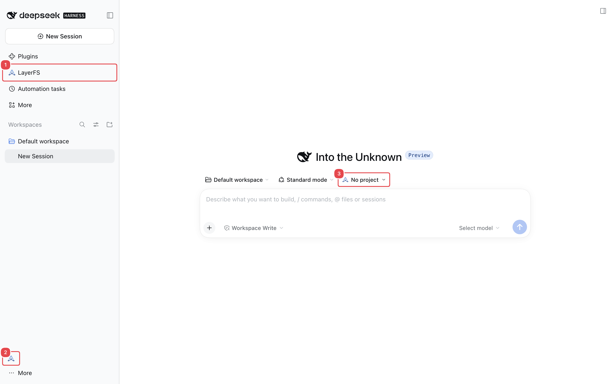

| # | Component | What it is |
|---|---|---|
| 1 | LayerFS row | The sidebar row that opens Center ([Home](home.md)) |
| 2 | Workspaces switch | The LayerFS glyph in the sidebar footer (DSH view) or project header (LayerFS view): DSH workspaces ↔ LayerFS projects |
| 3 | Project control | **No project** / the project's name on the New Session row |

## Layout

DSH's sidebar holds the **LayerFS** row (with Plugins, Automation tasks, More) and the
Workspaces list. LayerFS offers **Show LayerFS projects** above More in the sidebar footer; in LayerFS view the list
shows projects instead of folders. On the New Session row, next to the folder and mode
pickers, LayerFS adds the project control; once a session has a project, its folder picker
becomes the scratch folder picker. A project conversation carries the **LayerFS** agent preset
and the Files, History and Sandbox tabs ([Conversation](conversation.md)).

## Sidebar LayerFS row

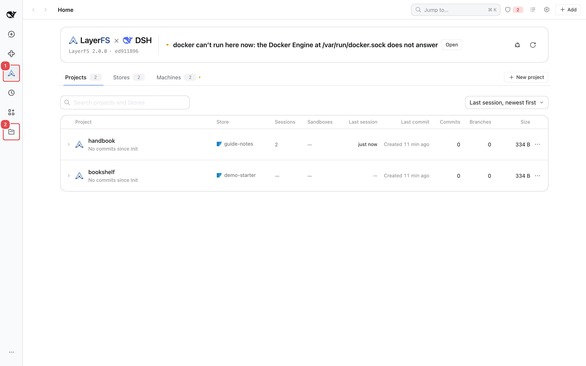

| Component | What it shows | Interaction → result | LayerFS call | States |
|---|---|---|---|---|
| LayerFS row | The LayerFS glyph and **LayerFS** | Press → Center opens on its last page (Home the first time) and the sidebar folds to its icon rail; use **Fold sidebar with LayerFS Center open** in the wide footer to fold it again | — (opens a view; Home then reads, see [Home](home.md#layout)) | highlighted while Center is open |
| 1 Rail LayerFS icon | The same row, folded to its glyph | Press → Center | — | — |
| 2 LayerFS Projects | A folder icon on the rail | Press → the sidebar opens wide again on the Workspaces list | — | only on the folded rail |

## Workspaces switch

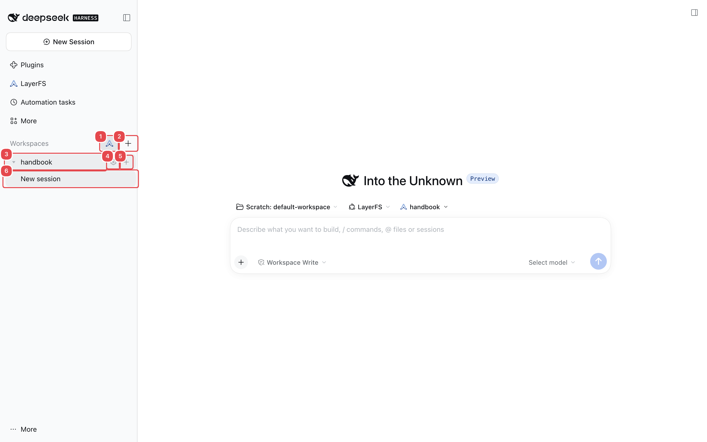

The switch trades DSH's Workspaces list (folders) for LayerFS's (projects with sessions on
this DSH), and back. The choice is remembered in this browser.

| Component | What it shows | Interaction → result | LayerFS call | States |
|---|---|---|---|---|
| 1 Switch | The LayerFS glyph; **Show LayerFS projects** / **Show DSH workspaces** | Press → the other list | — (remembered view) | pressed in LayerFS view |
| 2 + | **New session or project** | Press → the new menu (below) | — | LayerFS view only |
| 3 Project row | **handbook** with a fold arrow; **· {store}** when two projects share a name; a why-word when it cannot run (**Stopped**, **Unavailable**, **Machine stopped**, …) | Press → its sessions fold open | `projects.recent` (local, no call) joined to `projects.catalog`: `project list`, `branch list`, `store get` (read), with the Storage and Machines views (read); every 60 s and on events | — |
| 4 ⚙ | **Set up {project}** (on hover or keyboard focus) | Press → the [project dialog](#project-dialog) on that project | — (opens a dialog) | — |
| 5 + | **New session in {project}** (on hover) | Press → a new project conversation (see [below](#new-session-in-a-project)) | `sessions.choose`: `project get` (+ `branch list`, `branch fork` on the first claim) | disabled, with **Can’t start a session here: {reason}** |
| | **Start {machine}** | Shown in place of + when the project's machine is stopped; press → it starts | `machine start` | settles before it can be pressed again |
| 6 Session line | **New session** | Press → that conversation | `sessions.open`: none when its log is here; else `branch list`, `project export` | **Interrupted** with the error as its tip |
| | Archive icon | **Archive {session}** → it leaves the list (DSH's Archived list brings it back) | — (DSH's archive) | **Not archived** with **Try again** |

The sessions list reads local sessions every 15 s and the Store's archived conversations every
60 s (`sessions.list`: `branch list`, `file read`, read). Empty: **No project sessions yet** with
**New project**. A failed read: **Could not load projects: {message}** with **Retry**.

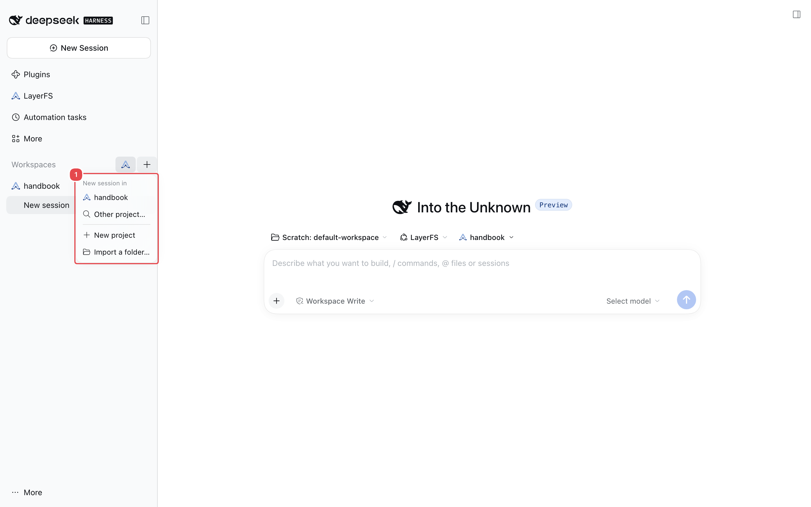

| Menu item | Result | LayerFS call |
|---|---|---|
| **New session in** › *project* (up to 5 recent, runnable) | A new conversation in that project | `sessions.choose`: `project get` |
| **Other project…** | The project dialog's project list ([Pick](#pick)) | — |
| **New project** | The [project dialog](#project-dialog), New project | see there |
| **Import a folder…** | The project dialog, Import a folder | see there |

## New Session project control

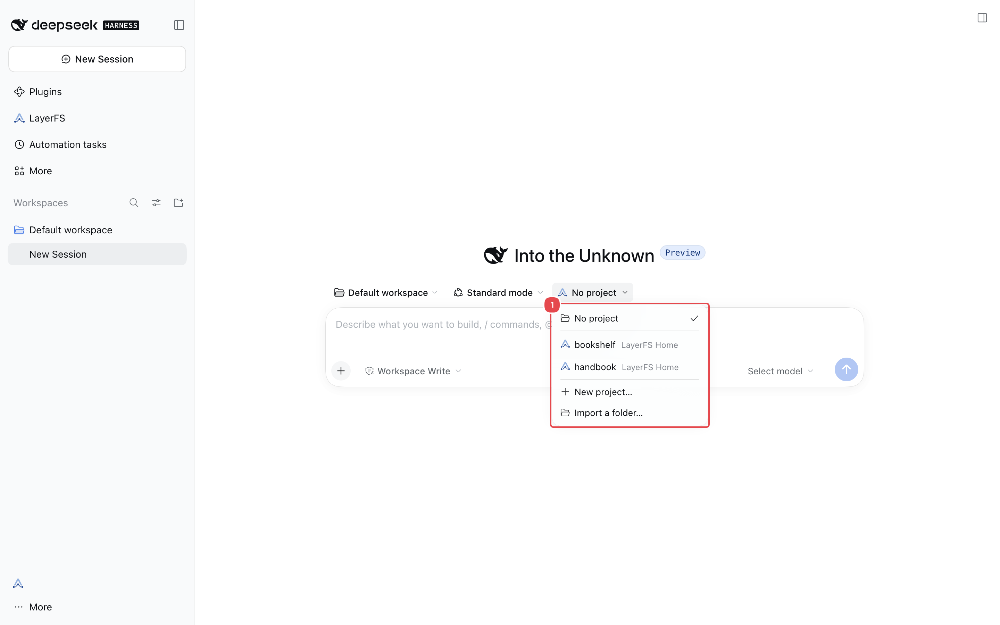

On a blank New Session the row reads **Default workspace · Standard mode · No project**.
Choosing a project makes the session a project session: its files live in the project, and
the folder becomes scratch.

| Component | What it shows | Interaction → result | LayerFS call | States |
|---|---|---|---|---|
| Chip | **No project** or the project; aria **LayerFS project: {project}** | Press → the menu | `session.place` (host state, no call) | — |
| **No project** | Checked when the session has none | Choose → a plain DSH session | — | — |
| Project rows | **bookshelf** and **handbook**, both on **LayerFS Home**: the name and where it runs; a ⚙ **Set up {project}** on hover | Choose → the session joins the project (the agent preset becomes **LayerFS**) · ⚙ → the [project dialog](#project-dialog) | `sessions.choose`: `project get`, and on the first claim `branch list`, `branch fork`; then a background Store sync | **Could not open the project: {message}** |
| **New project…** · **Import a folder…** | — | → the [project dialog](#project-dialog) in that mode | see there | — |
| Import progress | **Importing {name}…** · Counting files, Checking, Sending files, Writing layers, Recording the project, Opening | — | `project init` (polled job) | **Import failed** with **Dismiss** |

A default project that has been removed drops back to **No project**.

### New session in a project

Every **New session** button (here, Home's project rows, the sidebar's +, the project dialog)
does the same: if no folder is selected it makes the **Scratch** DSH workspace, connects it
as the session's folder, then places the session in the project (`sessions.choose`: `project get`,
plus `branch list` and `branch fork` the first time a project is claimed). The conversation opens
with the **LayerFS** agent preset.

## Scratch folder picker

In the project draft pictured below, **Scratch: default-workspace** (1) opens the folder picker.

| Component | What it shows | Interaction → result | LayerFS call | States |
|---|---|---|---|---|
| Chip | **Scratch: {folder}** in place of DSH's folder picker | Press → the menu | `sessions.scratchOptions` (DSH workspaces, no call) | — |
| Workspace folders | DSH's workspaces | Choose → that folder becomes the session's scratch (the agent's working folder) | `sessions.scratch` (no call) | — |
| **Browse local folders…** | — | DSH's folder chooser → the same | `sessions.scratch` (no call) | — |
| **Enter a folder path…** | — | Dialog **Choose scratch folder**: "The selected local folder is scratch for this project session. Its files are not saved into the project." · **Local folder path** · **Select folder** / **Cancel** | `sessions.scratch` (no call) | — |

## Project conversations

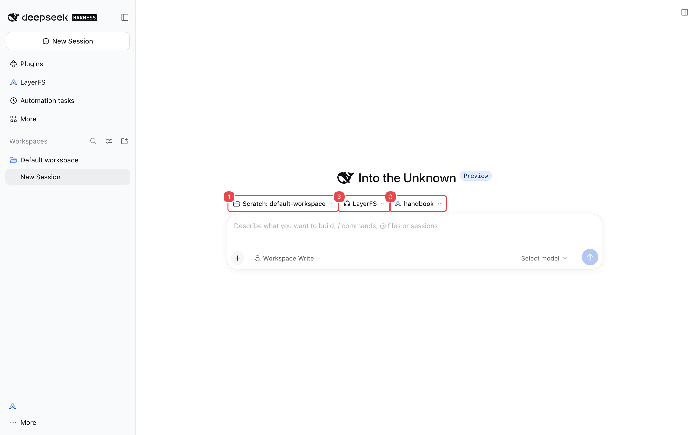

| Component | What it shows | Interaction → result | LayerFS call | States |
|---|---|---|---|---|
| Workspaces list (DSH view) | Project sessions are left out: LayerFS marks each one's row and hides it, so they are listed only under their project in LayerFS view. Its DSH group can look empty. | Switch to LayerFS view to see them | `session.place` per row (host state, no call) | — |
| 1 Scratch folder · 2 Project | **Scratch: default-workspace** and **handbook** | Press either control to open its picker | `sessions.scratchOptions` / `session.place` | — |
| 3 Agent preset | **LayerFS** in the draft controls; its tip: "LayerFS project sessions: everything through bash and the LayerFS CLI ($DSH_LAYERFS_CLI), so a project on any machine works the same way." | — | — | — |
| Tabs | **Trajectory**, **Files**, **History**, **Sandbox**, **Stats** | → [Conversation](conversation.md) | see there | — |

## Project dialog

One dialog in four modes: **New project**, **Import a folder**, the project list (**Projects**)
and a project's own settings. It opens from the sidebar's +, the project control, Home's
**New project** and Add menu, and every ⚙ **Set up {project}**.

### New project

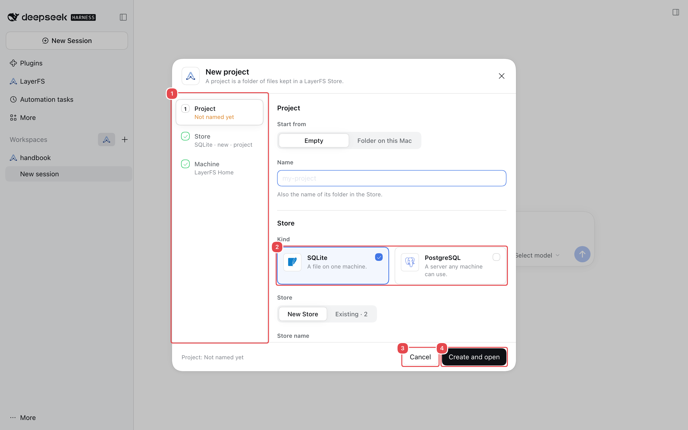

| Component | What it shows | Interaction → result | LayerFS call | States |
|---|---|---|---|---|
| 1 Steps rail | **Project** · **Store** · **Machine**, each with its summary (**Not named yet**, **SQLite · new · project**, **LayerFS Home**) | Press a step → its part | — | number while unfinished, check when set, orange when it needs you |
| Start from | **Empty** · **Folder on this Mac** | **Folder on this Mac** → a Folder field with **Browse…** | — | — |
| Name | **Also the name of its folder in the Store.** / **Saved as {slug}** | Type | — | — |
| Kind | **SQLite** "A file on one machine." · **PostgreSQL** "A server any machine can use." | Choose | — | — |
| Store | **New Store** · **Existing · {n}**; Store name | Choose or type | `GET /api/storage` (read) | — |
| 3 Cancel | — | Closes; nothing is made | — | — |
| 4 Create and open | — | Runs the steps in order: check the folder, make the Store, init the project, place the Store, open a session | `store create`, `project init` (polled job), `store move` (a job, when not on native), `sessions.choose`; folder check `POST /api/project-sources/check` (host only) | progress per step; **Create stopped** with **Edit {part}** on a refusal |

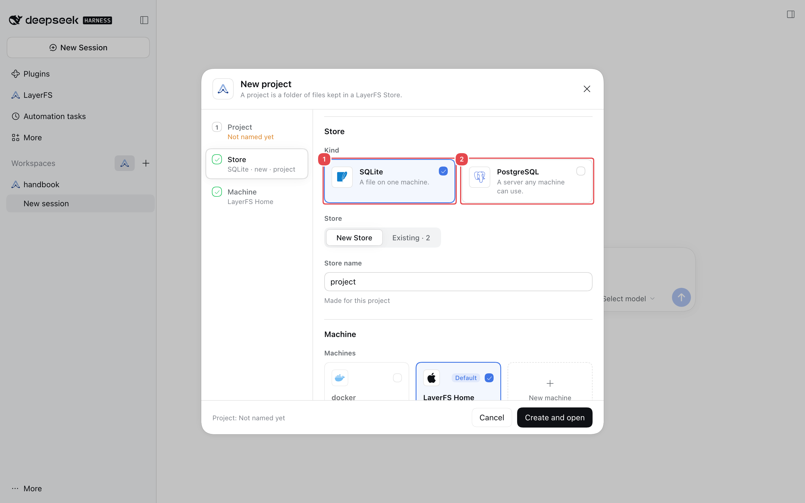
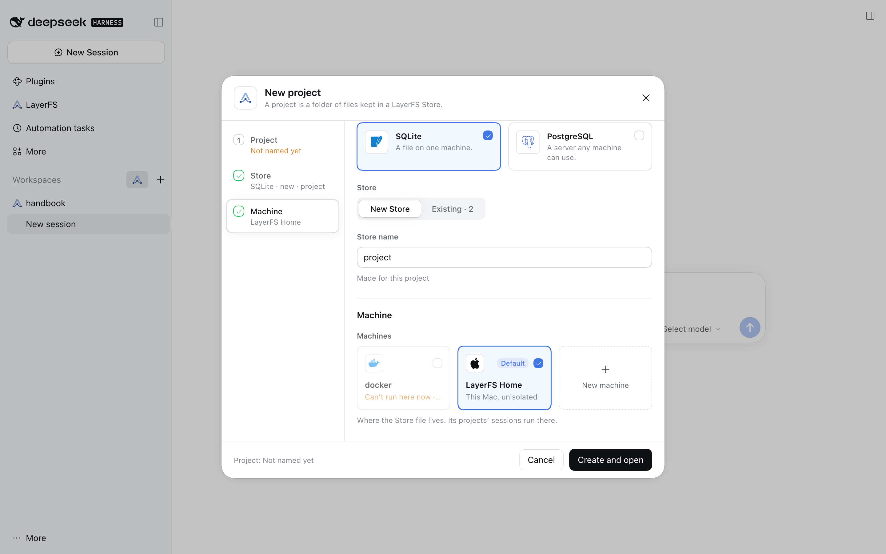

| Component | What it shows | Interaction → result | LayerFS call | States |
|---|---|---|---|---|
| Machines | Tiles: **docker** (Can’t run here now), **LayerFS Home** (This Mac, unisolated, **Default**), **New machine** | Choose where the Store file lives: "Where the Store file lives. Its projects’ sessions run there." · **New machine** → closes the dialog and opens Home › Machines with Add machine | `GET /api/platforms`: `home get` (read) | a stopped machine offers **Start {machine}** first (`machine start`) |

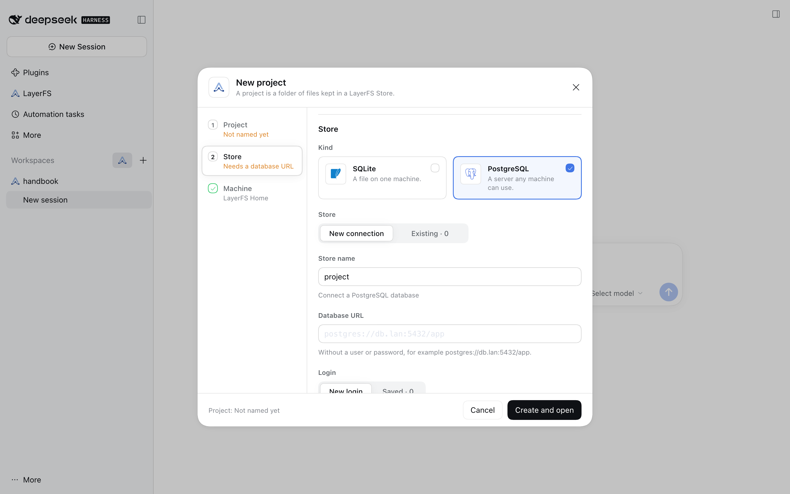

| Component | What it shows | Interaction → result | LayerFS call | States |
|---|---|---|---|---|
| Store | **New connection** · **Existing · {n}** | — | `GET /api/store-auths` (read, host only) | — |
| Database URL | "Without a user or password, for example postgres://db.lan:5432/app." | Type | — | **Needs a database URL** on the rail |
| Login | **New login** · **Saved · {n}**; Login name, User, Password ("Typed once. It goes to LayerFS on stdin and is never shown again.") | Type | `store save-auth`, `store connect`, `store get` on create | — |
| Runs on | The machine its sessions run on (the rail still says **Machine**) | Choose | — | — |

### Import a folder

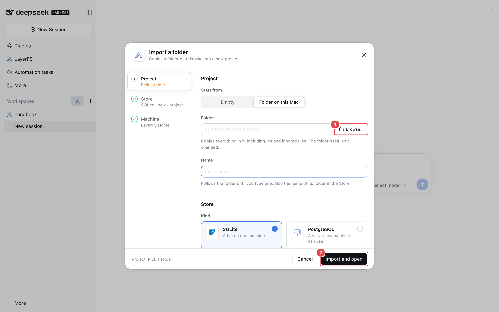

The same steps with **Folder on this Mac** chosen: "Copies everything in it, including .git
and ignored files. The folder itself isn’t changed." The name follows the folder until you type
one.

| Component | What it shows | Interaction → result | LayerFS call | States |
|---|---|---|---|---|
| 1 Browse… | — | DSH's folder chooser → the Folder field | — | — |
| 2 Import and open | — | As **Create and open**, copying the folder in | `store create`, `project init <folder>`, `store move`, `sessions.choose` | **Pick a folder** on the rail until one is set |

### Pick

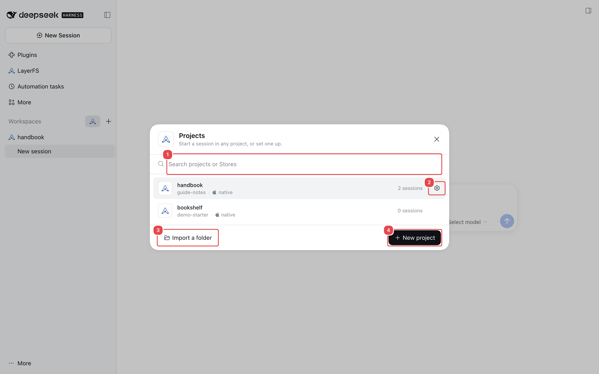

| Component | What it shows | Interaction → result | LayerFS call | States |
|---|---|---|---|---|
| 1 Search | **Search projects or Stores** | Type → filters | — | — |
| Rows | Name, Store · machine, **{n} sessions** | Press → a new session in it | `sessions.choose`: `project get` | a why-word, or **Start {machine}** when it is stopped |
| 2 ⚙ | **Set up {project}** (on hover) | → the project's settings, with a **Projects** back link | — | — |
| 3 Import a folder · 4 New project | — | → that mode | — | — |

### A project's settings

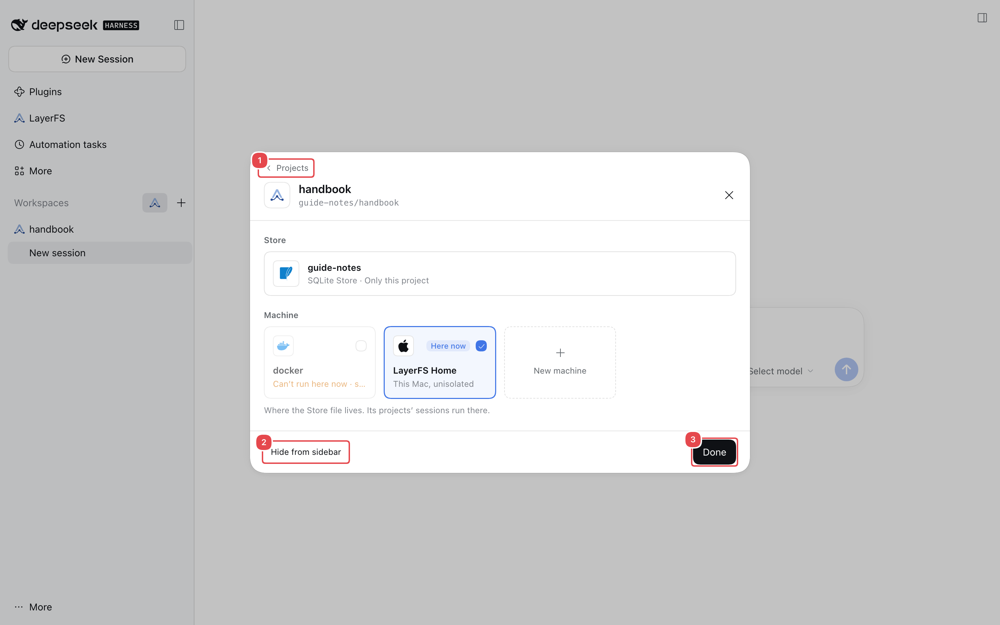

| Component | What it shows | Interaction → result | LayerFS call | States |
|---|---|---|---|---|
| 1 Projects | Back link (when opened from the list) | → the list | — | — |
| Store | **guide-notes** · **SQLite Store · Only this project** (or **Shared with {n} other projects**) | — | `GET /api/storage` (read) | PostgreSQL: **Connected from …** instead of machines |
| Machine | Tiles; **Here now** on the current one | Choose another → **Move to {machine}** | `store move` (a job) | a stopped machine offers **Start {machine}** first |
| 2 Hide from sidebar | — | The project leaves the sidebar's LayerFS view until its next session | — (remembered in this browser) | **Hidden until its next session** |
| 3 Done | — | Closes | — | — |

A project whose Store is gone: "This project’s Store is not in this LayerFS home any more…"
with **Open Home**.

## Set up LayerFS

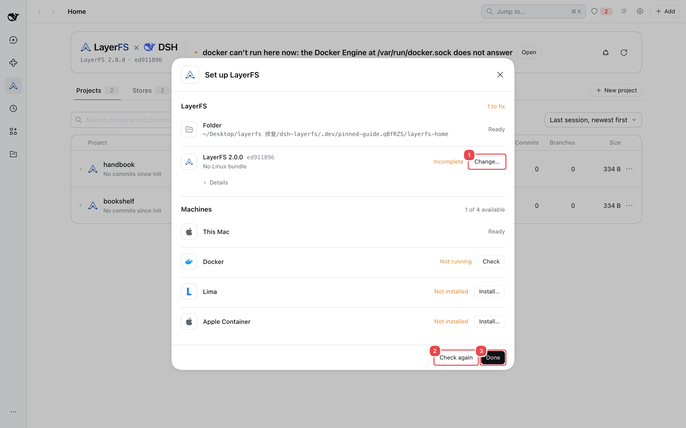

Opens from Home's runtime button and Center’s **Settings**, from the Set up card, and once per page
load on its own when something is missing (unless you chose **Later**). It reads
`setup.status` (`home get`, and `home init` when the folder does not exist yet).

| Component | What it shows | Interaction → result | LayerFS call | States |
|---|---|---|---|---|
| LayerFS | **Ready** or **{n} to fix** | — | — | — |
| Folder | The LayerFS folder's path | A copyable fix line when it cannot be used | `home get` (read) | **Ready**, **Created just now**, **Made by an older LayerFS**, **Not created yet**, **Can’t be read** |
| Runtime | **LayerFS 2.0.0** `ed911896` (Incomplete · No Linux bundle) | 1 **Change…** (or **Choose…**) → the runtime picker · **Details** → its pieces (CLI, Native daemon, Linux bundle, Node SDK, Terminal line) with copy buttons | `--version --json`, `help --json` (read) | **Use this daemon** when the native machine records another daemon: `machine get native`, `machine update native --daemon` |
| Machines | **{n} of {total} available**: This Mac, Docker, Lima, Apple Container | **Install…** / **Set up…** → how-to; **Check** → reads again | `GET /api/machines?fresh=1`: `home get`, `machine get`, `machine list` (read) | **Ready**, **Available**, **Not installed**, **Not running**, **Needs setup**, **Needs the Linux bundle** |
| 2 Check again | — | Reads everything again | as above | — |
| **Later** | Only when something is missing | Closes; the need moves to Home's head card | — (remembered in this browser) | — |
| 3 Done | — | Closes | — | disabled while something is missing |

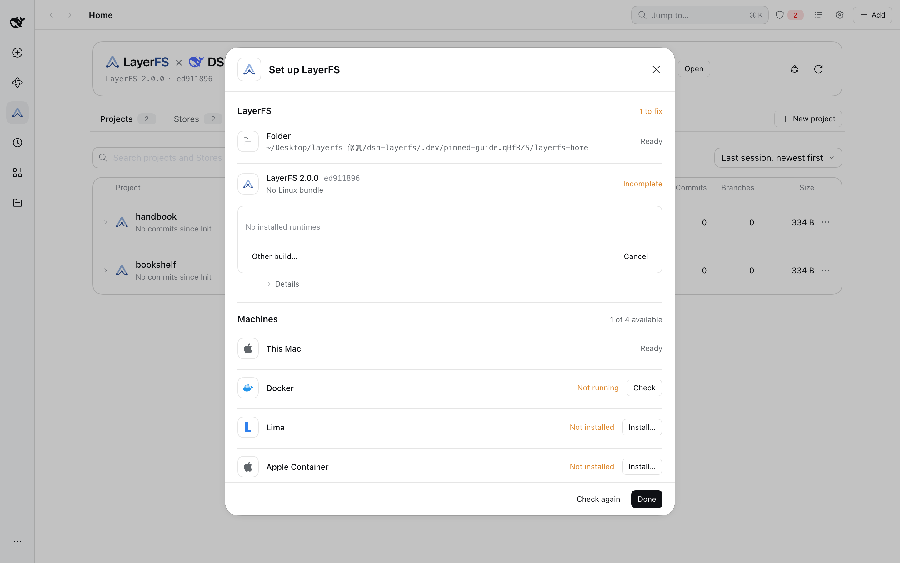

| Component | What it shows | Interaction → result | LayerFS call | States |
|---|---|---|---|---|
| Installed runtimes | One row per installed runtime | **Use** → pins it | `runtime.save`: `--version --json`, `help --json`, `machine update native` | **No installed runtimes** |
| **Other build…** | — | Pick a CLI, daemon and bundle by path | as above | — |
| **Cancel** | — | Closes the picker | — | — |

### Set up card

Shown in Center in place of Home's tabs while
LayerFS is not set up: **LayerFS isn’t set up yet** — "Choose a runtime and check the LayerFS
folder to start using projects and machines." (or **Finish setting up LayerFS**) with
**Set up LayerFS…** → the dialog above.

## Variants

- **DSH view vs LayerFS view** of Workspaces: project sessions are listed only in LayerFS view.
- **SQLite vs PostgreSQL** in the project dialog: PostgreSQL adds a database URL and a login, and
  the Machine step chooses where sessions run, not where a file lives.
- **A stopped machine** turns a project's + into **Start {machine}**, in the sidebar and the
  project list alike.

## Modals opened here

| Modal | Opened by | What it does | LayerFS call | Undo |
|---|---|---|---|---|
| Project dialog | sidebar +, project control, ⚙, Home | New project, Import a folder, Pick, settings | `store create`, `project init`, `store move`, `sessions.choose` | delete the project on Home |
| Set up LayerFS | Home's runtime and Center’s **Settings**, Set up card, on its own | Folder, runtime, machines | `home get`, `machine update native` | choose the old runtime again |
| Choose scratch folder | **Enter a folder path…** | Sets a project session's scratch | — | choose another |

## States and signals

- A project row's why-word (**Stopped**, **Unavailable**, **Machine stopped**) says why + is
  disabled; its tip names the reason, and **Start {machine}** fixes the common case.
- **Could not open the project** on the project control: the project, its Store or its machine
  cannot be reached; open Home to see which.
- **Not archived** under a session line: DSH refused the archive; its tip has DSH's message.

## Where next

[Home](home.md) · [Conversation](conversation.md) · [Project](project.md) · [Machine](machine.md) ·
[Doctor](health.md)

## Source

`src/client/storage/index.tsx` (sidebar row, rail fold) · `src/client/projects/WorkspacesView.tsx`,
`ProjectList.tsx`, `list-locale.ts`, `view-mode.ts`, `hooks.ts`, `recent.ts` ·
`src/client/hero/HeroProject.tsx`, `ScratchPicker.tsx`, `locale.ts` · `src/client/session/index.tsx`,
`session.module.css` · `src/client/projects/setup/ProjectDialog.tsx`, `run.ts`, `model.ts`, `locale.ts` ·
`src/client/setup/SetupDialog.tsx`, `SetupCard.tsx`, `RuntimePicker.tsx`, `store.ts` ·
`src/host/sessions/index.ts` (`sessions.*`, `session.place`, `projects.recent`, `projects.catalog`) ·
`cordis.patch.yml` (the `preset-layerfs` row) · shots: `tools/guide/shots/entry-points.mjs`
