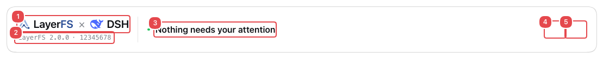

# Presets

> **Where:** `LayerFS › Home ›` **Try a preset** · **Opens from:** the Presets button on Home's [head card](components.md#head-card) · **Source:** see the end

The detail views below the current entry point come from the earlier demo setup.

*Isolated fixture data.*

The Presets dialog builds a sample project library into this LayerFS home, so you can explore
projects, Branches and history without your own data, or stops the home's machines. Building
first wipes the home. Behind one **Build** is a recipe of hundreds of LayerFS CLI calls; **View
script** lists every one before you run it.

| # | Component | What it is |
|---|---|---|
| 1 | Preset list | **Quick start** (no virtual machines) and **Full demos** |
| 2 | A preset | Name, state (**Built**, **Needs a rebuild**, **Not built**, **Building…**) and what it needs and makes (**Docker · No VMs · 552 commits**) |
| 3 | Status line | **Built and verified · *when* · *mode*** with **Open Home**; **The saved library is out of date or was not verified. Rebuild to replace it.**; **Not built yet. Build creates…** |
| 4 | **View script** | Every CLI command the build runs |
| 5 | **Build…** / **Rebuild…** | Wipes the home and builds the library (two confirms) |
| 6 | ⋯ (**More actions**) | **Stop machines…** |
| 7 | A project | Its machine and Store above it, its planned history, its build status (**Failed** here) |
| 8 | # (**View script for *project***) | The script filtered to that project's commands |
| 9 | **Last build** | The last operation: summary, stages, error, **Log**, **Details** |

## Layout

A modal: the title **Try a preset** and *Build a sample library into this LayerFS home to
explore projects, branches and history. Building replaces what the home holds now.*, the
preset list on the left, the selected preset on the right. It opens on the preset the home
holds, else the first quick start. **×** or Escape closes it; a running build carries on.

## Body

The selected preset answers "what would Build make, what does it need, and how did the last
run go". The list and status are the host's own records of its build jobs; they make no
LayerFS call.

| Component | What it shows | Interaction → result | LayerFS call | States |
|---|---|---|---|---|
| Preset list | **Starter** (*One project on SQLite in a Docker container, with 19 branches and 552 commits…*), **Studio** (*8 sample projects on 4 machines…*: Docker, Lima, 41,640 commits) | Click → shows that preset | `GET /api/demo-presets` (no LayerFS call: the host's preset records) | **Loading presets…**; **Could not read the presets** with **Retry** |
| Status line | See #3 | **Open Home** → Center's Home | — | **Checking the environment…** while a plan is read |
| Topology | Per machine (**Docker · Container**, **Native · Local machine**, **demo-build · Lima virtual machine · 2 CPUs · 4G memory · 20G disk**) its Store (**store demo-starter**, **PostgreSQL store demo-services**) and projects: name, description, ***done* / *planned* commits · *n* side branches · *elapsed*** | Click a project → **Selected resource** (below). **#** → its script | — | Project status while building: **Waiting**, **Running**, **Created**, **Failed**, **Stopped** |
| **Selected resource** | The project's description, its error, **Store** (*store* on *machine*), **Planned history** / **Verified history** (commits · merges · main Layers), **Side branches** (**View names**), **CLI progress** (*done* / *total* commands), **Elapsed** | **×** closes it | — | |
| Running build | **Building** / **Stopping machines** with progress | — | the build's calls (see below) | Stages **Checking** · **Resetting** · **Building** · **Verifying** |
| **Last build** | Outcome line, ***n* running · *done* / *total* completed · *n* failed · *time* elapsed**, workspace revisions, the four stages, the error in red | **Log** → the job's log (each CLI call it ran, timed). **Details** → the home, cleanup verified or not, what was kept, forgotten workspaces, deleted sessions | — | **Previous build** when a newer one replaced it; **Last machine stop** after a stop |
| Failure notice | A refusal under the head, with links to sessions in the way (**Open session *id***) | **Dismiss**; **Check operation** when the answer was lost | **Check operation**: `GET /api/demo-presets/requests/:id` (no LayerFS call: the job's record) | **The answer was lost. Check the operation before starting another; it is not submitted again.** |

On this server the Starter build ended partway: **PresetVerificationFailed:** *Preset step
dense.001.integration.publish.1: publication replaced a newer main head*. The stages show it
failed in **Building**; **CLI progress** reads **250 / 679 commands** and the project
**235 / 552 commits**. The library is kept as built so far (Home lists `bookshelf` with 235
commits), and Starter reads **Needs a rebuild**.

### View script

| Component | What it shows | Interaction → result | LayerFS call | States |
|---|---|---|---|---|
| Title | **CLI commands · *preset*** (**Starter**, **Studio**; or ***project* · CLI script** from a project's #) and **Every command the build runs, in order: …** | **×** closes | — | **Loading commands…** |
| Range (1) | ***from*–*to* of *total* commands** (100 a page) | **Previous** / **Next** | `GET /api/demo-presets/:id/script` (reads the home's inventory for the reset part: `machine list`, `store list --detail`, `sandbox list --detail`, `sandbox get` per Sandbox) | **This script preview expired. Close and reopen it…** |
| **Copy this page** (2) | | Press → this page's commands on the clipboard | — | **Copied**; **Copy is unavailable…** |
| **Download full plan** (3) | | Press → the whole plan as a file | — | **Preparing…** |
| Context | Mode (**File commands only** / **File commands and sandbox workspaces**), the LayerFS home, the CLI pool's limits, the ordering rule (`<commit:step-key>` resolves to the exact commit a step returned) | — | — | **Cleanup targets are discovered when Build starts.** |
| Phases (4) | **Reset environment**, **Build preset**, **Verify result**: numbered commands with notes, **Branch lane**, **Shell command / exec input**, **Step and dependencies**, **File content / standard input** | Open a disclosure | — | **No commands for this resource in the current plan.** |
| Filter | From a project's #: ***kind*: *name*** | **Show all commands** / **Show related commands** | — | |

For Starter the script is 765 commands: the reset (`machine list`, `store list`, `sandbox
list`, then `sandbox remove` and `store remove` for what the home holds now), then `store
create`, `project init`, and per commit `file write` with `branch fork`, `branch merge` and
`branch publish` on the side Branches, then the verification reads.

## Variants

- **Starter** needs Docker and a matching Linux bundle, and takes under a minute.
- **Studio** also needs Lima: it creates two Lima VMs (2 CPU, 4 GB each) and PostgreSQL
  Stores, 8 projects and about 41,640 commits.
- **Also commit through sandbox workspaces** (the build's mixed mode): about 30% of commits
  run a shell command in a Sandbox Workspace and commit it (`sandbox create`, `workspace
  mount`, `workspace exec`, `workspace commit`); needs the native daemon.
- **Stop machines…** is off until the home has machines (**This LayerFS home has no machines
  yet.**).

## Modals opened here

| Modal | Opened by | What it does | LayerFS call | Undo |
|---|---|---|---|---|
| **Build *preset*?** / **Rebuild *preset*?**, step 1 | **Build…** / **Rebuild…** | *Choose how the sample history is written.* **Also commit through sandbox workspaces**, **Needs**, and *Building first deletes every store, project, sandbox and custom machine in this LayerFS home.* **Cancel** · **Continue** → the environment is checked | **Continue**: `GET …/build-plan` (reads: `home get --with platforms`, `machine list`, `store list`, `sandbox list`, `sandbox get` per Sandbox; nothing is removed) | Cancel |
| Same, step 2 (plan review) | **Continue** | *This LayerFS home is wiped, then the library is built.* What goes: every Store with its projects and the session logs kept in them, Sandboxes, Workspaces, custom machines, DSH project workspaces dropped, project sessions deleted, machines it will start; **What will be reset** lists each. **Back** · **Wipe and build** | `POST …/environment-reset`: the reset (`machine start`, `workspace unmount --discard`, `sandbox remove`, `store remove`, `store disconnect`, `machine remove`, `machine stop docker`), then the build recipe (`store create`, `project init`, `file write`, `branch fork`, `branch merge`, `branch publish`…), then verification (`branch list`, `commit list`, `file read`…) | None: the home's previous contents are gone |
| **Stop machines and delete project sessions?** | ⋯ › **Stop machines…** | *Stop the machines and delete this home’s LayerFS project sessions. Stores, projects and their saved history stay.* **Machines to close** lists them. **Cancel** · **Stop machines** | Opening: `GET …/environment-plan` (read: `machine list`). **Stop machines**: `machine stop <m> --force` per machine, then the home's project sessions are deleted | Start the machines again; deleted sessions do not come back |
| Script drawer | **View script**, a project's # | Above | reads only | — |

The confirm button of each plan holds for a moment after the plan shows, so a double click
cannot run it. Step 2 was not opened for this guide: its **Continue** prepares the home.

## States and signals

- **Needs a rebuild**: the saved library is out of date, or its last build did not verify
  (as here). **Rebuild…** replaces it.
- **Failed** on a project, red error under **Last build**: the step and LayerFS's reason;
  the **Log** shows the calls up to it, and [Logs](logs.md) has each one.
- **Wait for the preset operation to finish…**: a build or stop is running; the buttons are
  off until it ends. Doctor checks and Storage jobs must also finish before a build starts.
- **Open session *id*** under a failure: a project session in the way.

## Where next

- [The guide's map](README.md): where the Stores, projects and machines a build makes are shown.
- [Logs](logs.md): every call a build ran.
- [Doctor](health.md): check the machines and Stores afterwards.

## Source

`src/client/presets/`: `PresetsDialog.tsx`, `PresetsSection.tsx` (status, Build/Stop
confirms, the last operation), `Topology.tsx`, `ScriptDrawer.tsx`, `Progress.tsx`,
`locale.ts`. Host: `src/host/presets/manager.ts` (`/api/demo-presets…`), `build.js`,
`runner.js`, `environment-reset.js`, `machine-stop.js`, `inventory.js`, `recipe/`.
