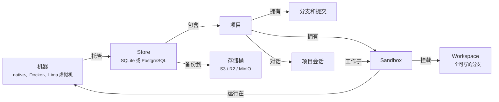
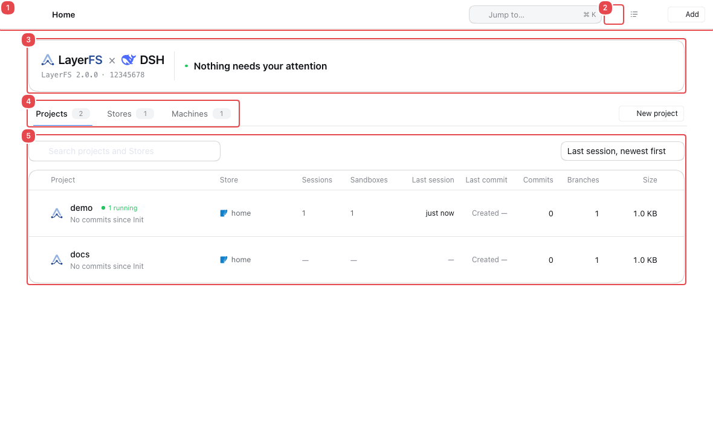
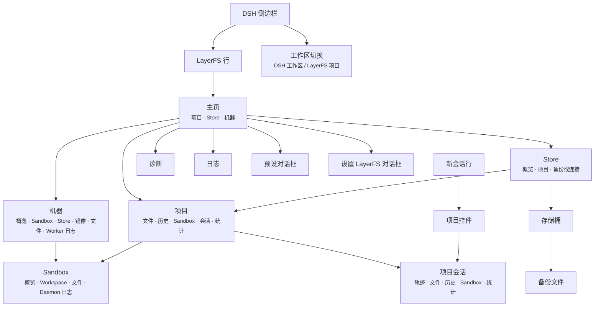

<!-- source: de7961d62f7f -->
# DSH 中的 LayerFS：界面指南

> 标有「隔离测试数据」的截图来自当前版本的实际组件，使用独立浏览器和示例数据。其余截图来自早期演示环境。

dsh-layerfs 把 LayerFS 加进了 DeepSeek Harness（DSH）网页应用。LayerFS 把项目文件放在 Store 里，每一次改动都记录成某个分支上的一个提交。Agent 在你机器上的 Sandbox 里干活。DSH 还是原来那个聊天应用，LayerFS 只是多加了一个侧边栏行、一组对话标签页，以及窗口周围的几个控件。

这份指南逐页介绍界面。每一页都会讲：这一页是做什么的，每个组件显示什么，每个操作会发生什么，以及背后运行的是哪条 LayerFS CLI 调用。

## 怎么读这份指南

- **位置用路径表示**，比如 `LayerFS › 主页 › Store › demo-starter › 备份`。DSH 没有 URL，所以靠路径找到一个地方。菜单写成 `⋯ › 备份到…` 这样。
- **截图带编号。** 每个编号对应图片下方表格中的一行。
- **每个操作都写明它的 LayerFS 调用**，放在“LayerFS 调用”一列里，比如 `store move`。“(读取)”标出视图为了绘制自己而读取的内容，`—` 表示没有调用（结果来自主机内存，或来自你的浏览器记住的内容）。[cli-map.md](cli-map.md) 把所有操作列在一处。
- **用词以界面为准。** 按钮用 **粗体**，先写中文界面上的文字，括号里附英文，因为截图是英文界面。
- 早期截图来自一套演示环境：入门（Starter）预设的 Store `demo-starter`（项目 `bookshelf`，235 个提交）、一个小 Store `guide-notes`（项目 `handbook`，含一个项目对话），以及一个存储桶 `guide-backups`。

## 两种模式：DSH 会话和项目会话

**DSH 会话**属于某个 DSH 工作区文件夹，和没有 LayerFS 时一样。
**项目会话**属于某个 LayerFS 项目。它的文件放在项目的 Store 里，你选的本地文件夹只是草稿目录。项目会话显示在屏幕上时，对话的标签页行会多出 LayerFS 的标签页：

| # | 标签页 | 显示内容 | 页面 |
|---|---|---|---|
| 1 | 轨迹（Trajectory） | 每次工具调用、它发起的 LayerFS 调用，以及留下的版本。取代 DSH 自带的轨迹标签页。 | [对话](conversation.md#trajectory) |
| 2 | 文件（Files） | 会话分支上的项目文件，可以看任意一个提交 | [对话](conversation.md#files) |
| 3 | 历史（History） | 项目的分支和提交，以图的形式显示 | [对话](conversation.md#history) |
| 4 | Sandbox | 会话运行所在的 Sandbox，实时显示 | [对话](conversation.md#sandbox) |
| 5 | 统计（Stats） | 会话的 LayerFS 数据 | [对话](conversation.md#stats) |

切换到 DSH 会话，这些标签页就会消失，DSH 自己的标签页回来。

## 各个概念

| 术语 | 含义 |
|---|---|
| 机器 | LayerFS 运行的地方。**native** 就是这台电脑。Docker 和 Lima 机器是 LayerFS 负责启动和停止的 worker。 |
| Store | 存放项目的数据库。SQLite Store 位于某一台机器上，可以在机器之间推送、拉回或移动。PostgreSQL Store 位于数据库服务器上。 |
| 项目 | 一棵文件树，有自己的分支和提交。项目存放在 Store 里。 |
| 分支、提交 | 每次保存都是一个提交。`main` 是项目的主线，侧分支承载进行中的工作。 |
| Sandbox | 机器上一个隔离的地方，项目的命令在这里运行。它属于项目。 |
| Workspace | 以可写方式挂载在 Sandbox 里的一个分支。命令在这里运行，**提交…**（Commit…）保存改动。 |
| 存储桶 | 存放 SQLite Store 备份的对象存储。 |
| 会话 | 一个 DSH 对话。项目会话的文件和命令都经过 LayerFS。 |

## 地图

LayerFS 在 DSH 侧边栏里只有一行。它打开 **Center**：一个页面一次显示一个地方，顶部有自己的导航栏。Center 从 **主页**（Home）开始。

*隔离测试数据。*

| # | 组件 | 说明 | 页面 |
|---|---|---|---|
| 1 | 导航栏 | 后退、前进、面包屑、跳转和添加 | [导航栏](components.md#nav-bar) |
| 2 | 诊断 | 打开诊断页查看检查结果。按钮上会显示发现数量 | [诊断](health.md) |
| 3 | 顶部卡片 | 运行时、最紧急的提示、预设和刷新 | [主页](home.md) |
| 4 | 标签页 | 项目、Store、机器 | [主页](home.md) |
| 5 | 项目表 | 项目及其 Store、会话和 Sandbox | [项目](home.md#projects) |

可选的标签页只在适用时出现。镜像、文件和日志标签页取决于机器和固定的 CLI；Store 显示备份还是连接，取决于它是 SQLite 还是 PostgreSQL。每个页面在这个浏览器里都会重新打开你上次停留的标签页。

## 页面

| 页面 | 打开它来…… | 位置 |
|---|---|---|
| [入口](entry-points.md) | 在 DSH 窗口里找到 LayerFS：侧边栏行、工作区切换、新会话的项目控件、设置对话框和项目对话框 | DSH 窗口 |
| [主页](home.md) | 一次看到全部：项目、Store、机器，以及需要你处理的事 | `LayerFS › 主页` |
| [Store](store.md) | 照看一个 Store：大小、项目、备份或连接，以及在机器之间移动 | `LayerFS › 主页 › Store › <store>` |
| [存储桶](bucket.md) | 查看存储桶里的备份文件，并恢复其中一个 | `LayerFS › 主页 › Store › <bucket>` |
| [项目](project.md) | 浏览项目的文件和历史、它的 Sandbox、会话和数据 | `LayerFS › … › <store> › <project>` |
| [机器](machine.md) | 管理一台机器：电源、就绪情况、Sandbox、Store、镜像、文件和日志 | `LayerFS › 主页 › 机器 › <machine>` |
| [Sandbox](sandbox.md) | 在 Sandbox 里工作：Workspace、终端、文件、Daemon 日志 | `LayerFS › … › <machine> › <sandbox>` |
| [对话](conversation.md) | 跟进一个项目会话：轨迹、文件、历史、Sandbox 和数据 | 一个项目会话 |
| [诊断](health.md) | 检查 LayerFS 及其运行的一切是否健康，并修复出问题的地方 | `LayerFS › 诊断` |
| [日志](logs.md) | 查看应用发起的每条 LayerFS 调用，以及原因 | `LayerFS › 日志` |
| [预设](presets.md) | 构建演示项目库，或重置这个 LayerFS 主目录 | `LayerFS › 主页 ›` 预设 |
| [组件](components.md) | 一次读懂多个页面共用的部件 | — |

## 我想……

| 我想…… | 去这里 | 背后的调用 |
|---|---|---|
| 第一次设置 LayerFS，或更换它的运行时或文件夹 | [入口 › 设置 LayerFS](entry-points.md#set-up-layerfs) | `home get`、`home init`、`machine update native` |
| 在项目里开始一个对话 | [入口 › 新会话项目控件](entry-points.md#new-session-project-control)，或项目的[会话](project.md#sessions)标签页 | `project get`，然后用 `branch fork` 建会话分支 |
| 创建项目，或把文件夹导入成项目 | [入口 › 项目对话框](entry-points.md#project-dialog) | `store create`、`project init`、`store move` |
| 查看项目在任意提交时的样子 | [项目 › 文件](project.md#files)和[历史](project.md#history) | `file list`、`file read`、`commit list`、`commit diff` |
| 逐条跟进 agent 做了什么 | [对话 › 轨迹](conversation.md#trajectory) | —（会话自己的日志） |
| 备份或恢复 Store | [Store › 备份](store.md#backups-sqlite)、[存储桶](bucket.md) | `backup create`、`backup restore` |
| 把 Store 移到另一台机器 | [Store 菜单](components.md#store-menu) | `store move`（两次，经由 native） |
| 连接 PostgreSQL 数据库 | [Store › 连接](store.md#connection-postgresql) | `store save-auth`、`store connect`、`store doctor` |
| 启动、停止或修复机器 | [机器](machine.md)、[机器菜单](components.md#machine-menu) | `machine start`、`machine stop` |
| 创建 Sandbox 并在里面运行命令 | [机器 › Sandbox](machine.md#sandboxes)、[Sandbox › Workspace](sandbox.md#workspaces) | `sandbox create`、`workspace mount`、`workspace exec`、`workspace commit` |
| 释放机器上的磁盘空间 | [机器 › 概览 › 磁盘空间](machine.md#disk-space-dialog)、[镜像](machine.md#images) | `machine stats --with space`、`machine prune` |
| 找出问题并修复 | [诊断](health.md)、[待处理提示](components.md#needs-you-notices) | `<family> doctor`，然后执行 LayerFS 给出的修复 |
| 看一次点击运行了哪条 LayerFS 调用 | [日志](logs.md) | —（读取调用日志） |
| 用演示数据试用 LayerFS | [预设](presets.md) | 一份包含许多调用的配方 |

## 每个按钮背后

每次点击都会调用 dsh-layerfs 主机上的一个路由，路由再以 `layerfs <family> <call>` 的形式运行固定版本的 `layerfs` CLI。

- [cli-map.md](cli-map.md) 列出每个操作、它调用的路由，以及背后的 LayerFS 调用。
- [cli-routes.md](../cli-routes.md) 是完整的路由表，由主机代码生成。
- [日志](logs.md) 显示一次点击实际运行的调用，并标注它所属的会话。可以用它来核对。

## 保持指南更新

[CONTRIBUTING.md](CONTRIBUTING.md) 里有页面模板、LayerFS 调用列的规则，以及重新截图和重新生成路由表的命令。
