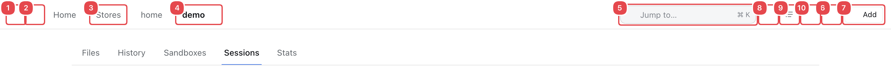
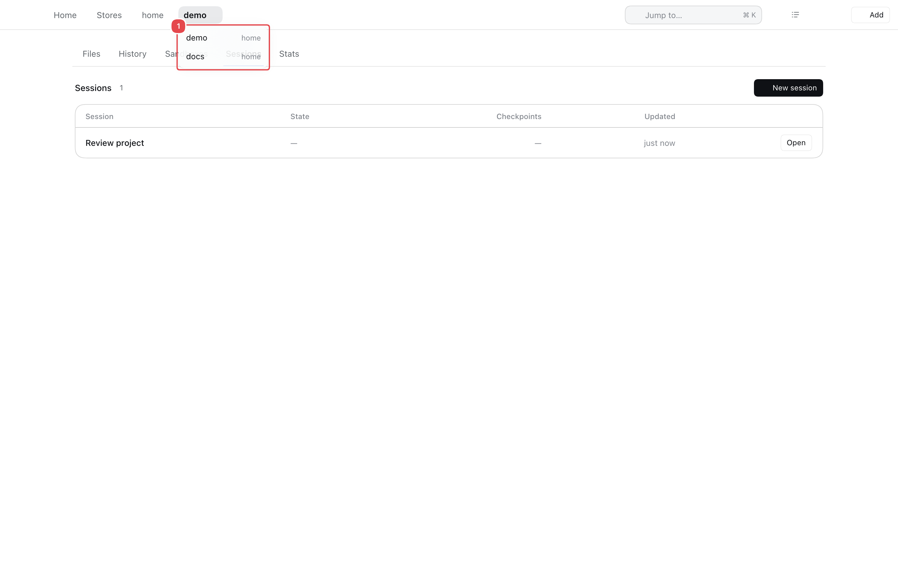
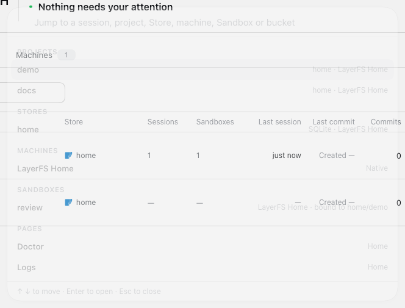
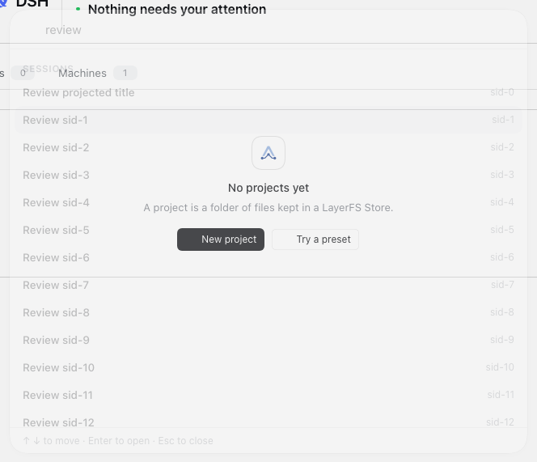
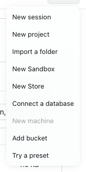
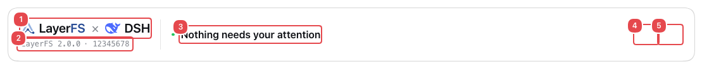

<!-- source: 09ed2fb907fc -->
# 组件

> 标有「隔离测试数据」的截图来自当前版本的实际组件，使用独立浏览器和示例数据。其余截图来自早期演示环境。

下面这些部件会出现在不止一个页面上，所以每个只在这里讲一次。各页面的指南
会链接到下面的小节，而不是重复说明。

## 导航栏

横在每个 Center 页面最上方的一条。它告诉你现在在哪儿，带你去别处，
还能新建东西。

当前主页导航栏，标号 1–3 分别是诊断、日志和设置。

*隔离测试数据。*

以下早期多 Store 示例显示面包屑切换器。

| # | 组件 | 显示内容 | 操作 → 结果 | LayerFS 调用 | 状态 |
|---|---|---|---|---|---|
| 1, 2 | 后退 · 前进 | 箭头 | 按下 → 上一个或下一个 Center 页面（最多保留 50 个） | —（本地历史） | 到头时不可用 |
| 3 | 面包屑 | `主页 › Store › demo-starter › bookshelf` | 按一个面包屑 → 去那一页 | — | 最后一个面包屑就是你所在的页面 |
| 4 | 面包屑切换 | 面包屑后面的一个箭头（**从 {name} 切换**，Switch from {name}），或当前面包屑上的一个小三角，在那个位置有同级项时出现 | 按下 → 列出它的同级项（每个 Store、这个 Store 里的每个项目……），带上种类和位置 → 打开其中一个 | —（使用 Center 已读到的内容） | 只有同级项多于一个时才出现 |
| | 传输 | **{n} 个传输**（{n} transfers），带百分比和进度条，在迁移、备份或恢复进行时出现 | 按下 → 那个 Store 的页面（只有一个任务时），或一个列出它们的菜单（有多个时） | —（Center 已在跟踪的任务） | 没有任务运行时隐藏 |
| 5 | **跳转到…**（Jump to…） | 一个带 **⌘K**（**Ctrl+K**）的输入框 | 点它或按快捷键 → **跳转到会话、项目、Store、机器、Sandbox 或存储桶**（Jump to a session, project, Store, machine, Sandbox or bucket），按项目、Store、机器、Sandbox、存储桶、页面和会话分组。会话结果显示标题与 ID，选中后打开对话。**↑ ↓ 移动 · Enter 打开 · Esc 关闭**（↑ ↓ to move · Enter to open · Esc to close） | —（在 Center 已读到的内容中搜索） | **没有与“{q}”匹配的项**（Nothing matches “{q}”）。最多 60 条结果。有对话框打开时快捷键不可用 |
| 6 | 刷新 | 一个环形箭头，除主页外每个页面都有 | 按下 → 页面重新读取它的数据 | 页面自己的读取 | 读取时显示一个圆点 |
| 7 | **+ 添加**（+ Add） | **新建会话**（New session）、**新建项目**（New project）、**导入文件夹**（Import a folder）、**新建 Sandbox**（New Sandbox）、**新建 Store**（New Store，从机器页打开时预选那台机器）、**连接数据库**（Connect a database）、**新建机器**（New machine）、**添加存储桶**（Add bucket）、**试用预设**（Try a preset） | 打开对应的对话框 | `store create` · `store save-auth`、`store connect`、`store get` · `machine create` · `backup connect` · 预设自己的脚本。新建项目：`store create`、`project init`、`store move` | 新建机器和新建 Sandbox 不可用时仍显示，并说明原因 |
| | 诊断 | 带计数的盾牌图标，提示为 **诊断：{n} 项发现**（Doctor: {n} findings） | 按下 → `LayerFS › 诊断`（[诊断](health.md)） | 读取主机保存的结果。如果还没有结果，打开主页时会运行一次 `home doctor` | 有错误时计数为红色，有警告时为橙色 |
| | 日志 | 列表图标 | 按下 → `LayerFS › 日志`（[日志](logs.md)） | — | |
| | 设置 | 齿轮图标 | 按下 → 设置 LayerFS | `home get`（读取） | |

*隔离测试数据。*

*隔离测试数据。*

*隔离测试数据。*

## 顶部卡片

主页的最上方。它告诉你这是哪个 LayerFS，以及有没有需要你处理的事。

*隔离测试数据。*

| # | 组件 | 显示内容 | 操作 → 结果 | LayerFS 调用 | 状态 |
|---|---|---|---|---|---|
| 1 | LayerFS × DSH | LayerFS × DSH 标志 | — | — | |
| 2 | 运行时 | `LayerFS 2.0.0 · 12345678`（**显示固定的运行时**，Show the pinned runtime） | 按下 → 打开[设置 LayerFS](entry-points.md#set-up-layerfs) | `--version --json` (读取) | **LayerFS 不可用**（LayerFS unavailable）、**正在读取 LayerFS…**（Reading LayerFS…） |
| 3 | 标题行 | 一个圆点和最紧急的那件事，或者绿色的 **没有需要处理的事项**（Nothing needs your attention） | 那件事的按钮（见[待处理提示](#needs-you-notices)） | 按钮的调用 | 有好几件时显示 **还有 {n} 个**（+{n} more） |
| 4 | 试用预设 | 预设图标 | 按下 → [预设](presets.md) | — | |
| 5 | 刷新 | 一个环形箭头。提示：**重新读取 Store、机器和存储桶，并重新运行 Home 检查 · Checked {ago}**（Read the Stores, machines and buckets again, and re-run the home checks · Checked {ago}） | 按下 → 重新读取 Store、机器和存储桶，并重新运行主目录检查 | `home get`、`project list`、`store auths`、`store list` (读取)，然后 `home doctor` | 检查运行期间不可用 |

按 **还有 {n} 个**（+{n} more）可在卡片下方展开或收起其余待处理事项及对应的修复按钮。被拒绝的操作显示在卡片下方，可按 **关闭**（Dismiss）收起。

## 待处理提示

顶部卡片的标题行和它的 **还有 {n} 个**（+{n} more）列表里放的东西，最紧急的排在前面。每条
提示都会点名是哪一项，用 LayerFS 的原话说明原因（在它的提示里），并给出修复。
双击也只算按一次。如果修复被拒绝，拒绝信息会显示在顶部卡片下方。

| 组件 | 级别 | 操作 → 结果 | LayerFS 调用 | 状态 |
|---|---|---|---|---|
| **完成 LayerFS 设置**（Finish setting up LayerFS，在你选了 **稍后**，Later，之后出现） | 警告 | **设置 LayerFS…**（Set up LayerFS…） → 打开对话框 | `home get` | 设置完成后消失 |
| 失败的任务：**{what} {place} 在{phase}时失败**（{what} {place} failed while {phase}）、**已中断 · 最终结果不可用**（Interrupted · final result unavailable）、**结果未知 · 请检查 Store**（Outcome unknown · inspect the Store） | 危险 | [修复按钮](#fix-buttons)（**启动 {name}**，Start {name}；**重启 {name}**，Restart {name}；**压缩 {name}**，Compact {name}；**保存登录…**，Save a login…；**重新连接…**，Connect again…；**运行 {n} 步修复…**，Run the {n}-step fix…），或 **打开 {name}**（Open {name}，存放该 Store 的 Sandbox），或 **重试**（Retry）。**关闭**（Dismiss） | 修复的调用（例如 `machine start`）。**重试** 会重复这个任务（`store move` 等） | 之后成功一次、Store 被移除或按了关闭后消失 |
| **{kind} 现在无法在此运行：{reason}**（{kind} can’t run here now: {reason}） | 警告 | **打开**（Open） → 这台机器 | — | 平台可用后消失 |
| **{machine} 的 worker 无响应[，{stores} 无法打开]**（{machine}'s worker is not answering[, so {stores} cannot open]） | 危险 | **打开**（Open）。**停止 {machine}**（Stop {machine}） → **确认：停止 {machine}**（Confirm: stop {machine}，关闭 {machine} 的虚拟机并记录为已停止） | `machine stop` | worker 有响应后消失 |
| **{machine} 的虚拟机已不存在[，{stores} 无法打开]**（{machine}’s VM is gone[, so {stores} cannot open]） | 危险 | 修复，或 **打开**（Open） | 修复的调用 | |
| **{machine} 的记录已过时…**（{machine}’s record is out of date…） | 危险 | **打开**（Open） | — | 记录更新后消失 |
| **{machine} 需要处理**（{machine} needs you） | 危险 | **打开**（Open） | — | |
| **{store} 不可用**（{store} is down） / **无法连接**（is unreachable） / **需要更新**（needs its update） / **需要登录信息**（needs its login） | 危险 | 修复，或 **打开**（Open） → 这个 Store | 修复的调用（`store update`、`store save-auth` 等） | Store 就绪后消失 |
| **{machine} 已停止，存放着 {stores}**（{machine} is stopped and holds {stores}）：机器运行之前，它的项目都打不开 | 警告 | **打开**（Open） | — | 机器运行后消失 |

悬停在圆点上会显示 **故障**（Problem）、**警告**（Warning）或 **提示**（Note）。诊断发现的问题只计在
诊断按钮上。没有备份的 Store 不算待处理事项。这些提示来自 Center 已经读到的
Store、机器和平台信息（`home get`、`machine get`、`machine list`、`store list`，都是读取）。

## 文件视图

项目已保存的文件，只读，显示的是某个分支最新的保存，或某个已保存的 ID。
它出现在[项目页的文件标签页](project.md#files)上，也作为项目会话的
[文件标签页](conversation.md#files)出现，在那里默认打开会话的分支。
文件是从 LayerFS 读取的，从不读 Sandbox，所以还没提交的改动不会显示在这里。

| 组件 | 显示内容 | 操作 → 结果 | LayerFS 调用 | 状态 |
|---|---|---|---|---|
| 分支选择器 | 当前显示的分支。`main` 在 **已发布**（Published）下面，其他分支在 **分支**（Branches）下面，各带分支头的短 ID。会话分支显示为 **会话 `<id>`**（Session `<id>`）（· **第 `<n>` 次恢复**，restore `<n>`）。内部的 `dsh.project.*` / `dsh.session.*` 分支会被隐藏。 | 选一个分支 → 按它的分支头重新读取文件树和已打开的文件。**加载更多分支**（Load more branches） → 再加载 100 个 | `branch list`、`branch get main` (读取；主机会把分支列表保留几秒) | 列表加载期间，按名称打开的分支会立刻显示它的文件树 |
| 保存行 | **已保存 `<id>`**（Saved `<id>`）：屏幕上的这个版本 | **查看最新版本**（Show latest，在 **在此提交中打开**，Open at this commit，之后出现） → 回到分支头 | — | |
| **在已展开的文件夹中查找**（Find in opened folders） | 筛选已经读到的条目 | 输入即可筛选。**Escape** 清空 | — | **已展开的文件夹中没有匹配的文件。**（No file in the opened folders matches.） |
| 文件夹树 | 先文件夹后文件，按名称排序。打开文件夹时才读取它。键盘：方向键、Home/End、输入首字母跳转、Enter | 打开文件夹。在标签页中打开文件 | 按保存的 ID 运行 `file list` (读取；每页 1000 条) | **读取中…**（Reading…）、**空文件夹**（Empty folder）、**无法读取此文件夹**（This folder could not be read）、**显示更多条目**（Show more entries） |
| 打开的文件 | 每个文件一个标签页。第一次访问时会打开 README | 选择一个标签页。**×** 关闭它 | — | 一个都没打开时显示 **只读文件**（Read-only files）和 **从文件树中打开文件**（Open a file from the tree） |
| **代码 · 逐行追溯 · 历史**（Code · Blame · History） | 文件的显示方式。选择会沿用到其他文件 | 切换 | — | |
| 代码 | 带行号和语法高亮的文本，带 **自动换行**（Wrap lines）和 **复制**（Copy） | **显示更多行**（Show more lines） → 再显示 1000 行 | `file stat`、`file read` (读取) | **显示第 1–N 行。**（Showing lines 1–N.）、**二进制文件 · `<size>`**（Binary file · `<size>`）、**所选的已保存版本中不存在此路径。**（This path is absent at the selected saved version.）、**一行过长，已被截断。**（A long line was clipped.） |
| 逐行追溯 | 按最后写入它们的版本分组的行：提交说明、短 ID、时间、**from `<branch>`**。最新的一组会被标出 | 点一组 → 切到历史并选中那个版本。**显示更多行**（Show more lines） | `file read`、`file blame`（同一范围），时间用 `file history` (读取) | **正在读取每行的来源…**（Reading who wrote each line…）、**未知版本**（Unknown version）、**部分结果为近似值**（Part of this answer is approximate） |
| 历史（单个文件） | 改过这个文件的版本，从新到旧，标有 **新增**（Added） / **删除**（Removed） | 选一个版本 → 看它的差异。**包含其他分支**（Include other branches）。**对比**（Compare with:）：**上一版本**（Previous version）或列表中的任一版本。**加载更早的版本**（Load earlier versions） | `file history` (读取；每页 50 条)、`commit diff --path --with patch` (读取) | **此文件没有已保存的版本**（No saved versions of this file）、**此版本添加了该文件。**（This version added the file.）、**查询提前结束…**（The search stopped early…）、**仅元数据有变化**（Only metadata changed）、**内容没有变化**（No content changes）、**二进制比较 · …**（Binary comparison · …） |

LayerFS 拒绝读取时，视图会显示拒绝的关键词，并把 LayerFS 的原话放在提示里，
再加上 **重试**（Retry）或一个修复（见[修复按钮](#fix-buttons)）：例如
**Broken · no saved login** 或 **Blocked · `<machine>` broken**。刷新会原地重新读取已展开的
文件夹，屏幕上的内容保持不动。切换到另一个分支或已保存的 ID 会让文件树从头开始。

## 历史视图

把一个项目的全部历史画成一棵树。main 的 Layer（`L1`、`L2`……）沿中线排开，
其他每个分支在上方或下方各有一条泳道，每个检查点是一片叶子，按保存顺序排列。
每个分支族有自己的颜色。圆环表示合并，虚线表示发布到 main，灰色泳道表示从未进入 main。
这棵树出现在[项目页的历史标签页](project.md#history)上，也作为项目会话的
[历史标签页](conversation.md#history)出现。缩放、选中项和折叠的分支在 DSH 打开期间按项目保留。

| 组件 | 显示内容 | 操作 → 结果 | LayerFS 调用 | 状态 |
|---|---|---|---|---|
| 树 | 坐标轴 `#n · time`、Layer、泳道、叶子、合并和发布 | 悬停 → 一个提示（分支、`#n`、时间、ID、提交说明）。点一片叶子或一个 Layer → 选中它并显示详情。拖动平移，滚轮缩放，←/→ 沿选中的分支走，+ − 0 | `branch list`，每个分支一次 `commit list` (读取) | 选中的那条线高亮，其余变暗 |
| 分支名标签 | 分支头处的分支名 | 点击 → 打开这个分支并选中它的分支头（空分支会通过它的分叉点打开）；在 **与…对比**（Compare with…）等待选择时，点它就以该分支头完成选择 | 尚未读取时运行 `commit list` (读取) | |
| 缩放 | **缩小**（Zoom out）、`<n> in view`（**当前显示 {count} 个**）、**放大**（Zoom in）、**完整历史**（Whole run） | 只缩放时间轴 | — | |
| **全部加载**（Load all） / **停止**（Stop） | 后台读取 | **停止** 暂停读取，**全部加载** 继续。提示：“检查点在后台加载，最新的在前……”（Checkpoints load in the background, newest first…） | `commit list`，大页面 (读取) | **正在加载检查点…已加载 `<n>` 个**（Loading checkpoints… `<n>` so far） / **`<n>` / `<total>`**（`<n>` of `<total>`） |
| **对比**（Compare） | | → 对比版本：main 与选中的版本 | `commit diff` (读取) | |
| 分支（**`<n>` 个分支，含 main**，`<n> Branches, main included`） | 有多少个分支，还有未读的时带 `+` | → 分支查找器：**查找分支…**（Find a branch…），点一个分支打开它，带子分支计数的箭头可折叠或展开一个 **Branch family**（分支族），**加载更多分支**（Load more branches） | 加载更多时 `branch list` (读取)。折叠只是视图状态 | **没有匹配的分支。**（No branches match.） |
| **刷新**（Refresh） | | 重新读取分支列表和移动过的分支头 | `branch list`、`commit list` (读取) | 转圈 |
| 图例 | **`<b>` 个分支 · `<c>` 个检查点 · `<l>` 个 Layer**（`<b>` Branches · `<c>` checkpoints · `<l>` Layers；只有一个时用单数：**1 Branch**）、**main 上的 Layer**（Layer on main）、**检查点**（Checkpoint）、**合并**（Merge）、**发布**（Publish）、**未进入 main**（Never reached main） | — | — | |
| 提交详情 | **检查点**（Checkpoint）、**main 上的 Layer**（Layer on main）、**合并**（Merge）或 **分支头**（Branch head），然后是提交说明、**分支**（Branch）、**ID**（可复制）、**时间**（When）、**基底 Layer**（Base layer）、**来源分支/提交**（Source branch/commit）、**合并父提交**（Merge parent）、**未进入 main**（Never reached main）、**更改的路径**（Changed paths） | 点一个路径 → 在文件中打开该提交时的这个文件。**查看差异**（View diff） → **`<id>` 中的更改**（Changes in `<id>`）。**与…对比**（Compare with…） → 出现一条提示“在图中选择另一个版本，与 `<id>` 对比。”，带 **取消**（Cancel）；然后点一片叶子或一个 Layer。**关闭提交详情**（Close commit details） | `commit get`、只含路径的 `commit diff` (读取；每页 100 条，**加载更多更改**，Load more changes) | **正在读取更改的路径…**（Reading changed paths…）、**这个提交没有更改任何路径。**（This commit changed no paths.）、**初始导入。**（Initial import.）、**未加载更早的父提交：`<id>`**（Earlier parent is not loaded: `<id>`） |
| **`<id>` 中的更改**（Changes in `<id>`，对话框） | 更改的路径，以及选中路径的差异 | **在此提交中打开**（Open at this commit） | `commit diff --path --with patch` (读取) | **第一个已保存版本没有可比较的对象。**（The first saved version has nothing to compare with.） |
| **对比版本**（Compare versions，对话框） | **起点**（From）和 **终点**（To）两个分支选择器 `@ <id>`（**查看最新版本**，Show latest）、**交换**（Swap）、`<n> files changed`（**`<n>` 个文件有变化**）、差异 | **加载更多更改**（Load more changes）、**在此提交中打开**（Open at this commit）（只有当 LayerFS 报告了整个差异的行归属时才有 **仅看归属变化**，Only owner changes；2.0 不报告） | `/` 下的 `commit diff` (读取；每页 100 条)，然后 `commit diff --path --with patch` (读取) | **两侧文件相同**（Both sides have the same files） |

这棵树是这样加载的，了解一下，在它逐步填充时你就知道自己看到的是什么：

1. 读取分支列表时显示 **正在读取历史…**（Reading history…）。
2. 拿到分支列表后立刻画出泳道。先读 main 的第一页和当前打开分支的第一页
   （各 20 个提交），再读其他分支，每次四个。
3. 每个分支都会一直读回到它的分叉点，一次一个分支，而且只在页面可见时读。
   树会分步长大（最多每 8 秒一次），**停止**（Stop）可以暂停读取。
4. 超过 20,000 个检查点后，后台读取会暂停，**全部加载**（Load all）会读完剩下的。
   之后会统计各侧分支的总数，让图例能显示“`<n>` of `<total>`”。
5. 主机会保留在某个具名提交处读到的每一页，以及每个分支在每个分支头下的计数。
   没有移动过的分支保留它们的页面，所以刷新只读取移动过的部分。

## Store 卡片

每个 Store 一张卡片。主页 › Store 显示所有 Store，机器的 Store 标签页显示
这台机器上的 Store。两处用的是同一种卡片。

| # | 组件 | 显示内容 | 操作 → 结果 | LayerFS 调用 | 状态 |
|---|---|---|---|---|---|
| 1 | 名称 | 图标和 Store 名 | 点击 → [Store 页](store.md) | `store list` (读取) | |
| 2 | ⋯ | [Store 菜单](#store-menu) | 见 Store 菜单 | 每项各不相同 | |
| | 数字 | SQLite：文件大小和 **最近写入**（last write）*时间*。PostgreSQL：打包后的字节数（或 **n 个项目**）和数据库名。悬停可看服务器和 **数据库 ID**（Database id） | — | `store list`；PostgreSQL 还有 `store get --with stats` (读取) | **大小未知**（Size unknown）。可能过时的大小显示为 **大小读取于**（size seen）*时间*，提示为 **……它的机器已停止**（…its machine is stopped）或 **……现在没有响应**（…does not answer now）。统计被拒绝时显示 `—` |
| 3 | **存放于**（Stored on）标签（SQLite，仅在主页上） | 所在机器（或 **LayerFS Home**），带一个表示它是否在运行的圆点 | 点击 → 机器页 | `home get` (读取) | 灰点表示机器没在运行 |
| | **连接自**（Connected from）标签（PostgreSQL） | 每个连接方一个标签，**这台电脑**（This computer）排第一：能否连到这个 Store，以及 **n ▣** 个 Sandbox。提示：它自己的地址或默认地址、**检查**（checked）*时间*、PostgreSQL 版本、延迟 | 点击 → 从那台机器发起的检查界面。出故障的机器的标签会改为打开那台机器。最后一个标签 **+ 连接一台机器**（+ Connect a machine）会从第一台还没连接的运行中机器打开检查 | `store doctor --machine` | 红色：检查失败，或机器出了故障。灰色：**未检查**（not checked） |
| 4 | 项目行 | 最多三个项目（有状态显示时只有一个），各带打包后的字节数和占比条 | 点击 → 项目页 | `project list`、`project stats`、`branch get` (读取；统计期间每 2 秒轮询一次) | **读取中…**（Reading…）、`—` 加 **此处未统计**（Not counted here）、**初始化后尚无提交**（No commits since Init）、**没有项目 · 添加项目**（No projects · Add project，`project init`） |
| | 状态行 | 只在有事发生时出现：一张正在运行或刚结束的[任务卡片](#job-card)、**另一个客户端正在运行 …**（Another client runs …），或者一个说明需要你处理什么的词（**Waiting on docker**、**Broken · …**），加上它唯一的操作（**启动**（Start）*m*、一个[修复](#fix-buttons)，或 **修复**（Repair）*m*） | 那个操作 | `machine start`，或修复的调用 | |
| 5 | 备份徽标（SQLite） | 服务商标志、**n 个备份**（n backup(s)），以及一个表示最糟状态的圆点。提示：**x 个需要处理，y 个已过期，z 个最新，w 个未列出**（x need attention, y out of date, z current, w not listed） | 点击 → *store* 的备份（Backups of *store*）对话框。没有备份时显示 **无备份**（No backup），点击打开备份对话框 | 打开对话框时，对每个关联的存储桶运行 `backup list` (读取) | |
| | **另有 n 个项目**（+n projects） | 这个 Store 的项目比卡片上显示的多 | 点击 → Store 页 | — | |
| 6 | 底部操作（SQLite） | LayerFS Home 里的 Store 显示 **推送到…**（Push to…），机器上的 Store 显示 **拉取**（Pull） | **推送到…** → 推送对话框。**拉取** → 一个拉取任务 | `store move <s> <m>`，或先 `store get` 再 `store move <s> native` | Store 不是就绪状态时不可用。任务运行时隐藏 |

PostgreSQL 卡片按保存的登录分组，每个登录一个组头。组头显示登录名、它的用户、
有几个 Store 在用它、最糟的状态（检查失败后显示 **未连上**，Not reached），以及
**更换密码…**（Rotate password…）：它会运行 `store save-auth`，然后对每个 Store 运行 `store doctor`。
组头的 ⋯ 里有 **移除登录**（Remove login，`store remove-auth`）。只要还有 Store 在用这个登录，
它就不可用，提示为 **使用者：…**（Used by …）。

## Store 菜单

Store 页面头部和每张 Store 卡片上的 ⋯。

| 组件 | 适用于 | 操作 → 结果 | LayerFS 调用 | 状态 |
|---|---|---|---|---|
| **推送到…**（Push to…） | LayerFS Home 里的 SQLite | 推送对话框 → 一个任务 | `store move <s> <m>` | 未就绪时不可用 |
| **拉回 Home**（Pull to home） | 机器上的 SQLite | 立即开始一个任务 | `store get`、`store move <s> native` | 未就绪时不可用 |
| **迁移到其他机器…**（Move to another machine…） | 机器上的 SQLite | 迁移对话框 → 一个任务 | `store get`，然后经由 native 运行两次 `store move` | 未就绪时不可用 |
| **备份到…**（Back up to…） | SQLite | 备份对话框。还没有存储桶时先添加存储桶 | `backup create`，然后 `backup list` | 未就绪时不可用 |
| **立即备份 · *bucket*/*file***（Back up now · *bucket*/*file*） | SQLite，每个关联的存储桶一行 | 立即开始一个任务 | `backup create`，然后 `backup list` | 未就绪时不可用 |
| **压缩…**（Compact…） | 两种都有，前提是运行时支持 `store compact` | 普通确认 → 一个任务 | `store get`、`store compact` | 未就绪时不可用。提示：**请先启动机器** *m*（Start machine *m* first）、**请先修复机器** *m*（Repair machine *m* first）、**Store 当前未就绪**（The Store is not ready）。如果某个故障 Store 的修复就是压缩，也会在它上面提供 |
| **移除…**（Remove…，红色） | SQLite | 输入名称确认 | `store remove` | |
| **检查**（Check） | PostgreSQL | 从这台电脑发起的检查界面（在机器页上则从那台机器发起）。在你按下 **从** *machine* **检查** *store*（Check *store* from *machine*）之前什么都不会运行 | `store doctor --machine`、`store get` | |
| **更换登录…**（Change login…） | PostgreSQL | 编辑连接；如果 Store 没有指定登录，则是保存登录 | `store connect` / `store save-auth` / `store update` | |
| **断开** *machine*（Disconnect *machine*） | PostgreSQL，每台有自己地址的机器一行 | 确认 → 那台机器改回使用 Store 的默认地址 | `store disconnect --machine` | |
| **断开连接…**（Disconnect…，红色） | PostgreSQL | 确认（不用输入名称）。数据库本身保留 | `store disconnect` | |

## 任务卡片

一个 Store 任务（推送、拉取、迁移、备份、恢复或压缩）的进度。它显示在
Store 页面头部下方，以及 Store 卡片的状态行里。

| 组件 | 显示内容 | 操作 → 结果 | LayerFS 调用 | 状态 |
|---|---|---|---|---|
| 进行中 | 圆点、任务正在做什么（**正在推送到** / **正在从…拉回** / **正在迁移到** *m*，Pushing to / Pulling from / Moving to；**正在…上创建** *m*，Creating on；**正在备份到** *b*，Backing up to；**正在从…恢复** *b/f*，Restoring from；**压缩中** *s*，Compacting）、**第 n/N 步**（Step n of N）及步骤名（检查、拍快照、发送、校验、安装、记录、清理、上传、下载、计算哈希、标记、构建、交换）、**已完成量 / 总量**，以及一个进度条 | — | 任务自己的调用，它会流式报告进度（`store move`、`backup create`、`backup restore`、`store compact`）。卡片跟随 `storage-job` 事件更新 | |
| 结束 | **已推送到** / **已从…拉回** / **已迁移到** / **已在…上创建** / **已备份到** / **已从…恢复** / **已压缩** …（Pushed to / Pulled from / Moved to / Created on / Backed up to / Restored from / Compacted；**· 没有可回收的空间**，· nothing to reclaim；**· 释放** *n*，· freed）。失败时：*种类 位置* **在** *步骤* **时失败**（failed while）、**…：正在使用**（… : in use）、**结果未知 · 请检查 Store**（Outcome unknown · inspect the Store），或 **已中断 · 最终结果不可用**（Interrupted · final result unavailable）。拒绝的代码、说明和修复都在提示里 | — | — | 绿色或红色圆点 |
| 操作（仅失败的任务） | 一个按钮：Center 能运行时是[修复](#fix-buttons)，否则是 **打开** *Sandbox*（Open，存放该 Store 的 Sandbox），再否则是 **重试**（Retry） | **重试** 再运行一次同样的任务。**打开** 去 Sandbox 页 | 重试会重复任务的调用：推送 `store move`；拉取 `store get` + `store move`；迁移 `store move` ×2；备份 `backup create`；恢复 `backup restore`；压缩 `store compact` | |
| **关闭**（Dismiss） | | 隐藏一个已结束的任务 | —（记在这个浏览器里） | |
| 其他客户端 | **另一个客户端正在此 Store 上运行** *op · phase*（Another client runs *op · phase* on this Store） | — | `store list` (读取) | 没有操作 |

成功的任务会保留一分钟。失败的任务会一直保留，直到你关闭它。迁移的两个阶段
合在一个进度条里计算。

## 确认对话框

一个对话框，三种形式：输入名称确认、普通确认，或不需要输入名称的红色确认。

| 组件 | 显示内容 | 操作 → 结果 | LayerFS 调用 | 状态 |
|---|---|---|---|---|
| 标题和正文 | *操作* *名称*，以及哪些会被删除、哪些会保留 | — | — | |
| 步骤列表 | 多步修复的编号步骤（**移除 Store** *s* **及其数据**，Remove Store *s* and its data，…） | — | — | 仅用于一串修复 |
| **输入** *name* **以确认**（Type *name* to confirm） | 一个输入框，占位文字就是名称 | 输入完全一致的名称 | — | 名称对上之前，操作按钮一直不可用 |
| 强制复选框 | 可选。会改变操作按钮的文字 | 勾选 → 以强制方式运行操作 | — | 很少出现 |
| **取消**（Cancel） / × / Escape | | 关闭。什么都不运行 | — | 运行期间不可用 |
| 操作按钮 | 移除类操作为红色（**移除**，Remove；**删除**，Delete；**断开连接**，Disconnect；**运行这些步骤**，Run the steps），**压缩**（Compact）为普通样式 | 运行操作。被拒绝时，拒绝信息留在表单下方 | 调用方的调用 | 运行时转圈 |

用到它的地方：

- 移除 Store（输入名称，`store remove`）。
- PostgreSQL 的 **断开连接…**（Disconnect…，`store disconnect`）。
- **断开** *machine*（Disconnect *machine*） / **忘记**（Forget）（`store disconnect --machine`）。
- **移除登录**（Remove login，输入名称，`store remove-auth`）。
- **压缩…**（Compact…，普通确认，`store compact`）。
- 存储桶的 **断开连接**（Disconnect，`backup disconnect`）。
- 项目的 **删除**（Delete，输入名称，`project delete`）。
- 会删除数据的修复链（输入名称）。

## 修复按钮

LayerFS 拒绝某个操作、报告记录损坏或任务失败时，往往会给出能修好它的命令。
Center 把这条命令变成一个按钮。按钮的文字说明它要做什么，提示里显示命令（**可解决：** *line*，Clears it:），
运行过之后显示 **已完成**（Done）。

| 组件 | LayerFS 修复命令 | 操作 → 结果 | LayerFS 调用 | 状态 |
|---|---|---|---|---|
| **启动** *m*（Start） | `machine start M` | 启动机器（`POST /api/machines/:m/start`） | `machine start` | 无需确认 |
| **停止** *m*（Stop） / **重启** *m*（Restart） | `machine stop M` / `stop && start` | `/stop` 或 `/restart` | `machine stop`，或先 `machine stop` 再 `machine start` | 无需确认 |
| **删除未使用的镜像**（Remove unused images） | `machine prune M --unused` | `POST /api/machines/:m/prune-images` | `machine prune` | 需按两次 |
| **诊断** *m*（Diagnose） | `machine doctor M` | 运行检查并打开[诊断](health.md) | `machine doctor` | 无需确认 |
| **移除** *m* **的记录**（Remove *m*'s record） | `machine remove M` | `DELETE /api/machines/:m` | `machine remove` | 需按两次 |
| **压缩** *s*（Compact） | `store compact S` | `POST /api/stores/:s/compact` | `store compact` | 无需确认 |
| **移除** *s* **的记录**（Remove *s*'s record） | `store remove S` | `DELETE /api/stores/:s` | `store remove` | 需按两次 |
| **关闭** *b*（Close） | `sandbox remove B` | `DELETE /api/sandboxes/:b` | `sandbox remove` | 需按两次 |
| **删除** *p*（Delete） | `project delete S/P` | `DELETE /api/projects/:p` | `project delete` | 需按两次 |
| **备份到** *b*（Back up to） | `backup create S B` | `POST /api/stores/:s/backup` | `backup create`，然后 `backup list` | 无需确认 |
| **设置文件夹**（Set up the folder） | `home init` | op `setup.init` | `home init` | 无需确认 |
| **保存登录…**（Save a login…） | `store save-auth … && store update S --auth` | 打开保存登录对话框 | `store save-auth`、`store update` | 对话框 |
| **更新**（Update） | `store update S --auth A` | `POST /api/stores/:s/connection` | `store update` | 无需确认 |
| **重新连接…**（Connect again…） | `backup connect …` | 重新打开连接 *bucket* 对话框 | `backup connect`、`backup list` | 对话框 |
| **运行 n 步修复…**（Run the n-step fix…） | 用 `&&` 连接的多条命令 | 按顺序运行每一步的路由。第一次被拒绝就停止后面的步骤 | 每一步的调用 | 需按两次。会删除数据的修复链会打开输入名称的确认框，并列出每一步 |

如果一台机器自己的记录已损坏，Center 从不建议对它运行 `machine start`。当某条启动、
停止或重启命令指向这样的机器时，按钮会换成这台机器自己的修复。如果修复本身也被拒绝，
就只显示它的拒绝信息，不再给出进一步的修复。

## 机器菜单

机器的 ⋯ 菜单。它在机器页的头部，也在
[机器面板](machine.md#machines-board)的每一行上，在那里第一项是 **打开**（Open）。每个电源操作
都有防误触保护：如果这一项刚在你的指针下变了样，紧接着落下的点击不会生效。

| 组件 | 显示内容 | 操作 → 结果 | LayerFS 调用 | 状态 |
|---|---|---|---|---|
| **打开**（Open） | 只在面板上有 | 打开机器页 | — | |
| **启动 worker (docker)**（Start worker (docker)） / **停止 worker (docker)**（Stop worker (docker)） / **启动 (name)**（Start (name)） / **停止 (name)**（Stop (name)） | 与机器当前状态相符的电源操作 | 启动机器（显示启动进度）或停止它 | `machine start` / `machine stop` | 有其他电源操作在运行时不可用。LayerFS Home 上不显示 |
| **重启 worker (name)**（Restart worker (name)），加上 **停止 worker**（Stop worker） / **停止（关闭虚拟机）**（Stop (shut down the VM)） | worker 不正常（无响应、版本过旧、无法连接）时，替换上面那一项 | **重启** 运行 LayerFS 建议的修复。**停止** 停止机器 | `machine get`，然后 `machine stop` 和 `machine start`（或只有 `machine start`）；`machine stop` | 如果因为机器上有 Sandbox，LayerFS 的修复需要 `--force`，**重启** 不可用。悬停可看原因 |
| **强制停止…**（Force stop…，红色） | CLI 的 `machine stop` 支持强制、且机器正在运行或上面有 Sandbox 时出现。ssh 和 Firecracker 机器没有 | **强制停止 *name*？**（Force stop *name*?） → **Force stop** | `machine stop --force` | |
| **更新设置…**（Update settings…） | 仅 Docker 机器 | **Update settings**（Docker 套接字：**自动**，Automatic，或它找到的某个套接字） → **保存**（Save） | `machine update docker --docker <socket>`（留空表示自动） | |
| **移除…**（Remove…，红色，单独放置） | | **移除 *name* 及其磁盘？**（Remove *name* and its disk?）如果机器上还有 Sandbox 或 Store，会把它们列出来，要求你 **输入 *name* 以确认**（Type *name* to confirm），然后显示 **全部移除**（Remove everything） | 每个 Sandbox 运行 `sandbox remove --force`，每个 Store 运行 `store remove`，然后 `machine remove` | 内置机器：不可用，显示 **内置 · 无法移除**（Built in · can’t be removed），除非 LayerFS 自己给出的修复就是移除记录。记录无法读取时、以及有操作在运行时也不可用 |

## Sandbox 卡片

机器的 [Sandbox 标签页](machine.md#sandboxes)上的一个 Sandbox。需要你处理的 Sandbox
排在前面，并带一条警示边。

| 组件 | 显示内容 | 操作 → 结果 | LayerFS 调用 | 状态 |
|---|---|---|---|---|
| 名称 | 圆点、图标和名称 | 打开 [Sandbox 页](sandbox.md) | — | |
| 状态标签 | **运行中**（Running）、**守护进程未运行**（Daemon not running）、**需要修复**（Needs repair）……悬停可看 LayerFS 的消息 | — | `sandbox list` (读取) | |
| ⋯ | **删除 Sandbox…**（Delete Sandbox…；删除结果不明确时改为 **读取 Sandbox**，Read Sandbox）、**强制删除 Sandbox…**（Force delete Sandbox…） | 打开一个[确认框](#confirm-dialog) | `sandbox remove` / `sandbox remove --force`（**读取 Sandbox** 用 `sandbox get`） | 有操作在运行时 **删除** 不可用 |
| 副标题行 | 项目 · **up *time*** · ***n* 个 Workspace**（*n* Workspaces） | — | 指标采样器；`sandbox list` | 列表没有报告 Workspace 数时不显示 |
| **镜像**（Image） | 镜像名，链接到镜像标签页；名称未知时显示短 ID | → 镜像标签页 | `machine images` (读取) | LayerFS Home 上不显示 |
| 数字 | **处理器**（Processor，*n* **of** *cpus*）、**内存**（Memory）、**占用空间**（On disk，一个分成 Workspace 改动、Sandbox 自己的文件、运行时和日志三段的进度条） | — | 采样器的 `machine stats`；`machine stats --with space` (读取) | 某个数字未知时显示破折号并说明原因。宿主进程类型：**未读取处理器和内存：*why*。**（Processor and memory not read: *why*.） |
| 已消失 / 已损坏提示 | **文件夹仍在磁盘上**（Folder kept on disk，*大小*）或 **不可用 · 记录仍在**（Unusable · records kept） | **关闭**（Close） | `sandbox remove` | 取代数字区域 |
| **终端**（Terminals） / **文件**（Files） | | 打开 Sandbox 页的 Workspace 或文件视图 | — | Sandbox 已消失时隐藏 |
| 已关闭卡片 | 在 **已关闭**（Closed）筛选下：***time* 关闭**（closed *time*）、运行了多久、内存峰值 | 名称 → Sandbox 页 | —（采样器内存） | 只显示最近一小时内关闭的 Sandbox |

## 终端窗格

把一个已挂载的 Workspace 显示为终端，位于 Sandbox 页的
[Workspace › 终端](sandbox.md#workspaces)视图。它不是实时 shell。每条命令都是
一次单独的调用，命令结束后才显示输出。命令运行期间，每 1.5 秒重新读取一次记录。

| 组件 | 显示内容 | 操作 → 结果 | LayerFS 调用 | 状态 |
|---|---|---|---|---|
| 头部 | 名称、分支、挂载目录、一个改动标签（悬停可看覆盖层大小），以及一个忙碌圆点 | — | `sandbox get` (读取) | |
| **最大化**（Maximize） / **还原**（Restore） | | 让一个窗格占满整个区域。Esc 或 Alt+Enter 还原 | — | |
| ⋯ **{name} 的更多操作**（More for *name*） | **提交…**（Commit…）、**复制路径**（Copy path） | **提交…** 打开 **Commit *name*** 对话框，可填写 **提交说明**（Commit message，可选） → **提交**（Commit），窗格会报告 **已提交 *id***（Committed *id*）或 **没有可提交的更改**（Nothing to commit）。**复制路径** 复制挂载路径 | `workspace commit [--message]`；复制路径：— | Sandbox 无法连接时 **提交** 不可用 |
| × **关闭 *name***（Close *name*） | | 立即卸载，不需要确认。未提交的改动会被丢弃，正在运行的命令会被取消 | `workspace unmount --discard --force` | |
| 其他运行中 | **另有命令在运行：*program* · *age* · *who***（Also running: *program* · *age* · *who*；会话、本应用、某个标签或其他客户端） | 只能查看 | `sandbox get` (读取) | 只针对不是由本主机启动的命令 |
| 记录 | 提示符和命令，然后是 stdout/stderr（**… *total* 中的最后 64 KB**，… last 64 KB of *total*；不显示二进制输出）、**[exit *n* · *time*]**、**cancelled**、**运行中 *time* — 按 ^C 取消**（running *time* — ^C to cancel）、**结果未知…**（outcome unknown…） | 往上滚动后出现 **↓ 新输出**（↓ New output） | —（主机的命令日志） | 为空时显示 **运行一条命令，其输出会显示在这里**（Run a command; its output appears here） |
| 提示符 | *name*:*folder* **$** | Enter 运行这一行。↑/↓ 浏览历史。Ctrl+C 取消正在运行的命令或清空这一行。Ctrl+L 清屏 | `workspace exec`（一次一条命令）；Ctrl+C：`workspace cancel --exec <id>` | **The Sandbox can't be reached, so commands can't run.** |

## 日志窗格

机器的 [Worker 日志](machine.md#worker-log)和 Sandbox 的
[守护进程日志](sandbox.md#daemon-log)。日志一次只发一个读取请求，而且只在
标签页显示、窗口可见时读取：每 2 秒一次，没有新内容时逐渐放慢到每 10 秒一次。

| 组件 | 显示内容 | 操作 → 结果 | LayerFS 调用 | 状态 |
|---|---|---|---|---|
| **在已加载的行中查找**（Find in loaded lines） | 高亮匹配项，***n* / *m*** | Enter / Shift+Enter 或 ↑/↓ 在匹配项之间跳转。Esc 清空 | — | |
| 状态 | **正在跟随 · 已加载 *n* 行**（Following · *n* lines loaded）、**未在读取**（Not reading）、**正在显示更早的行**（Showing earlier lines）、**已停止读取**（Stopped reading） | — | — | |
| **换行**（Wrap） | | 切换自动换行（会被记住） | — | |
| **复制**（Copy） | | 复制选中的内容，或所有已加载的行 | — | |
| **重新读取**（Read again） | | 立即读取 | `machine log` / `sandbox log` (读取) | |
| 日志行 | 最新的在最下面。你停在底部时会跟随新行；否则显示 **↓ *n* 行新内容**（↓ *n* new lines） | 顶部的 **更早的行**（Earlier lines）会继续往前读 | `machine log` / `sandbox log`，带 `--cursor` / `--limit` (读取) | 没有更早内容时显示 **日志开头**（Start of the log）。日志轮转后，会出现一条分隔线：**日志已被替换。新日志从这里开始。**（The log was replaced. The new log starts here.） |
| 横幅 | **刚才无法读取日志 · *code***（Could not read the log just now · *code*），带 **重新读取**（Read again）；**不可用 · 机器已停止…**（Unavailable · The machine is stopped…），带启动；**正在显示更早的行**（Showing earlier lines），带 **回到最新**（Back to latest） | 如按钮所示 | `machine log` / `sandbox log` (读取) | 读取失败不会清空窗格。日志不受支持，或它的机器或 Sandbox 已消失时，读取会彻底停止 |
