<!-- source: ef1b407fb9d2 -->
# 入口

> 截图来自独立的指南环境，使用固定版本的 LayerFS 运行时和预置的 `handbook` 项目。

> **位置：** DSH 窗口里、Center 之外 · **打开方式：** —（一直都在） · **源码：** 见文末

这一页列出 LayerFS 在 DSH 自己的窗口里出现的所有位置：打开 Center 的侧边栏行、在 DSH 工作区和
LayerFS 项目之间切换的 Workspaces 开关、New Session 行上的项目控件、草稿目录选择器、项目对话，
以及从这些地方打开的两个对话框（设置 LayerFS 和项目对话框）。

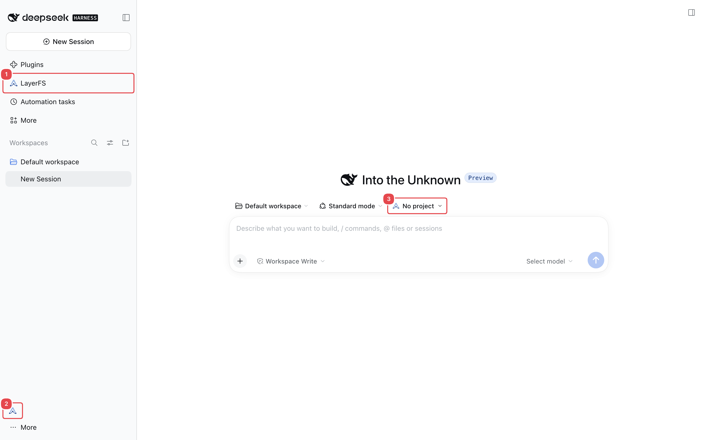

| # | 组件 | 说明 |
|---|---|---|
| 1 | LayerFS 行 | 打开 Center（[主页](home.md)）的侧边栏行 |
| 2 | Workspaces 开关 | DSH 侧边栏底部或 LayerFS 项目视图标题中的切换按钮：DSH 工作区 ↔ LayerFS 项目 |
| 3 | 项目控件 | New Session 行上的 **无项目**（No project）/ 项目名 |

## 布局

DSH 的侧边栏里有 **LayerFS** 行（和 Plugins、Automation tasks、More 并列）以及 Workspaces 列表。
在 DSH 视图中，**显示 LayerFS 项目**（Show LayerFS projects）位于侧边栏底部的 More 上方，LayerFS 视图的开关在 Workspaces 标题中；在 LayerFS 视图里，列表显示的是项目而不是文件夹。
在 New Session 行上，文件夹和模式选择器旁边，LayerFS 加了项目控件；会话一旦有了项目，它的文件夹
选择器就变成草稿目录选择器。项目对话带有 **LayerFS** 智能体预设，以及文件、历史和 Sandbox 标签
（[对话](conversation.md)）。

## 侧边栏 LayerFS 行

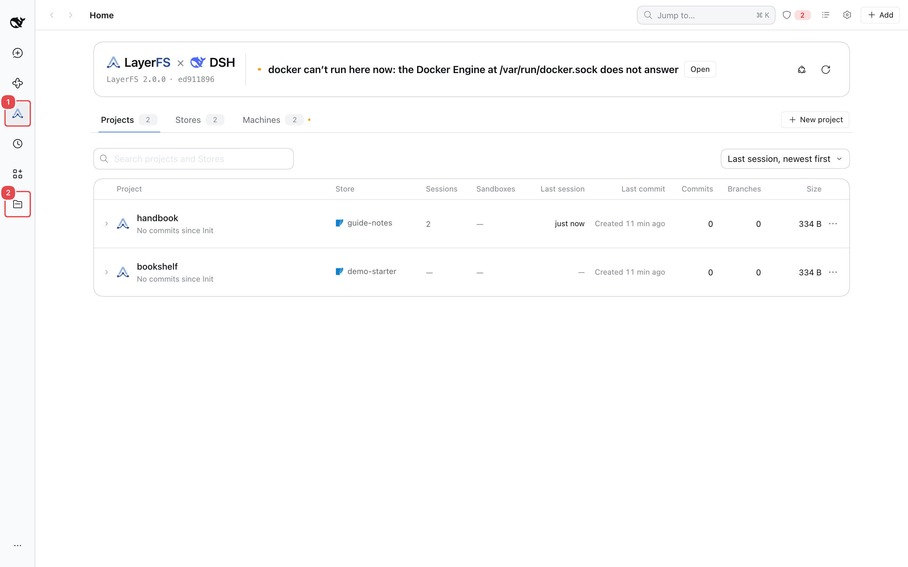

| 组件 | 显示内容 | 操作 → 结果 | LayerFS 调用 | 状态 |
|---|---|---|---|---|
| LayerFS 行 | LayerFS 图标和 **LayerFS** | 按下 → Center 打开到上次的页面（第一次是主页），侧边栏收成图标栏；侧边栏重新展开后，按底部的 **保持 LayerFS 中心打开并折叠侧栏**（Fold sidebar with LayerFS Center open）可再次收起侧边栏 | —（打开一个视图；之后主页会读取，见[主页](home.md#layout)） | Center 打开时高亮 |
| 1 图标栏上的 LayerFS 图标 | 同一行，收起后只剩图标 | 按下 → Center | — | — |
| 2 LayerFS 项目 | 图标栏上的文件夹图标 | 按下 → 侧边栏重新展开，显示 Workspaces 列表 | — | 只在收起的图标栏上有 |

## Workspaces 开关

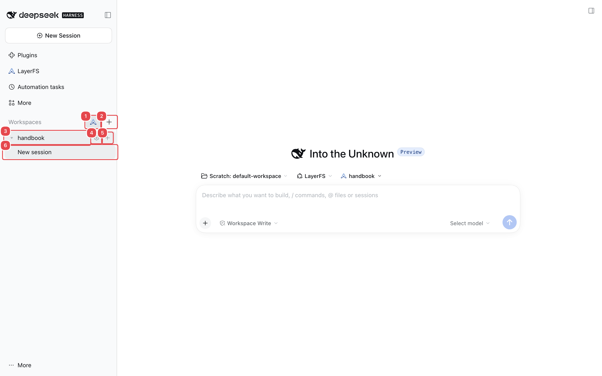

这个开关把 DSH 的 Workspaces 列表（文件夹）换成 LayerFS 的列表（在这个 DSH 上有会话的项目），再按一次换回来。
你的选择会记在这个浏览器里。

| 组件 | 显示内容 | 操作 → 结果 | LayerFS 调用 | 状态 |
|---|---|---|---|---|
| 1 开关 | LayerFS 图标；**显示 LayerFS 项目**（Show LayerFS projects）/ **显示 DSH 工作区**（Show DSH workspaces） | 按下 → 另一个列表 | —（记住的视图） | LayerFS 视图下为按下状态 |
| 2 + | **新建会话或项目**（New session or project） | 按下 → 新建菜单（见下） | — | 只在 LayerFS 视图里有 |
| 3 项目行 | **handbook** 和折叠箭头；两个项目同名时加 **· {store}**；不能运行时有一个原因词（**已停止**（Stopped）、**不可用**（Unavailable）、**机器已停止**（Machine stopped）…） | 按下 → 展开它的会话 | `projects.recent`（本地，没有调用）结合 `projects.catalog`：`project list`、`branch list`、`store get` (读取)，以及存储和机器视图 (读取)；每 60 秒一次，有事件时也会读 | — |
| 4 ⚙ | **设置 {project}**（Set up {project}，悬停或键盘聚焦时出现） | 按下 → 打开这个项目的[项目对话框](#project-dialog) | —（打开对话框） | — |
| 5 + | **在 {project} 中新建会话**（New session in {project}，悬停时出现） | 按下 → 一个新的项目对话（见[下文](#new-session-in-a-project)） | `sessions.choose`：`project get`（第一次认领时还有 `branch list`、`branch fork`） | 不可用，并显示 **无法在此新建会话：{reason}**（Can’t start a session here: {reason}） |
| | **启动 {machine}**（Start {machine}） | 项目的机器停止时代替 + 出现；按下 → 启动它 | `machine start` | 操作结束后才能再按 |
| 6 会话行 | **New session** | 按下 → 打开那个对话 | `sessions.open`：日志在本机时没有调用；否则 `branch list`、`project export` | **已中断**（Interrupted），提示文字是错误信息 |
| | 归档图标 | **归档 {session}**（Archive {session}）→ 它离开列表（在 DSH 的 Archived 列表里可以找回） | —（DSH 的归档） | **未归档**（Not archived），附 **重试**（Try again） |

会话列表每 15 秒读一次本地会话，每 60 秒读一次 Store 里归档的对话（`sessions.list`：`branch list`、
`file read`，读取）。为空时显示 **还没有项目会话**（No project sessions yet）和 **新建项目**（New project）。
读取失败时显示 **无法加载项目：{message}**（Could not load projects: {message}）和 **重试**（Retry）。

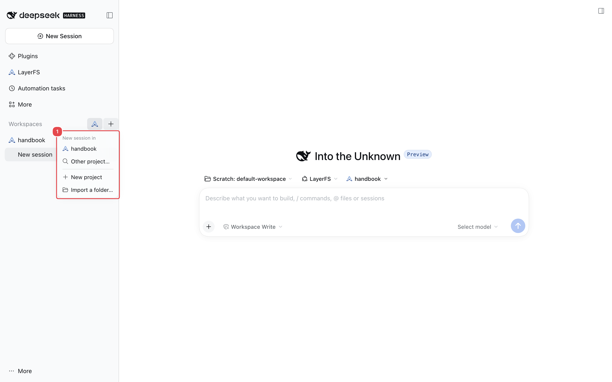

| 菜单项 | 结果 | LayerFS 调用 |
|---|---|---|
| **新建会话于**（New session in）› *项目*（最多 5 个最近用过、能运行的） | 在那个项目里新建一个对话 | `sessions.choose`：`project get` |
| **其他项目…**（Other project…） | 项目对话框的项目列表（[挑选](#pick)） | — |
| **新建项目**（New project） | [项目对话框](#project-dialog)的新建项目 | 见那里 |
| **导入文件夹…**（Import a folder…） | 项目对话框的导入文件夹 | 见那里 |

## New Session 项目控件

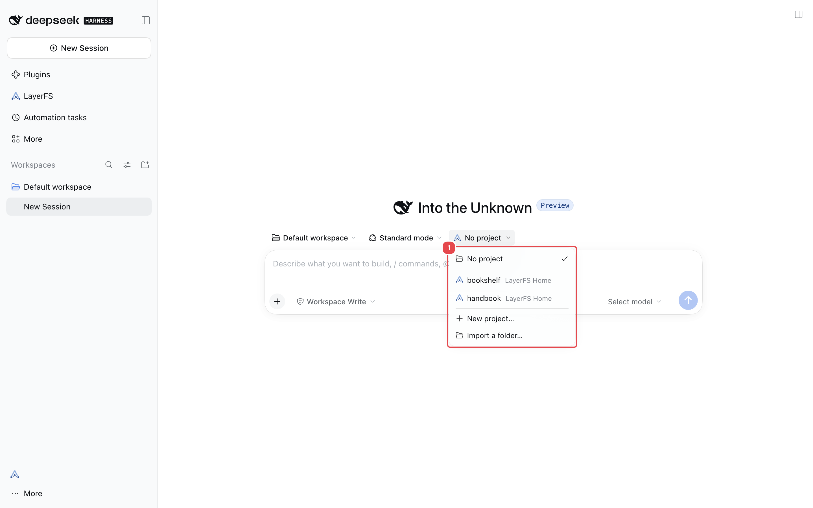

空白的 New Session 行显示 **Default workspace · Standard mode · 无项目**（No project）。
选一个项目，这个会话就成了项目会话：它的文件放在项目里，文件夹变成草稿目录。

| 组件 | 显示内容 | 操作 → 结果 | LayerFS 调用 | 状态 |
|---|---|---|---|---|
| 控件块 | **无项目**（No project）或项目名；aria 为 **LayerFS 项目：{project}**（LayerFS project: {project}） | 按下 → 菜单 | `session.place`（主机状态，没有调用） | — |
| **无项目**（No project） | 会话没有项目时打勾 | 选择 → 普通的 DSH 会话 | — | — |
| 项目行 | **bookshelf** 和 **handbook** 均显示 **LayerFS Home**：名称和运行位置；悬停时有 ⚙ **设置 {project}**（Set up {project}） | 选择 → 会话加入这个项目（智能体预设变成 **LayerFS**）· ⚙ → [项目对话框](#project-dialog) | `sessions.choose`：`project get`，第一次认领时还有 `branch list`、`branch fork`；之后在后台同步 Store | **无法打开项目：{message}**（Could not open the project: {message}） |
| **新建项目…**（New project…）· **导入文件夹…**（Import a folder…） | — | → 以对应模式打开[项目对话框](#project-dialog) | 见那里 | — |
| 导入进度 | **正在导入 {name}…**（Importing {name}…）· 正在统计文件（Counting files）、正在检查（Checking）、正在发送文件（Sending files）、正在写入层（Writing layers）、正在记录项目（Recording the project）、正在打开（Opening） | — | `project init`（轮询的任务） | **导入失败**（Import failed），附 **关闭**（Dismiss） |

默认项目被删除后，会退回 **无项目**（No project）。

### 在项目中新建会话

所有 **新建会话**（New session）按钮（这里、主页的项目行、侧边栏的 +、项目对话框）做的事都一样：
如果没选文件夹，就建一个 **Scratch** DSH 工作区，把它接为会话的文件夹，然后把会话放进项目
（`sessions.choose`：`project get`，项目第一次被认领时还有 `branch list` 和 `branch fork`）。
对话打开时带 **LayerFS** 智能体预设。

## 草稿目录选择器

下图中，点击项目草稿里的 **Scratch: default-workspace**（1）即可打开文件夹选择器。

| 组件 | 显示内容 | 操作 → 结果 | LayerFS 调用 | 状态 |
|---|---|---|---|---|
| 控件块 | **草稿：{folder}**（Scratch: {folder}），代替 DSH 的文件夹选择器 | 按下 → 菜单 | `sessions.scratchOptions`（DSH 工作区，没有调用） | — |
| 工作区文件夹 | DSH 的工作区 | 选择 → 那个文件夹成为会话的草稿目录（智能体的工作文件夹） | `sessions.scratch`（没有调用） | — |
| **浏览本地文件夹…**（Browse local folders…） | — | DSH 的文件夹选择器 → 同上 | `sessions.scratch`（没有调用） | — |
| **输入文件夹路径…**（Enter a folder path…） | — | 对话框 **选择草稿目录**（Choose scratch folder）：“所选本地文件夹是本项目会话的草稿目录，其中的文件不会保存到项目中。” · **本地文件夹路径**（Local folder path）· **选择文件夹**（Select folder）/ **取消**（Cancel） | `sessions.scratch`（没有调用） | — |

## 项目对话

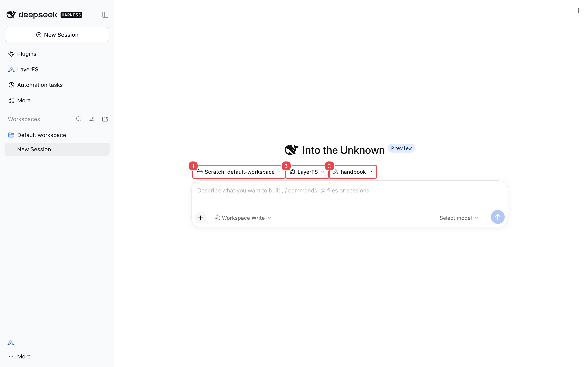

| 组件 | 显示内容 | 操作 → 结果 | LayerFS 调用 | 状态 |
|---|---|---|---|---|
| Workspaces 列表（DSH 视图） | 项目会话不在这里：LayerFS 给每个项目会话的行打上标记并把它藏起来，所以它们只列在 LayerFS 视图里各自的项目下面。它所在的 DSH 分组可能为空。 | 切到 LayerFS 视图才能看到它们 | 每行一次 `session.place`（主机状态，没有调用） | — |
| 1 草稿目录 · 2 项目 | **Scratch: default-workspace** 和 **handbook** | 点击可打开各自的选择器 | `sessions.scratchOptions` / `session.place` | — |
| 3 智能体预设 | 草稿控件里的 **LayerFS**；提示文字：“LayerFS project sessions: everything through bash and the LayerFS CLI ($DSH_LAYERFS_CLI), so a project on any machine works the same way.” | — | — | — |
| 标签 | **轨迹**（Trajectory）、**文件**（Files）、**历史**（History）、**Sandbox**、**统计**（Stats） | → [对话](conversation.md) | 见那里 | — |

## 项目对话框

一个对话框，四种模式：**新建项目**（New project）、**导入文件夹**（Import a folder）、项目列表（**项目**（Projects））
和某个项目自己的设置。可以从侧边栏的 +、项目控件、主页的 **新建项目**（New project）和添加菜单，以及每个
⚙ **设置 {project}**（Set up {project}）打开它。

### 新建项目

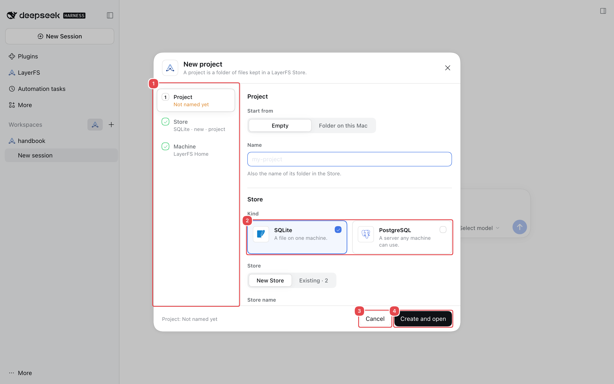

| 组件 | 显示内容 | 操作 → 结果 | LayerFS 调用 | 状态 |
|---|---|---|---|---|
| 1 步骤栏 | **项目**（Project）· **存储**（Store）· **机器**（Machine），各带摘要（**尚未命名**（Not named yet）、**SQLite · 新建 · project**（SQLite · new · project）、**LayerFS Home**） | 按某一步 → 跳到那一部分 | — | 未完成时显示序号，设置好后显示勾，需要你处理时为橙色 |
| 2 起点 | **空项目**（Empty）· **本机上的文件夹**（Folder on this Mac） | **本机上的文件夹**（Folder on this Mac）→ 出现一个文件夹字段，带 **浏览…**（Browse…） | — | — |
| 名称 | **也是它在存储中的文件夹名。**（Also the name of its folder in the Store.）/ **保存为 {slug}**（Saved as {slug}） | 输入 | — | — |
| 类型 | **SQLite**“一台机器上的一个文件。”（A file on one machine.）· **PostgreSQL**“任何机器都能使用的服务器。”（A server any machine can use.） | 选择 | — | — |
| 存储 | **新建存储**（New Store）· **已有 · {n}**（Existing · {n}）；存储名称（Store name） | 选择或输入 | `GET /api/storage` (读取) | — |
| 3 取消（Cancel） | — | 关闭；什么都不会创建 | — | — |
| 4 创建并打开（Create and open） | — | 按顺序执行各步：检查文件夹、创建 Store、初始化项目、放置 Store、打开会话 | `store create`、`project init`（轮询的任务）、`store move`（任务，不在本机时才有）、`sessions.choose`；文件夹检查 `POST /api/project-sources/check`（仅主机） | 每一步显示进度；被拒绝时显示 **创建已停止**（Create stopped），附 **修改{part}**（Edit {part}） |

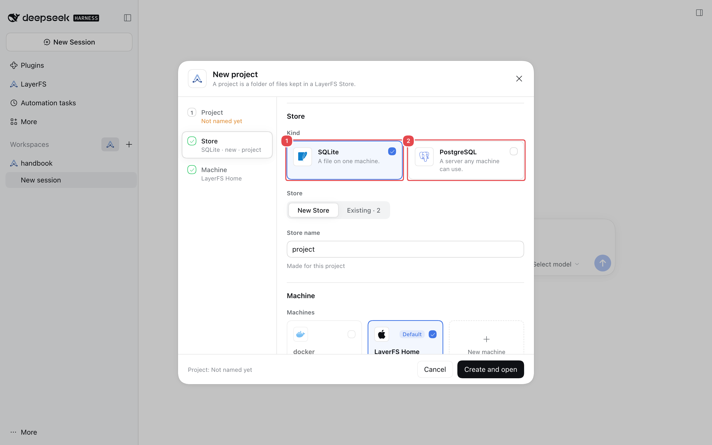
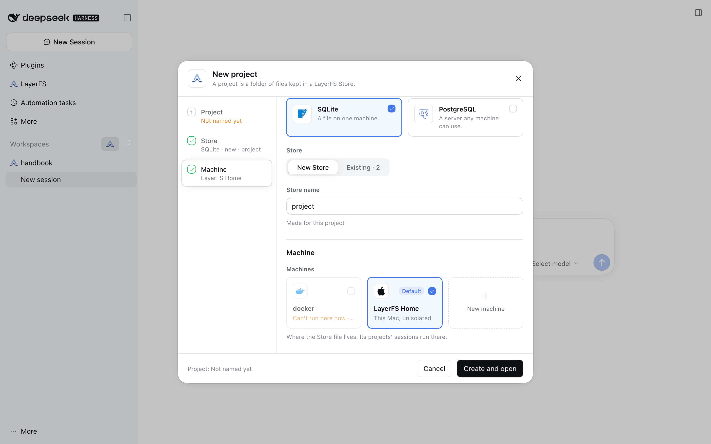

| 组件 | 显示内容 | 操作 → 结果 | LayerFS 调用 | 状态 |
|---|---|---|---|---|
| 机器 | 磁贴：**docker**（当前无法运行）、**LayerFS Home**（本机，无隔离（This Mac, unisolated），**默认**（Default））、**新建机器**（New machine） | 选择 Store 文件放在哪里：“存储文件所在的位置，其中项目的会话也在那里运行。”（Where the Store file lives. Its projects’ sessions run there.）· **新建机器**（New machine）→ 关闭对话框，打开 主页 › 机器，并展开添加机器（Add a machine） | `GET /api/platforms`：`home get` (读取) | 已停止的机器会先提供 **启动 {machine}**（Start {machine}）（`machine start`） |

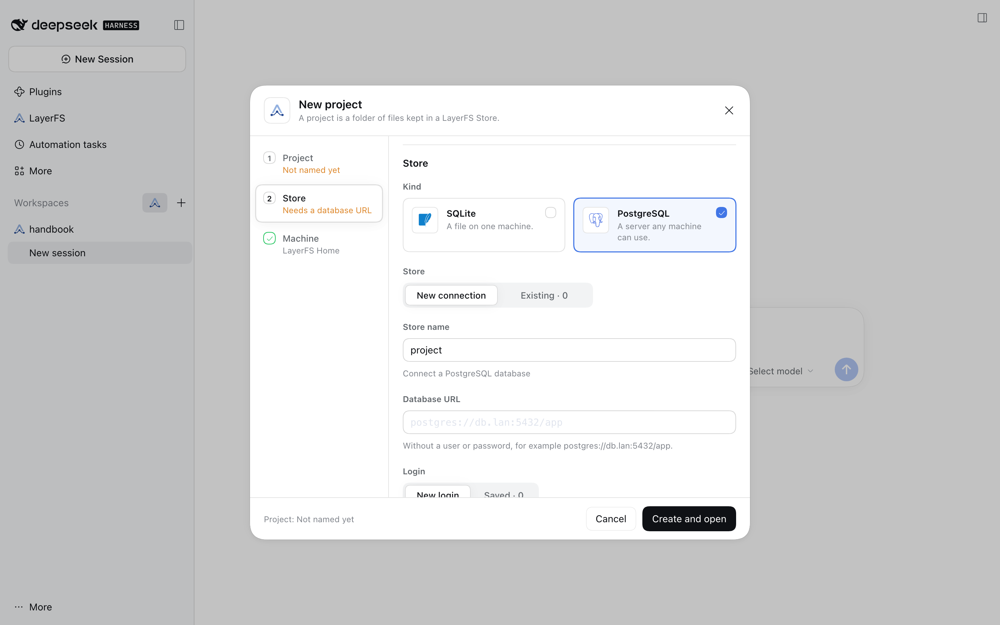

| 组件 | 显示内容 | 操作 → 结果 | LayerFS 调用 | 状态 |
|---|---|---|---|---|
| 存储 | **新建连接**（New connection）· **已有 · {n}**（Existing · {n}） | — | `GET /api/store-auths` (读取，仅主机) | — |
| 数据库 URL | “不含用户和密码，例如 postgres://db.lan:5432/app。”（Without a user or password, for example postgres://db.lan:5432/app.） | 输入 | — | 步骤栏上显示 **需要数据库 URL**（Needs a database URL） |
| 登录 | **新建登录**（New login）· **已保存 · {n}**（Saved · {n}）；登录名（Login name）、用户（User）、密码（Password）（“只输入一次，经标准输入交给 LayerFS，之后不再显示。”（Typed once. It goes to LayerFS on stdin and is never shown again.）） | 输入 | 创建时 `store save-auth`、`store connect`、`store get` | — |
| 运行于 | 会话运行的机器（步骤栏上仍写 **机器**（Machine）） | 选择 | — | — |

### 导入文件夹

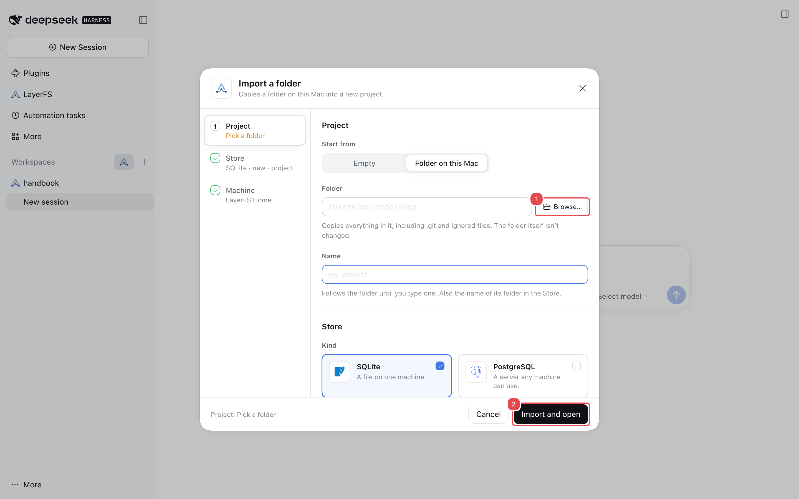

步骤相同，只是选了 **本机上的文件夹**（Folder on this Mac）：“复制其中的全部内容，包括 .git 和被忽略的文件。原文件夹不会被修改。”
（Copies everything in it, including .git and ignored files. The folder itself isn’t changed.）名称会跟着文件夹变，
直到你自己输入一个。

| 组件 | 显示内容 | 操作 → 结果 | LayerFS 调用 | 状态 |
|---|---|---|---|---|
| 1 浏览…（Browse…） | — | DSH 的文件夹选择器 → 文件夹字段 | — | — |
| 2 导入并打开（Import and open） | — | 和 **创建并打开**（Create and open）一样，只是把文件夹复制进来 | `store create`、`project init <folder>`、`store move`、`sessions.choose` | 选好文件夹之前，步骤栏上显示 **请选择文件夹**（Pick a folder） |

### 挑选

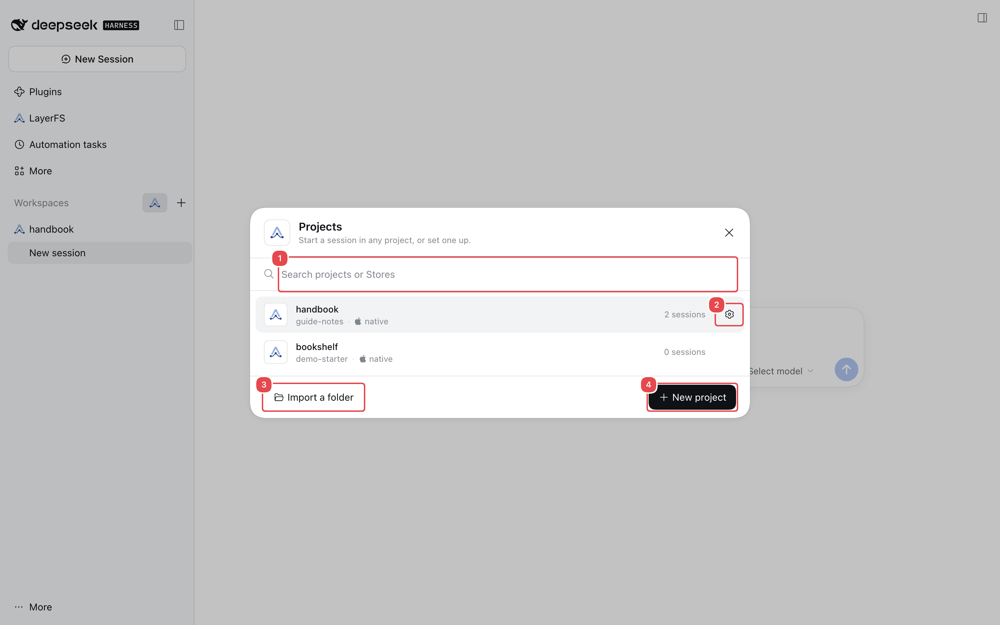

| 组件 | 显示内容 | 操作 → 结果 | LayerFS 调用 | 状态 |
|---|---|---|---|---|
| 1 搜索 | **搜索项目或存储**（Search projects or Stores） | 输入 → 筛选 | — | — |
| 行 | 名称、Store · 机器、**{n} 个会话**（{n} sessions） | 按下 → 在其中新建会话 | `sessions.choose`：`project get` | 一个原因词，或机器停止时显示 **启动 {machine}**（Start {machine}） |
| 2 ⚙ | **设置 {project}**（Set up {project}，悬停时出现） | → 这个项目的设置，带 **项目**（Projects）返回链接 | — | — |
| 3 导入文件夹（Import a folder）· 4 新建项目（New project） | — | → 对应模式 | — | — |

### 项目的设置

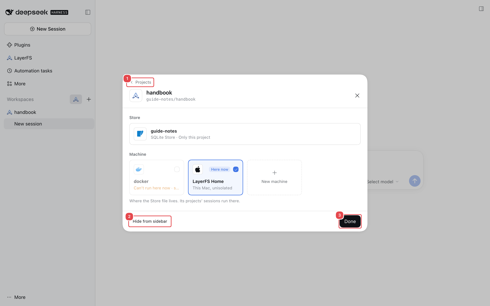

| 组件 | 显示内容 | 操作 → 结果 | LayerFS 调用 | 状态 |
|---|---|---|---|---|
| 1 项目（Projects） | 返回链接（从列表打开时才有） | → 列表 | — | — |
| 存储 | **guide-notes** · **SQLite 存储 · 仅此项目**（SQLite Store · Only this project）（或 **与另外 {n} 个项目共用**（Shared with {n} other projects）） | — | `GET /api/storage` (读取) | PostgreSQL：显示 **连接自 …**（Connected from …），而不是机器 |
| 机器 | 磁贴；当前那台标着 **当前位置**（Here now） | 选另一台 → **移到 {machine}**（Move to {machine}） | `store move`（任务） | 已停止的机器会先提供 **启动 {machine}**（Start {machine}） |
| 2 从侧边栏隐藏（Hide from sidebar） | — | 项目从侧边栏的 LayerFS 视图里消失，直到它有新会话 | —（记在这个浏览器里） | **已隐藏，直到它有新会话**（Hidden until its next session） |
| 3 完成（Done） | — | 关闭 | — | — |

Store 已经不在的项目会显示：“此项目的存储已不在这个 LayerFS 主目录中。…”（This project’s Store is not in this LayerFS home any more…），
附 **打开主页**（Open Home）。

## 设置 LayerFS

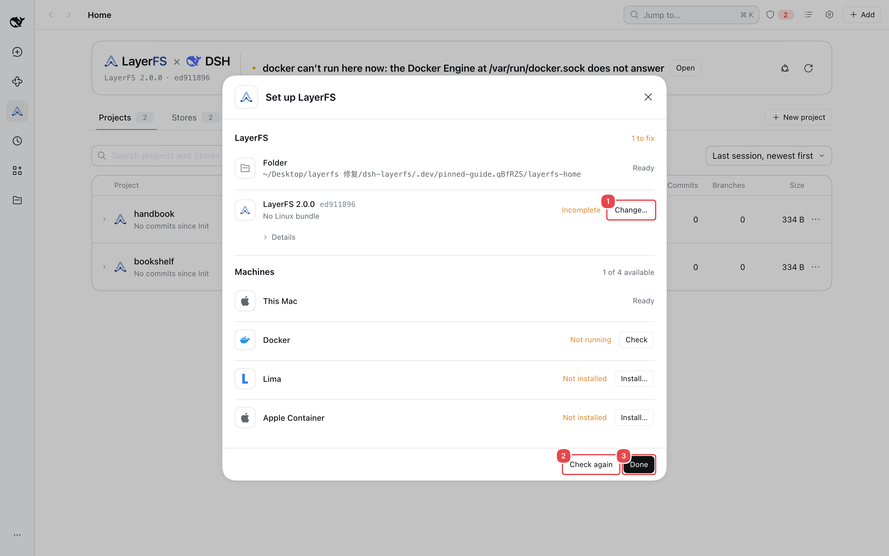

可以从主页的运行时按钮、Center 导航栏的 **设置**（Settings）、从设置卡片打开；缺东西时，每次加载页面它也会自己弹出一次
（除非你选了 **稍后**（Later））。它读取 `setup.status`（`home get`，文件夹还不存在时还有 `home init`）。

| 组件 | 显示内容 | 操作 → 结果 | LayerFS 调用 | 状态 |
|---|---|---|---|---|
| LayerFS | **就绪**（Ready）或 **{n} 项待处理**（{n} to fix） | — | — | — |
| 文件夹 | LayerFS 文件夹的路径 | 不能用时给出一行可复制的修复命令 | `home get` (读取) | **就绪**（Ready）、**刚刚创建**（Created just now）、**由旧版 LayerFS 创建**（Made by an older LayerFS）、**尚未创建**（Not created yet）、**无法读取**（Can’t be read） |
| 运行时 | **LayerFS 2.0.0** `ed911896`（Incomplete，缺少 Linux 包） | 1 **更改…**（Change…）（或 **选择…**（Choose…））→ 运行时选择器 · **详情**（Details）→ 它的各个部分（CLI、本机守护进程（Native daemon）、Linux 包（Linux bundle）、Node SDK、终端（Terminal）命令行），带复制按钮 | `--version --json`、`help --json` (读取) | 本机机器记录的是另一个守护进程时，显示 **使用此守护进程**（Use this daemon）：`machine get native`、`machine update native --daemon` |
| 机器 | **{n}/{total} 可用**（{n} of {total} available）：本机、Docker、Lima、Apple Container | **安装…**（Install…）/ **设置…**（Set up…）→ 操作说明；**检查**（Check）→ 重新读取 | `GET /api/machines?fresh=1`：`home get`、`machine get`、`machine list` (读取) | **就绪**（Ready）、**可用**（Available）、**未安装**（Not installed）、**未运行**（Not running）、**需要设置**（Needs setup）、**需要 Linux 包**（Needs the Linux bundle） |
| 2 重新检查（Check again） | — | 全部重新读取 | 同上 | — |
| **稍后**（Later） | 只在缺东西时出现 | 关闭；待办挪到主页的头部卡片上 | —（记在这个浏览器里） | — |
| 3 完成（Done） | — | 关闭 | — | 缺东西时不可用 |

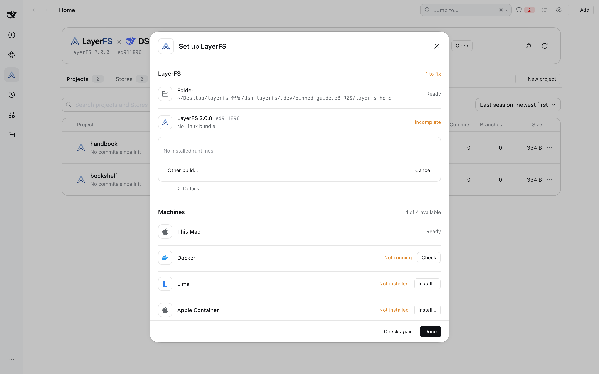

| 组件 | 显示内容 | 操作 → 结果 | LayerFS 调用 | 状态 |
|---|---|---|---|---|
| 已安装的运行时 | 每个已安装的运行时一行 | **使用**（Use）→ 固定使用它 | `runtime.save`：`--version --json`、`help --json`、`machine update native` | **没有已安装的运行时**（No installed runtimes） |
| **其他构建…**（Other build…） | — | 按路径挑选 CLI、守护进程和 Linux 包 | 同上 | — |
| **取消**（Cancel） | — | 关闭选择器 | — | — |

### 设置卡片

LayerFS 还没设置好时，它会出现在 Center 里、代替主页的标签：
**LayerFS 尚未设置**（LayerFS isn’t set up yet）——“选择运行时并检查 LayerFS 文件夹，即可开始使用项目和机器。”
（Choose a runtime and check the LayerFS folder to start using projects and machines.）（或 **完成 LayerFS 设置**
（Finish setting up LayerFS）），附 **设置 LayerFS…**（Set up LayerFS…）→ 上面的对话框。

## 变体

- Workspaces 的 **DSH 视图与 LayerFS 视图**：项目会话只在 LayerFS 视图里列出。
- 项目对话框里的 **SQLite 与 PostgreSQL**：PostgreSQL 多了数据库 URL 和登录，机器那一步选的是会话在哪里运行，
  而不是文件放在哪里。
- **机器停止时**，项目的 + 会变成 **启动 {machine}**（Start {machine}），侧边栏和项目列表都一样。

## 在这里打开的对话框

| 对话框 | 打开方式 | 作用 | LayerFS 调用 | 撤销 |
|---|---|---|---|---|
| 项目对话框 | 侧边栏 +、项目控件、⚙、主页 | 新建项目、导入文件夹、挑选、设置 | `store create`、`project init`、`store move`、`sessions.choose` | 在主页删除项目 |
| 设置 LayerFS | 主页的运行时按钮、Center 导航栏的 **设置**（Settings）、设置卡片、自动弹出 | 文件夹、运行时、机器 | `home get`、`machine update native` | 重新选回原来的运行时 |
| 选择草稿目录（Choose scratch folder） | **输入文件夹路径…**（Enter a folder path…） | 设置项目会话的草稿目录 | — | 另选一个 |

## 状态与提示

- 项目行上的原因词（**已停止**（Stopped）、**不可用**（Unavailable）、**机器已停止**（Machine stopped））说明了 +
  为什么不可用；提示文字写明原因，最常见的情况点 **启动 {machine}**（Start {machine}）就能解决。
- 项目控件上的 **无法打开项目**（Could not open the project）：项目、它的 Store 或它的机器连不上；打开主页看是哪一个。
- 会话行下面的 **未归档**（Not archived）：DSH 拒绝了归档；提示文字里是 DSH 的消息。

## 下一步

[主页](home.md) · [对话](conversation.md) · [项目](project.md) · [机器](machine.md) ·
[诊断](health.md)

## 源码

`src/client/storage/index.tsx`（侧边栏行、图标栏收起）· `src/client/projects/WorkspacesView.tsx`、
`ProjectList.tsx`、`list-locale.ts`、`view-mode.ts`、`hooks.ts`、`recent.ts` ·
`src/client/hero/HeroProject.tsx`、`ScratchPicker.tsx`、`locale.ts` · `src/client/session/index.tsx`、
`session.module.css` · `src/client/projects/setup/ProjectDialog.tsx`、`run.ts`、`model.ts`、`locale.ts` ·
`src/client/setup/SetupDialog.tsx`、`SetupCard.tsx`、`RuntimePicker.tsx`、`store.ts` ·
`src/host/sessions/index.ts`（`sessions.*`、`session.place`、`projects.recent`、`projects.catalog`）·
`cordis.patch.yml`（`preset-layerfs` 那一行）· 截图：`tools/guide/shots/entry-points.mjs`
