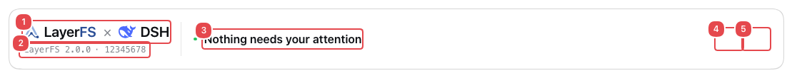

<!-- source: 850a207c5552 -->
# 预设

> **位置：** `LayerFS › 主页 ›` **试用预设**（Try a preset）· **打开方式：** 主页[头部卡片](components.md#head-card)上的预设按钮（刷新按钮旁）· **源码：** 见文末

当前入口下方的详情图来自早期演示环境。

*隔离测试数据。*

预设对话框会在这个 LayerFS 主目录里构建一个示例项目库，让你不用自己的数据就能浏览项目、分支和历史；它也可以停止主目录的机器。构建会先清空主目录。一次 **构建…**（Build）背后是一份包含数百条 LayerFS CLI 调用的配方；运行前，**查看脚本**（View script）会把每一条都列出来。

| # | 组件 | 说明 |
|---|---|---|
| 1 | 预设列表 | **快速开始**（Quick start，无需虚拟机）和 **完整演示**（Full demos） |
| 2 | 一个预设 | 名称、状态（**已构建**（Built）、**需要重新构建**（Needs a rebuild）、**未构建**（Not built）、**正在构建…**（Building…）），以及它需要什么、会生成什么（**Docker · 无需虚拟机 · 552 个提交**（Docker · No VMs · 552 commits）） |
| 3 | 状态行 | **已构建并验证 · *时间* · *模式***（Built and verified · *when* · *mode*），附 **打开主页**（Open Home）；**已保存的项目库已过期或未经验证。重新构建以替换它。**（The saved library is out of date or was not verified. Rebuild to replace it.）；**尚未构建。构建会……**（Not built yet. Build creates…） |
| 4 | **查看脚本**（View script） | 构建要运行的每条 CLI 命令 |
| 5 | **构建…**（Build…）/ **重新构建…**（Rebuild…） | 清空主目录并构建项目库（需确认两次） |
| 6 | ⋯（**更多操作**（More actions）） | **停止机器…**（Stop machines…） |
| 7 | 一个项目 | 上方是它的机器和 Store，下面是它的计划历史和构建状态（这里是 **失败**（Failed）） |
| 8 | #（**查看 *项目* 的脚本**（View script for *project*）） | 只显示该项目命令的脚本 |
| 9 | **上次构建**（Last build） | 最近一次操作：摘要、各阶段、错误、**日志**（Log）、**详情**（Details） |

## 布局

这是一个对话框：标题 **试用预设**（Try a preset），说明文字是 *在此 LayerFS 主目录中构建示例库，用来浏览项目、分支和历史。构建会替换主目录现有的内容。*（Build a sample library into this LayerFS home to explore projects, branches and history. Building replaces what the home holds now.）左边是预设列表，右边是选中的预设。打开时会选中主目录当前装着的那个预设，否则选第一个快速开始预设。点 **×** 或按 Escape 关闭；正在运行的构建会继续进行。

## 主体

选中的预设回答三个问题：“构建会生成什么，需要什么，上次运行得怎么样”。列表和状态来自主机自己对构建任务的记录，不会发起 LayerFS 调用。

| 组件 | 显示内容 | 操作 → 结果 | LayerFS 调用 | 状态 |
|---|---|---|---|---|
| 预设列表 | **入门**（Starter，*一个在 Docker 容器中运行的 SQLite 项目，包含 19 个分支和 552 个提交……*），**Studio**（*8 个示例项目，分布在 4 台机器上……*：Docker、Lima，41,640 个提交） | 点击 → 显示该预设 | `GET /api/demo-presets`（不发起 LayerFS 调用：读取主机的预设记录） | **正在读取预设…**（Loading presets…）；**无法读取预设**（Could not read the presets），附 **重试**（Retry） |
| 状态行 | 见 #3 | **打开主页**（Open Home）→ Center 的主页 | — | 读取计划期间显示 **正在检查环境…**（Checking the environment…） |
| 拓扑 | 每台机器（**Docker · 容器**（Docker · Container）、**本机 · 本地机器**（Native · Local machine）、**demo-build · Lima 虚拟机 · 2 个 CPU · 4G 内存 · 20G 磁盘**（demo-build · Lima virtual machine · 2 CPUs · 4G memory · 20G disk））上的 Store（**Store demo-starter**（store demo-starter）、**PostgreSQL Store demo-services**（PostgreSQL store demo-services））和项目：名称、描述、***已完成* / *计划* 个提交 · *n* 个侧分支 · *已用时间***（*done* / *planned* commits · *n* side branches · *elapsed*） | 点击项目 → **所选资源**（Selected resource，见下）。**#** → 它的脚本 | — | 构建时的项目状态：**等待中**（Waiting）、**运行中**（Running）、**已创建**（Created）、**失败**（Failed）、**已停止**（Stopped） |
| **所选资源**（Selected resource） | 项目描述、它的错误、**Store**（*机器* 上的 *store*）、**计划历史**（Planned history）/ **已验证历史**（Verified history）（提交数 · 合并数 · main Layer 数）、**侧分支**（Side branches，附 **查看名称**（View names））、**CLI 进度**（CLI progress，*已完成* / *总数* 条命令）、**已用时间**（Elapsed） | **×** 关闭 | — | |
| 运行中的构建 | **正在构建**（Building）/ **正在停止机器**（Stopping machines），附进度 | — | 构建发起的调用（见下文） | 阶段 **检查**（Checking）· **重置**（Resetting）· **构建**（Building）· **验证**（Verifying） |
| **上次构建**（Last build） | 结果行、***n* 个运行中 · *已完成* / *总数* 已完成 · *n* 个失败 · 已用 *时间***（*n* running · *done* / *total* completed · *n* failed · *time* elapsed）、工作区修订、四个阶段、红色的错误 | **日志**（Log）→ 任务的日志（它运行的每条 CLI 调用及耗时）。**详情**（Details）→ 主目录、清理是否已验证、保留了什么、移除的工作区、删除的会话 | — | 被更新的构建取代后显示 **上次构建**（Previous build）；停止机器之后显示 **上次停止机器**（Last machine stop） |
| 失败提示 | 头部下方的一条拒绝信息，附挡路会话的链接（**打开会话 *id***（Open session *id*）） | **关闭**（Dismiss）；响应丢失时显示 **检查操作**（Check operation） | **检查操作**：`GET /api/demo-presets/requests/:id`（不发起 LayerFS 调用：读取任务记录） | **响应已丢失。开始其他操作前请先检查此操作；它不会被再次提交。**（The answer was lost. Check the operation before starting another; it is not submitted again.） |

在这台服务器上，入门（Starter）构建中途停了下来：**PresetVerificationFailed:** *Preset step
dense.001.integration.publish.1: publication replaced a newer main head*。阶段显示它在 **构建**（Building）阶段失败；**CLI 进度**（CLI progress）显示 **250 / 679 条命令**（250 / 679 commands），项目显示 **235 / 552 个提交**（235 / 552 commits）。项目库保留了已经构建的部分（主页列出 `bookshelf`，有 235 个提交），入门预设显示 **需要重新构建**（Needs a rebuild）。

### 查看脚本

| 组件 | 显示内容 | 操作 → 结果 | LayerFS 调用 | 状态 |
|---|---|---|---|---|
| 标题 | **CLI 命令 · *预设***（CLI commands · *preset*，**入门**（Starter）、**Studio**；从项目的 # 打开时是 ***项目* · CLI 脚本**（*project* · CLI script））和 **构建运行的全部命令，按顺序：……**（Every command the build runs, in order: …） | **×** 关闭 | — | **正在读取命令…**（Loading commands…） |
| 范围 (1) | **第 *起*–*止* 条，共 *总数* 条命令**（*from*–*to* of *total* commands，每页 100 条） | **上一页**（Previous）/ **下一页**（Next） | `GET /api/demo-presets/:id/script`（为重置部分读取主目录的清单：`machine list`、`store list --detail`、`sandbox list --detail`，每个 Sandbox 一次 `sandbox get`） | **This script preview expired. Close and reopen it…** |
| **复制本页**（Copy this page）(2) | | 按下 → 本页命令复制到剪贴板 | — | **已复制**（Copied）；**无法复制……**（Copy is unavailable…） |
| **下载完整计划**（Download full plan）(3) | | 按下 → 整份计划以文件下载 | — | **正在准备…**（Preparing…） |
| 上下文 | 模式（**仅文件命令**（File commands only）/ **文件命令与沙盒工作区**（File commands and sandbox workspaces））、LayerFS 主目录、CLI 池的上限、排序规则（`<commit:step-key>` 解析为某一步返回的确切提交） | — | — | **清理目标会在构建开始时发现。**（Cleanup targets are discovered when Build starts.） |
| 阶段 (4) | **重置环境**（Reset environment）、**构建预设**（Build preset）、**验证结果**（Verify result）：带注释的编号命令，**分支通道**（Branch lane）、**Shell 命令 / exec 输入**（Shell command / exec input）、**步骤与依赖**（Step and dependencies）、**文件内容 / 标准输入**（File content / standard input） | 展开一个折叠项 | — | **当前计划中没有此资源的命令。**（No commands for this resource in the current plan.） |
| 筛选 | 从项目的 # 打开时：***类型*：*名称***（*kind*: *name*） | **显示全部命令**（Show all commands）/ **显示相关命令**（Show related commands） | — | |

对入门（Starter）来说，脚本共 765 条命令：先是重置（`machine list`、`store list`、`sandbox
list`，然后对主目录现有的内容执行 `sandbox remove` 和 `store remove`），接着是 `store
create`、`project init`，每个提交一次 `file write`，侧分支上还有 `branch fork`、`branch merge` 和
`branch publish`，最后是验证用的读取。

## 变体

- **入门**（Starter）需要 Docker 和匹配的 Linux 套件，不到一分钟就能完成。
- **Studio** 还需要 Lima：它会创建两台 Lima 虚拟机（各 2 个 CPU、4 GB 内存）和若干 PostgreSQL
  Store，共 8 个项目、约 41,640 个提交。
- **同时通过沙盒工作区提交**（Also commit through sandbox workspaces，构建的混合模式）：约 30% 的提交会在 Sandbox 的 Workspace 中运行一条 shell 命令再提交（`sandbox create`、`workspace
  mount`、`workspace exec`、`workspace commit`）；需要本机守护进程。
- 主目录里还没有机器时，**停止机器…**（Stop machines…）不可用（**此 LayerFS 主目录还没有机器。**（This LayerFS home has no machines
  yet.））。

## 从这里打开的对话框

| 对话框 | 打开方式 | 作用 | LayerFS 调用 | 撤销 |
|---|---|---|---|---|
| **构建 *预设*？**（Build *preset*?）/ **重新构建 *预设*？**（Rebuild *preset*?），第 1 步 | **构建…**（Build…）/ **重新构建…**（Rebuild…） | *选择示例历史的写入方式。*（Choose how the sample history is written.）**同时通过沙盒工作区提交**（Also commit through sandbox workspaces）、**需要**（Needs），以及 *构建会先删除此 LayerFS 主目录中的所有 Store、项目、沙盒和自定义机器。*（Building first deletes every store, project, sandbox and custom machine in this LayerFS home.）**取消**（Cancel）· **继续**（Continue）→ 检查环境 | **继续**：`GET …/build-plan`（读取：`home get --with platforms`、`machine list`、`store list`、`sandbox list`，每个 Sandbox 一次 `sandbox get`；不会删除任何东西） | 取消 |
| 同上，第 2 步（审阅计划） | **继续**（Continue） | *清空此 LayerFS 主目录，然后构建项目库。*（This LayerFS home is wiped, then the library is built.）会被清掉的内容：每个 Store 连同其项目和保存在其中的会话日志、Sandbox、Workspace、自定义机器，被移除的 DSH 项目工作区、被删除的项目会话，以及将要启动的机器；**将被重置的内容**（What will be reset）逐项列出。**返回**（Back）· **清空并构建**（Wipe and build） | `POST …/environment-reset`：先重置（`machine start`、`workspace unmount --discard`、`sandbox remove`、`store remove`、`store disconnect`、`machine remove`、`machine stop docker`），再执行构建配方（`store create`、`project init`、`file write`、`branch fork`、`branch merge`、`branch publish`…），最后验证（`branch list`、`commit list`、`file read`…） | 无：主目录原来的内容已经没了 |
| **停止机器并删除项目会话？**（Stop machines and delete project sessions?） | ⋯ › **停止机器…**（Stop machines…） | *停止机器，并删除此主目录的 LayerFS 项目会话。Store、项目及其已保存的历史会保留。*（Stop the machines and delete this home’s LayerFS project sessions. Stores, projects and their saved history stay.）**将关闭的机器**（Machines to close）列出它们。**取消**（Cancel）· **停止机器**（Stop machines） | 打开时：`GET …/environment-plan`（读取：`machine list`）。**停止机器**：每台机器一次 `machine stop <m> --force`，然后删除主目录的项目会话 | 重新启动机器；删除的会话不会回来 |
| 脚本抽屉 | **查看脚本**（View script）、项目的 # | 见上文 | 只读取 | — |

每个计划的确认按钮在计划显示后会先锁定片刻，防止双击误触。本指南没有打开第 2 步：它的 **继续**（Continue）会开始准备主目录。

## 状态与信号

- **需要重新构建**（Needs a rebuild）：已保存的项目库已过期，或上次构建没有通过验证（就像这里）。**重新构建…**（Rebuild…）会替换它。
- 项目上显示 **失败**（Failed），**上次构建**（Last build）下有红色错误：写明出错的步骤和 LayerFS 给出的原因；**日志**（Log）显示到这一步为止的调用，[日志](logs.md) 里能看到每一条。
- **Wait for the preset operation to finish…**：有构建或停止正在运行，按钮在它结束前不可用。诊断检查和存储任务也必须结束后才能开始构建。
- 失败提示下的 **打开会话 *id***（Open session *id*）：一个挡路的项目会话。

## 下一步

- [指南地图](README.md)：构建生成的 Store、项目和机器在哪里显示。
- [日志](logs.md)：构建运行的每一条调用。
- [诊断](health.md)：构建完成后检查机器和 Store。

## 源码

`src/client/presets/`：`PresetsDialog.tsx`、`PresetsSection.tsx`（状态、构建/停止确认、上一次操作）、`Topology.tsx`、`ScriptDrawer.tsx`、`Progress.tsx`、
`locale.ts`。主机：`src/host/presets/manager.ts`（`/api/demo-presets…`）、`build.js`、
`runner.js`、`environment-reset.js`、`machine-stop.js`、`inventory.js`、`recipe/`。
